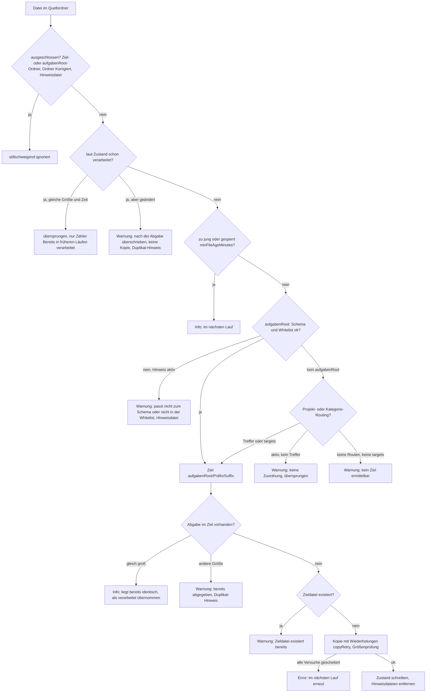

# Debugging und Fehlersuche

Code: [scripts/DocFlowEngine/](https://github.com/pkr-lab/DocFlowEngine/tree/main/scripts/DocFlowEngine), [scripts/DocFlowEngine.psm1](https://github.com/pkr-lab/DocFlowEngine/blob/main/scripts/DocFlowEngine.psm1), [scripts/Rename-ExistingAufgaben.ps1](https://github.com/pkr-lab/DocFlowEngine/blob/main/scripts/Rename-ExistingAufgaben.ps1), [scripts/Invoke-OneDriveSync.ps1](https://github.com/pkr-lab/DocFlowEngine/blob/main/scripts/Invoke-OneDriveSync.ps1)

Diese Seite sammelt alle Fehler- und Warnmeldungen des Codes und führt durch die Fehlersuche. Die Beschreibung der Log-Ausgabe steht in [Logging](logging.md), die häufigsten Fehlerbilder in der [Nutzung](nutzung.md#troubleshooting). Das projektübergreifende Kapitel ist die [zentrale Fehlersuche](../capulus/capulus-core/2-betrieb-hardware/20070-troubleshooting-zentral.md).

---

## Wo man Fehler findet

| Quelle | Inhalt |
|---|---|
| Konsole (`Write-Host`) | jede Meldung ab dem eingestellten Level, im Format `[JJJJ-MM-TT HH:mm:ss] [LEVEL] Text` |
| Log-Datei (`log.file`, Standard `./docflow.log`) | dieselben Zeilen per `Add-Content`. Im `-DryRun` wird das Log-Verzeichnis nicht angelegt, ein vorhandenes wird aber beschrieben ([Logging](logging.md#verhalten-im--dryrun)) |
| `.docflow-state.json` (`stateFile`) | welche Quelldateien als verarbeitet gelten (Schlüssel `Quellpfad\|relativer Pfad`, kleingeschrieben) |
| Lock-Datei (`lockFile`) | Inhalt `Rechnername\|PID\|Zeitstempel`, zeigt, wer zuletzt gelaufen ist |
| Hinweisdateien neben den Schülerdateien | Rückmeldung an den Schüler (Naming-Hinweis, Duplikat-Hinweis) |
| `-Verbose` / `-Debug` | ohne Wirkung: Der Code nutzt weder `Write-Verbose` noch `Write-Debug`. Den Detailgrad steuert allein `log.level` (`Trace` bis `Error`) |

Log-Level für die Fehlersuche: `log.level = 'Debug'` zeigt zusätzlich die vollständige Whitelist, `Trace` den größten Detailgrad. Im Normalbetrieb genügt `Info`.

---

## Warum wurde meine Datei nicht kopiert?



Mit `-DryRun` lässt sich jeder dieser Schritte ohne Änderung nachvollziehen. Dann steht bei jeder geplanten Aktion `[DryRun]` in der Meldung, und Zustand, Sperre und Dateien bleiben unberührt (Hinweisdateien werden nur als „würde erstellt“ gemeldet).

---

## Fehlermeldungen

### Abbruch bei Start oder Konfiguration (`throw`)

Diese Meldungen beenden den Lauf mit einem PowerShell-Fehler.

| Meldung | Ursache | Lösung |
|---|---|---|
| `Teilmodul '<pfad>' wurde nicht gefunden.` | eine der sieben Teildateien unter `scripts/DocFlowEngine/` fehlt (Checkout unvollständig oder Dateien verschoben) | Repo vollständig auschecken, Struktur prüfen |
| `Konfigurationsdatei '<pfad>' wurde nicht gefunden.` | `-ConfigPath` zeigt ins Leere (Standard `.\config\docflow-config.psd1` ist relativ zum aktuellen Verzeichnis) | absoluten Pfad angeben oder im Projektverzeichnis starten |
| `Konfiguration muss mindestens einen Eintrag unter 'sources' enthalten.` | `sources` leer oder fehlt | Quellordner ergänzen ([Konfiguration](konfiguration.md#sources-pflicht)) |
| `Konfiguration braucht 'aufgabenRoot' oder mindestens einen Eintrag unter 'targets'.` | weder `aufgabenRoot` noch `targets` | eines von beiden angeben |
| `Konfiguration muss mindestens eine Regel unter 'namingConventions' enthalten.` | `namingConventions` leer oder fehlt | Regel ergänzen ([Konfiguration](konfiguration.md#namingconventions-pflicht)) |
| `Pfad-Variable '{<name>}' ist in 'paths' nicht definiert.` | Platzhalter `{name}` in einem Pfad ohne passenden Eintrag unter `paths` | `paths` ergänzen oder Schreibweise prüfen |
| `Pfad-Variable '{<name>}' in '<feld>' ist in 'paths' nicht definiert.` | wie oben, mit Feldangabe | wie oben |
| `Zirkulärer Verweis in 'paths' bei '{<name>}'.` | zwei Pfad-Variablen verweisen aufeinander | Verweis auflösen |
| `Pfad '<wert>' enthält Wildcards, aber es konnte kein existierendes übergeordnetes Verzeichnis dafür gefunden werden.` | Pfad mit `*` oder `?`, dessen fester Anteil nicht existiert (zum Beispiel OneDrive nicht eingebunden) | Pfad prüfen, OneDrive-Sync abwarten |
| `Zielverzeichnis '<pfad>' existiert nicht und createIfMissing ist false.` | `targets[].createIfMissing = $false` und der Ordner fehlt | Ordner anlegen oder `createIfMissing` auf `$true` |
| Parse-Fehler beim Import der `.psd1` | ungültige Hashtable-Syntax | `Import-PowerShellDataFile -Path .\config\docflow-config.psd1` ausführen und die Zeile aus dem Fehler korrigieren |

### Skripte `Rename-ExistingAufgaben.ps1` und `Invoke-OneDriveSync.ps1`

| Meldung | Ursache | Lösung |
|---|---|---|
| `Moduldatei '<pfad>' wurde nicht gefunden.` | `DocFlowEngine.psm1` nicht neben dem Skript | Skript im Verzeichnis `scripts/` belassen |
| `Undo-Datei '<pfad>' wurde nicht gefunden.` | falscher Pfad bei `-Undo` | Pfad der Bericht-CSV prüfen |
| `Pfad '<eintrag>' wurde nicht gefunden.` | Eintrag in `-Path` existiert nicht | Pfad korrigieren |
| `Kein Ordner zum Durchsuchen gefunden. -Path angeben oder 'sources' in der Konfiguration prüfen.` | kein `-Path` und keine auflösbare Quelle in der Konfiguration | `-Path` angeben |
| `Abgebrochen: eine andere DocFlowEngine-Instanz ist aktiv (Lock-Datei '<pfad>').` (Warnung) | Lock ist frisch, ein Lauf auf einem anderen Rechner oder Task läuft | warten oder Lock-Datei prüfen |
| `Nicht mehr vorhanden, übersprungen: '<pfad>'` (beim Undo) | die umbenannte Datei existiert nicht mehr | kein Fehler, nur Hinweis |
| `Alter Name ist bereits wieder belegt, übersprungen: '<pfad>'` (beim Undo) | unter dem früheren Namen liegt inzwischen eine andere Datei | manuell klären |
| `Konnte '<pfad>' nicht zurückbenennen: <detail>` | Rechte oder gesperrte Datei | Detail lesen, Datei freigeben |
| `OneDrive.exe wurde nicht gefunden (gesucht unter '<pfad>'). Ueberspringe Sync-Anstoss.` (Warnung, Exit-Code 0) | OneDrive nicht an der Standardstelle | `-ExecutablePath` angeben, oder die Aufgabe weglassen |

### Meldungen im Lauf (Level Warning und Error)

| Meldung | Level | Ursache | Lösung |
|---|---|---|---|
| `Verarbeitung übersprungen, da eine andere Instanz aktiv ist.` | Warning | folgt auf die Lock-Meldung, der Lauf endet ohne Arbeit | siehe Lock |
| `Lauf abgebrochen: aktive Lock-Datei '<pfad>' gefunden (<rechner>\|<pid>\|<zeit>).` | Warning | Lock jünger als `lockTimeoutMinutes` (Standard 15) | warten, bis der andere Lauf endet oder der Timeout abläuft. Bei abgestürztem Lauf Datei löschen. Bei geteiltem Ordner siehe [Multi-Machine](konzepte/multi-machine-setup.md) |
| `Quellverzeichnis '<pfad>' existiert nicht oder wurde nicht gefunden. Überspringe.` | Warning | Quelle nicht vorhanden (OneDrive nicht synchronisiert, Tippfehler) | Pfad prüfen |
| `Zustandsdatei '<pfad>' konnte nicht gelesen werden. Es wird eine neue Datei erstellt.` | Warning | beschädigtes JSON in `.docflow-state.json` | Datei sichern, Lauf wiederholen. Alle Dateien gelten danach als neu und können erneut kopiert werden. Ob sie im Ziel schon liegen, entscheidet die Prüfung „liegt bereits identisch“ |
| `Registry-Datei '<pfad>' wurde nicht gefunden.` | Warning | `projectRoutesFile` zeigt auf eine fehlende Datei | Pfad prüfen oder Startbestand per `projectRoutesSeedFile` angeben |
| `Whitelist-Startbestand '<pfad>' wurde nicht gefunden. Synchronisierung übersprungen.` | Warning | `projectRoutesSeedFile` fehlt | Pfad prüfen |
| `Projekt-Routing-Datei '<pfad>' wurde nicht gefunden.` | Warning | Routing-Datei fehlt | Pfad prüfen |
| `Ungültige Zeile in Whitelist '<pfad>' ignoriert (erlaubt: praefix=<Name>, suffix=<Name>): '<zeile>'` | Warning | Zeile in `project-routes.txt` hat falsche Form | Zeile korrigieren |
| `Suffix '<name>' in Whitelist '<pfad>' steht vor dem ersten praefix= und wird ignoriert.` (beim Abgleich: `… wird beim Abgleich entfernt.`) | Warning | Suffix ohne Präfix | `praefix=<Name>` davor setzen |
| `Datei '<name>': Präfix '<p>' ist nicht in der Whitelist '<pfad>' eingetragen.` | Warning | Präfix unbekannt | Whitelist ergänzen oder dem Schüler das richtige Präfix nennen |
| `Datei '<name>': Suffix '<s>' ist für Präfix '<p>' nicht in der Whitelist '<pfad>' eingetragen.` | Warning | Kombination nicht erlaubt | Whitelist ergänzen |
| `Datei '<name>' passt nicht zum Schema initialen[_v<version>]_praefix_suffix_aufgabennummer (…).` | Warning | Name verletzt das Schema (Leerzeichen, Bindestrich, Umlaut, fehlender Teil) | Datei umbenennen. Der Schüler findet die Hinweisdatei neben der Datei |
| `Keine passende Projekt- oder Kategorie-Zuordnung für '<name>' gefunden. Datei wird übersprungen.` | Warning | Projekt- oder Kategorie-Routing aktiv, aber kein Treffer | Routing erweitern oder Dateinamen korrigieren |
| `Kein Ziel für '<name>' ermittelbar (kein gültiges Präfix/Suffix-Routing, keine 'targets' konfiguriert). Datei wird übersprungen.` | Warning | weder `aufgabenRoot`-Routing noch `targets` | `targets` konfigurieren oder Namen korrigieren |
| `Datei '<name>' wurde nach der Abgabe unter gleichem Namen überschrieben. Sie wird nicht erneut kopiert; der Schüler soll eine Versionsangabe (_v2_ usw.) verwenden.` | Warning | bereits verarbeitete Datei wurde geändert | Version im Namen (`_v2_`) verwenden |
| `Datei '<name>' wurde bereits abgegeben ('<vorhanden>'). Sie wird nicht erneut kopiert; …` | Warning | im Ziel liegt schon eine andere Abgabe | wie oben |
| `Zieldatei existiert bereits, überspringe Kopie: '<pfad>'` | Warning | Ziel existiert (zum Beispiel durch einen anderen Rechner) | normal bei Multi-Machine-Betrieb |
| `Kopierversuch N von M fehlgeschlagen: '<quelle>' -> '<ziel>' (<detail>). Neuer Versuch in S Sekunden.` | Warning | Kopie scheiterte, wird wiederholt | Detail lesen, oft gesperrte Datei |
| `Kopieren nach M Versuchen fehlgeschlagen: '<quelle>' -> '<ziel>' (<detail>). Wird beim nächsten Lauf erneut versucht.` | Error | alle Versuche scheiterten | Detail lesen (Rechte, Pfadlänge, Speicherplatz) |
| `Zieldatei hat X Bytes, Quelle Y Bytes.` (im Detail der Kopier-Meldung) | Error/Warning | Größenprüfung nach dem Kopieren schlug fehl, Datei wurde beim Kopieren geändert | erneut laufen lassen |
| `Verzeichnis konnte nicht erstellt werden: '<pfad>' (<detail>). '<name>' wird beim nächsten Lauf erneut versucht.` | Error | Rechte oder Pfad ungültig | Berechtigung und Pfadlänge prüfen |
| `<Meldung> Hinweis-Datei konnte nicht erstellt werden: '<pfad>' (<detail>)` | Error | keine Schreibrechte im Quellordner | Rechte prüfen |
| `Hinweis-Datei konnte nicht entfernt werden: '<pfad>' (<detail>)` | Warning | Datei gesperrt oder schreibgeschützt | manuell löschen |
| `Kein Schülerordner für '<name>' ermittelbar (erkanntes Kürzel aus dem Dateinamen: '<kürzel>') - Rückkopie übersprungen.` | Warning | Kürzel nicht registriert | Kürzel erst über eine Abgabe registrieren lassen oder Registry ergänzen, siehe `unknownKuerzelHint` |
| `Verzeichnis konnte nicht erstellt werden: '<korrigiert-ordner>' (<detail>). Rückkopie von '<name>' wird beim nächsten Lauf erneut versucht.` | Error | Ordner „Korrigiert“ nicht anlegbar | Rechte prüfen |

Die Info-Meldungen (zum Beispiel „wurde vor weniger als N Minuten geändert“ oder „ist gerade gesperrt“) sind keine Fehler: Die Datei wird im nächsten Lauf verarbeitet. Eine Übersicht der normalen Meldungen steht unter [Logging](logging.md#typische-meldungen).

---

## Checkliste „Feature funktioniert nicht“

1. **Konfiguration lesen:** `Import-PowerShellDataFile -Path .\config\docflow-config.psd1` ohne Fehler? Stimmen `sources`, `aufgabenRoot`, `namingConventions`?
2. **Trockenlauf:** `Invoke-DocFlowEngine -ConfigPath <pfad> -DryRun` und das Log lesen. Was steht für die betroffene Datei?
3. **Quelle da?** Meldung `Quellverzeichnis … existiert nicht` oder `Gefundene Dateien in '…': 0`?
4. **Name prüfen:** Schema `initialen[_v<version>]_praefix_suffix_aufgabennummer`, nur Buchstaben und Ziffern. Präfix und Suffix in der Whitelist ([Namenskonvention](konfiguration.md#namingconventions-pflicht), `project-routes.txt`)?
5. **Alter und Sperre:** Datei jünger als `minFileAgeMinutes` (Standard 2) oder noch in Synchronisierung?
6. **Zustand:** Steht die Datei in `.docflow-state.json`? Dann gilt sie als verarbeitet. Zum erneuten Kopieren den Eintrag entfernen (Datei sichern).
7. **Lock:** Lock-Datei frisch? Läuft ein anderer Rechner? ([Multi-Machine](konzepte/multi-machine-setup.md))
8. **Rechte:** Schreibrechte im Ziel und (für Hinweisdateien) im Quellordner?
9. **Mehrere Rechner:** Zeigen `stateFile`, `lockFile` und `projectRoutesFile` auf einen geteilten Ordner?
10. **PowerShell-Version:** `$PSVersionTable.PSVersion` (5.1 oder neuer), siehe [Kompatibilität](compatibility-und-admin-rechte.md).

---

## Lokal debuggen

```powershell
# Konfiguration prüfen
Import-PowerShellDataFile -Path .\config\docflow-config.psd1

# Vorschau, ändert nichts
Import-Module .\scripts\DocFlowEngine.psm1 -Force
Invoke-DocFlowEngine -ConfigPath .\config\docflow-config.psd1 -DryRun

# Mit höchstem Detailgrad: log.level = 'Trace' in der Konfiguration setzen

# Tests (Pester 5)
Invoke-Pester -Path .\tests\DocFlowEngine.Tests.ps1

# Debugger: Haltepunkt in einer Teildatei, zum Beispiel
Set-PSBreakpoint -Script .\scripts\DocFlowEngine\CopyForward.ps1 -Line 292
Invoke-DocFlowEngine -ConfigPath .\config\docflow-config.psd1 -DryRun
```

Die Teildateien werden beim Import per Dot-Sourcing geladen (`Common.ps1`, `Config.ps1`, `State.ps1`, `Lock.ps1`, `Naming.ps1`, `CopyForward.ps1`, `CopyBack.ps1`). Haltepunkte setzt man daher auf die Teildatei, nicht auf `DocFlowEngine.psm1`. Nach einer Codeänderung `Import-Module … -Force` ausführen. Den Ablauf erklärt [Implementierungsnotizen](implementation-notes.md) und die [Modulreferenz](module-reference.md). Das Tests-Kapitel steht unter [Tests](testing.md).

---

## Typische Probleme zwischen Konfiguration und anderen Repos

| Symptom | Ursache | Lösung |
|---|---|---|
| Dateien werden zweimal verarbeitet | zwei Rechner mit lokalem `stateFile` | gemeinsamen Ordner verwenden ([Multi-Machine](konzepte/multi-machine-setup.md)) |
| Whitelist aus dem Repo (`config/project-routes.txt`) greift nicht | die Laufzeit-Kopie (`projectRoutesFile`) wird nur ergänzt, nicht ersetzt | Abgleich mit `projectRoutesSeedFile`, siehe [Konfiguration](konfiguration.md#projectroutesfile--projectroutesseedfile-optional) |
| Fehler nur im Task Scheduler | Arbeitsverzeichnis anders, relative Pfade laufen ins Leere | absolute Pfade, Arbeitsverzeichnis in der Aufgabe setzen |
| OneDrive liefert Dateien verspätet | Sync noch nicht abgeschlossen | `Invoke-OneDriveSync.ps1` vor dem Lauf, siehe [Nutzung](nutzung.md#regelmäßige-automatisierung) |
