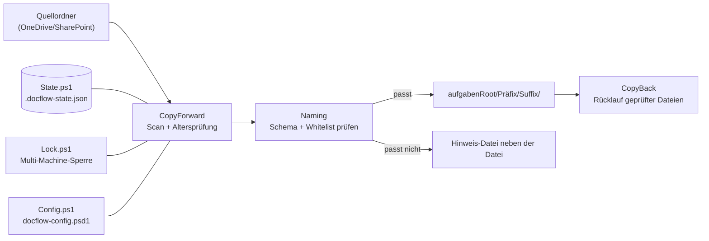

# DocFlowEngine

## Projektübersicht

Dieses Projekt dient der Überwachung von Quellordnern, der Erkennung neuer Dokumente, der automatischen Umbenennung nach definierten Regeln und der Kopie in Zielordner. Die Konfiguration soll flexibel sein und sowohl Filter für Dateitypen als auch Logging-Optionen unterstützen.

Repository: [pkr-lab/DocFlowEngine](https://github.com/pkr-lab/DocFlowEngine)

## Architektur

`Invoke-DocFlowEngine` (in `DocFlowEngine.psm1`) lädt die Konfiguration, setzt bei Bedarf die Sperre, scannt die Quellordner, benennt Dateien nach den Regeln um, kopiert sie in die Zielstruktur und erledigt den „Korrigiert“-Rücklauf. Die Zustandsdatei verhindert doppeltes Verarbeiten. Die Funktionen der Teilmodule stehen in der [Modulreferenz](module-reference.md).

## Dateien

- `config/docflow-config.psd1` - PowerShell-Data-Konfiguration mit Quellen, Zielen und Umbenennungsregeln
- `config/project-routes.txt` - Startbestand der Präfix/Suffix-Whitelist, von Hand gepflegt und versioniert. Wird bei jedem Lauf automatisch in die geteilte Laufzeit-Kopie synchronisiert (siehe [DocFlowEngine/konzepte/multi-machine-setup.md](konzepte/multi-machine-setup.md))
- `scripts/DocFlowEngine.ps1` - Skript-Wrapper, der das modulare `DocFlowEngine.psm1` ausführt
- `scripts/Invoke-OneDriveSync.ps1` - Eigenständiges Skript, das vor dem eigentlichen Lauf einen OneDrive-Sync anstößt (siehe [Nutzung](nutzung.md#regelmäßige-automatisierung))
- `scripts/Rename-ExistingAufgaben.ps1` - Eigenständiges, manuell auszuführendes Migrationsskript für bestehende (nicht dem Namensschema folgende) Alt-Dateien (siehe [Nutzung](nutzung.md#alt-bestand-nachträglich-ins-namensschema-bringen))
- `scripts/DocFlowEngine.psm1` - Root-Modul: bindet die Teilmodule unten ein und stellt `Invoke-DocFlowEngine` bereit
- `scripts/DocFlowEngine/Common.ps1` - Logging, Pfadauflösung, generische Hilfsfunktionen
- `scripts/DocFlowEngine/Config.ps1` - Laden und Validieren der Konfiguration inkl. Defaults
- `scripts/DocFlowEngine/State.ps1` - Laden/Speichern der Zustandsdatei
- `scripts/DocFlowEngine/Lock.ps1` - Lock-Datei für den Multi-Machine-Betrieb
- `scripts/DocFlowEngine/Naming.ps1` - Namenskonvention, Umbenennung, Pro-Datei-Hinweise, Präfix/Suffix-Whitelist-Prüfung
- `scripts/DocFlowEngine/CopyForward.ps1` - Quell-Scan und Kopieren neuer Dateien
- `scripts/DocFlowEngine/CopyBack.ps1` - "Korrigiert"-Rücklauf (Kürzel-Registry, Rückkopie geprüfter Dateien)
- `tests/DocFlowEngine.Tests.ps1` - Pester-Tests für Konfiguration, Benennung, Kopieren, Rücklauf und Locking
- Detail-Dokumentation: dieser Ordner im Docs-Repo, siehe [Dokumentation](#dokumentation)
- `.gitignore` - schließt Laufzeitdateien (State, Log, Lock, Pro-Datei-Hinweise) von Git aus
- `.docflow-state.json` - Statusdatei, die bereits verarbeitete Dateien speichert (im Multi-Machine-Betrieb im geteilten Ordner). Einträge älter als `stateRetentionYears` (Default 3 Jahre) werden bei jedem Lauf automatisch entfernt, damit die Datei nicht unbegrenzt wächst

## Dokumentation

Detail-Dokumentation (Übersicht: [uebersicht.md](uebersicht.md)), aufgeteilt nach Themen:

- [DocFlowEngine/compatibility-und-admin-rechte.md](compatibility-und-admin-rechte.md) - Nachweis: reines PowerShell 5.1, keine Admin-Rechte nötig
- [DocFlowEngine/konfiguration.md](konfiguration.md) - Alle Optionen von `config/docflow-config.psd1`
- [DocFlowEngine/module-reference.md](module-reference.md) - Funktionsreferenz der Teilmodule
- [DocFlowEngine/logging.md](logging.md) - Log-Level, Log-Format, Verhalten im DryRun
- [DocFlowEngine/testing.md](testing.md) - Pester-Tests installieren und ausführen
- [DocFlowEngine/debugging.md](debugging.md) - Fehlermeldungen, Entscheidungsfluss „Warum wurde die Datei nicht kopiert?“, Checkliste, lokales Debugging

Konzeptdokumente:

- [DocFlowEngine/konzepte/multi-machine-setup.md](konzepte/multi-machine-setup.md) - DocFlowEngine auf mehreren Rechnern betreiben (geteilter Ordner, Lock-Datei, deterministische Benennung)
- [DocFlowEngine/konzepte/erweiterungskonzept.md](konzepte/erweiterungskonzept.md) - Konzept und Umsetzung der Pro-Datei-Namenskonvention-Hinweise, des "Korrigiert"-Rücklaufs, der Präfix/Suffix-Whitelist und der Modularisierung

## Sicherheit & Admin-Rechte

- **Keine Admin-Rechte erforderlich** für die Ausführung des Skripts (Details und Nachweis: [DocFlowEngine/compatibility-und-admin-rechte.md](compatibility-und-admin-rechte.md))
- `-ExecutionPolicy Bypass` gilt nur für diesen Prozess, nicht systemweit
- Zugriffsrechte benötigt: Lesezugriff auf Quellordner, Schreibzugriff auf Zielordner
- Zustandsdatei (`stateFile`) wird am konfigurierten Pfad gespeichert (muss schreibbar sein) - im Multi-Machine-Betrieb üblicherweise im geteilten OneDrive/SharePoint-Ordner statt im lokalen Repo-Verzeichnis, siehe [DocFlowEngine/konzepte/multi-machine-setup.md](konzepte/multi-machine-setup.md)
- Log-Datei wird im konfigurierten Pfad gespeichert (Verzeichnis muss existieren oder `createIfMissing` setzen)

## Fehlersuche

Meldungen, Entscheidungsfluss und Checkliste: [Debugging und Fehlersuche](debugging.md).
