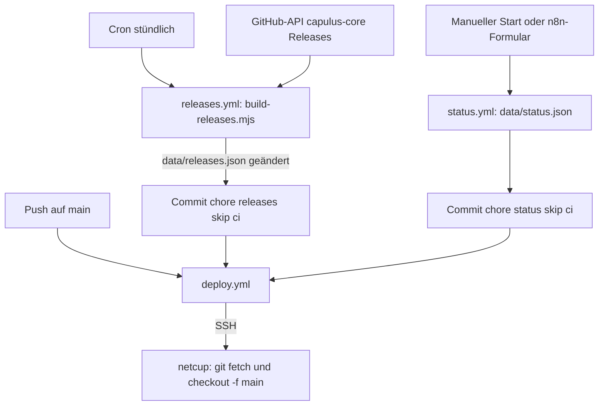

# Automatisierung

Alle Abläufe rund um die Website: Deployment, Release-Verlauf, Status-Hinweis und die zugehörigen n8n-Workflows.

Code: [.github/workflows/](https://github.com/pkr-lab/EDV-Kretzer/tree/main/.github/workflows), [scripts/build-releases.mjs](https://github.com/pkr-lab/EDV-Kretzer/blob/main/scripts/build-releases.mjs), [automation/](https://github.com/pkr-lab/EDV-Kretzer/tree/main/automation)

---

## Überblick

| Workflow | Datei | Auslöser | Wirkung |
|---|---|---|---|
| Deploy to netcup | `deploy.yml` | Push auf `main`, manuell, `workflow_call` | Spiegel aktualisieren und nach `httpdocs` auschecken |
| Release-Verlauf | `releases.yml` | stündlich (Minute 17), manuell | `data/releases.json` erzeugen, bei Änderung committen und deployen |
| Status-Hinweis | `status.yml` | nur manuell (`workflow_dispatch`) | `data/status.json` schreiben, committen, deployen |
| Release | `release.yml` | Push auf `main`, manuell | semantic-release (zentraler Workflow) |
| Commitlint | `commitlint.yml` | Pull Request | Conventional Commits prüfen |



---

## Deployment

`deploy.yml` verbindet sich per `appleboy/ssh-action` mit dem netcup-Hosting und führt aus:

```bash
git -C "$HOME/git/EDV-Kretzer" fetch --prune origin
git --git-dir="$HOME/git/EDV-Kretzer" --work-tree="<NETCUP_PATH>" checkout -f main
```

Das Docroot ist kein Klon, sondern ein Arbeitsverzeichnis des Git-Spiegels. Einrichtung, Secrets (`NETCUP_HOST`, `NETCUP_USER`, `NETCUP_SSH_KEY`, `NETCUP_PORT`, `NETCUP_PATH`) und Stolperstellen: [Installation](installation.md#deployment-auf-netcup). Die Gruppe `deploy-netcup` verhindert parallele Deployments, ein laufendes wird nicht abgebrochen (`cancel-in-progress: false`).

Die Commits aus `releases.yml` und `status.yml` tragen `[skip ci]` und werden mit dem `GITHUB_TOKEN` gepusht, ein Push-Lauf von `deploy.yml` entsteht daraus nicht. Deshalb rufen beide Workflows `deploy.yml` selbst auf (`uses: ./.github/workflows/deploy.yml`, `secrets: inherit`), `releases.yml` nur, wenn sich die Datei geändert hat.

---

## Release-Verlauf

`scripts/build-releases.mjs` (Node, ohne Abhängigkeiten) schreibt `data/releases.json`:

1. Ruft `https://api.github.com/repos/pkr-lab/capulus-core/releases?per_page=10` ab. Der `GITHUB_TOKEN` des Workflows dient als Bearer-Token (ohne Token gilt das Rate-Limit für anonyme Aufrufe, 60 pro Stunde). Bei einer Antwort ≠ 200 endet das Skript mit `GitHub-API: HTTP <n>` und Exit-Code 1.
2. Verwirft Entwürfe und Vorabversionen, behält höchstens 10.
3. Kurzfassung: aus den Release-Notes die Abschnitte `### Features` (Präfix „Neu“) und `### Bug Fixes` („Behoben“), je höchstens 3 Einträge, der Rest als „und N weitere“. Commit-Hash-Links am Zeilenende und `**scope:**` werden entfernt bzw. zu `scope:` umgeformt. Länge höchstens 320 Zeichen (`…`). Ohne passende Abschnitte: „Release veröffentlicht.“
4. `tag` ist `Major` (Release-Notes beginnen mit der Überschrift `# [X.0.0]`), sonst `Feature` (hat Abschnitt Features), sonst `Fix`.
5. Titel und Text sind HTML-escaped (`&`, `<`, `>`, `"`). Die Datei wird mit Zeilenumbruch am Ende geschrieben.

`releases.yml` committet nur, wenn sich `data/releases.json` geändert hat (`git diff --quiet`), mit `chore(releases): Release-Verlauf aktualisiert [skip ci]`, macht `git pull --rebase` und `git push`, und deployt anschließend.

Lokal ausführen (ohne Commit):

```bash
GITHUB_TOKEN=$(gh auth token) node scripts/build-releases.mjs && git diff data/releases.json
```

---

## Status-Hinweis

`status.yml` schreibt `data/status.json` mit `jq` aus den Eingaben, committet mit `chore(status): Status-Hinweis aktualisiert [skip ci]` und deployt.

| Eingabe | Wirkung in `status.json` |
|---|---|
| `aktiv` | `active` |
| `art` | `level` (`maintenance`, `incident`, `info`) |
| `titel` | `title` |
| `text` | `message` |
| `bereiche` | `areas`, Komma-getrennt, Leerzeichen entfernt, leere Einträge verworfen |
| `bis` | `until` (leer = offen) |
| – | `since`: aktuelle UTC-Zeit, nur bei `aktiv` |

Bei `aktiv=false` setzt der Workflow `areas`, `since` und `until` zurück. Hat sich nichts geändert, bricht der Commit-Schritt ohne Fehler ab (`git diff --cached --quiet && exit 0`), danach läuft trotzdem das Deployment. Bedienung: [Nutzung](nutzung.md#status-hinweis-wartung-störung), Darstellung: [Komponenten](komponenten.md#status-hinweis-banner).

---

## n8n-Workflows

Beide Dateien liegen als JSON-Export in `automation/` und werden manuell in n8n importiert ([n8n](../capulus-core/3-apps-workloads/30070-n8n.md)).

### „EDV-Kretzer – Status-Hinweis schalten“

`automation/n8n-status-schalten.json`: Formular-Trigger (Aktion, betroffene Bereiche, freie Bereiche, Text, Dauer) → Knoten „Eingaben aufbereiten“ (Code) → HTTP-Request `POST https://api.github.com/repos/pkr-lab/EDV-Kretzer/actions/workflows/status.yml/dispatches` mit dem Credential „GitHub PAT (Status-Schalter)“. Es stößt also nur `status.yml` an. Das Token (fine-grained, nur Repo EDV-Kretzer, Berechtigung Actions Lesen und Schreiben) steht im [Token-Register](https://github.com/pkr-lab/capulus-core/blob/main/ops/token-register.yaml) als `n8n-github-status-schalter` (Rotation siehe [Nutzung](nutzung.md#status-hinweis-wartung-störung) und [Tokens](../cubi/tokens.md)).

### „EDV-Kretzer – Update veröffentlichen“ (ohne Wirkung)

`automation/n8n-update-veroeffentlichen.json`: Webhook `POST /publish-update` (Header-Auth) oder GitHub-Trigger bei Release → liest `data/updates.json` über die GitHub-API → hängt einen Eintrag an → schreibt die Datei per `PUT` zurück. `updates.html` liest diese Datei nicht mehr (der Verlauf kommt aus `releases.json`), der Workflow hat daher keinen Effekt auf die Seite und kann in n8n deaktiviert werden.

---

## Debugging und Fehlersuche

Logs: GitHub → Repo EDV-Kretzer → Actions → Lauf auswählen → Schritt aufklappen. Auf dem Server gibt es keine Skriptlogs, das Docroot enthält nur Dateien.

| Symptom | Ursache | Lösung |
|---|---|---|
| Deploy schlägt mit `missing server host` fehl | Secret `NETCUP_HOST` fehlt | Secrets setzen ([Installation](installation.md#secrets-anlegen)) |
| Deploy: `ssh: handshake failed` oder `Permission denied (publickey)` | Schlüssel nicht in `authorized_keys` oder falscher Benutzer | Schlüssel testen, `NETCUP_USER` prüfen |
| Deploy: `fatal: not a git repository` | Git-Spiegel `~/git/EDV-Kretzer` fehlt oder defekt | Spiegel neu anlegen (Bare-Repository mit `mirror = true`) |
| Deploy grün, Seite alt | Browser-Cache oder `NETCUP_PATH` zeigt auf falsches Docroot | Strg+F5, Pfad prüfen, Dateizeit auf dem Server |
| `GitHub-API: HTTP 403` im Release-Verlauf | Rate-Limit oder fehlendes Token | später erneut, `GITHUB_TOKEN` im Workflow prüfen |
| `GitHub-API: HTTP 404` | Repo umbenannt (`REPO` im Skript) | Konstante `REPO` in `build-releases.mjs` anpassen |
| Release-Verlauf bleibt leer oder alt | `releases.yml` ohne Änderung, oder neuer Release hat keine Abschnitte Features und Bug Fixes | Lauf prüfen; Fallback „Release veröffentlicht.“ ist normal |
| `releases.yml` schlägt bei `git push` fehl | Branch-Schutz auf `main` verhindert Pushes durch die Action | Ausnahme für `github-actions[bot]` oder anderen Weg einrichten (TODO: prüfen, ob `main` geschützt ist) |
| Status-Workflow schlägt im Schritt „status.json schreiben“ fehl | `jq` meldet einen Fehler zu einer Eingabe (der Schritt gibt den Fehler aus) | Fehlertext im Lauf lesen, Eingaben prüfen (`bis` als ISO-8601-Zeitpunkt) |
| Banner erscheint nicht | Workflow nicht gelaufen, `until` in der Vergangenheit | Lauf prüfen, `data/status.json` ansehen |
| n8n-Formular: 403 „Resource not accessible by personal access token“ | Token ohne Berechtigung Actions oder falsches Repo | Token neu erzeugen ([Nutzung](nutzung.md#status-hinweis-wartung-störung)) |
| n8n-Formular: 401 | Token abgelaufen oder Credential falsch | Credential in n8n erneuern, Register aktualisieren |
| n8n-Formular nicht erreichbar | n8n nur im Heimnetz oder Tailnet erreichbar | VPN, Alternative: Workflow in GitHub starten |
| `commitlint` rot | Commit-Nachricht im falschen Format | `<typ>(<scope>): <beschreibung>` |

Weiter: [Debugging und Fehlersuche](debugging.md).
