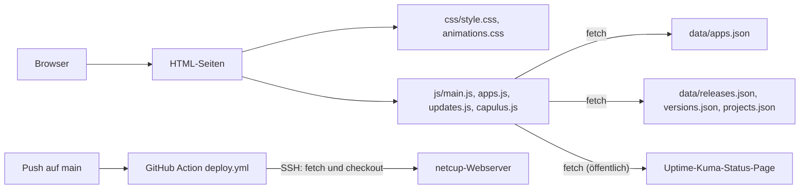

# EDV-Kretzer

Statische Website von EDV-Kretzer (<https://www.edv-kretzer.de>). Sie zeigt, was auf dem Capulus-Homelab läuft und wie es gebaut ist: das GitOps-Projekt capulus-core, den Katalog der selbst gehosteten Anwendungen, die iOS-App, Updates mit Live-Status sowie Kontakt, Impressum und Datenschutz.

Repository: [pkr-lab/EDV-Kretzer](https://github.com/pkr-lab/EDV-Kretzer)

## Überblick

Reines HTML, CSS und etwas JavaScript, ohne Build-Schritt und ohne Framework. Die Seite wird per `git pull` auf einem netcup-Webserver ausgeliefert.

| Seite | Inhalt |
|---|---|
| `index.html` | Startseite mit Kurzvorstellung |
| `projekt.html` | Das Projekt capulus-core: Architektur, Komponenten, Hintergründe |
| `capulus.html` | capulus im Überblick: SVG-Architekturdiagramm, Projektkarten mit aktueller Version, neueste Releases |
| `anwendungen.html` | Katalog der Self-Hosted-Dienste, geladen aus `data/apps.json` |
| `mediamtx-drohnenstream.html` | Anleitung: Drohnen-Livestream per MediaMTX zum ELW |
| `app.html` | Die eigene iOS-App fürs Homelab mit Screenshots |
| `updates.html` | Verlauf der letzten zehn Releases aller capulus-Repos aus `data/releases.json` und Live-Status der Dienste |
| `ueber-mich.html`, `kontakt.html` | Vorstellung und Kontaktformular (Zammad) |
| `sitemap.html`, `sitemap.xml`, `robots.txt` | Seitenübersicht und Hinweise für Suchmaschinen |
| `impressum.html`, `datenschutz.html` | rechtliche Seiten |

## Architektur

| Ordner / Datei | Inhalt |
|---|---|
| `assets/icons`, `assets/images` | Logo, Favicon, SVG-Sprite, Screenshots |
| `css/` | `style.css` (Designsystem mit CSS-Variablen), `animations.css` |
| `js/main.js` | Navigation, Dropdown, Einblend-Animationen, Info-Banner, Status-Hinweis (alle Seiten) |
| `js/apps.js` | rendert den Anwendungskatalog mit Filter und Suche |
| `js/updates.js` | rendert den Changelog und das Status-Widget |
| `data/` | `apps.json`, `releases.json`, `status.json`, `updates.json` (alt) |
| `automation/` | n8n-Workflows: Status-Hinweis schalten, früherer Update-Feed |
| `scripts/build-releases.mjs` | erzeugt `data/releases.json` aus der GitHub-API |
| `.github/workflows/` | `deploy.yml`, `releases.yml`, `status.yml`, `release.yml`, `commitlint.yml`, siehe [Automatisierung](automatisierung.md) |

## Seiten

- [Installation](installation.md)
- [Konfiguration](konfiguration.md)
- [Nutzung](nutzung.md)
- [Komponenten](komponenten.md): JavaScript, Status-Banner, Zammad-Chat und -Formular, Katalog, Changelog, Status-Widget
- [Automatisierung](automatisierung.md): Deployment, Release-Verlauf, Status-Hinweis, n8n
- [Debugging und Fehlersuche](debugging.md)
- [Releases](releases.md)
- [SEO](seo.md)
- [Phase 5: Strukturvorschlag](phase-5-strukturvorschlag.md)

## Fehlersuche

Fehlerbilder, Logs und Checkliste: [Debugging und Fehlersuche](debugging.md). Komponentenweise: [Komponenten](komponenten.md#debugging-und-fehlersuche), [Automatisierung](automatisierung.md#debugging-und-fehlersuche). Zentral: [zentrale Fehlersuche](../capulus-core/2-betrieb-hardware/20070-troubleshooting-zentral.md).
