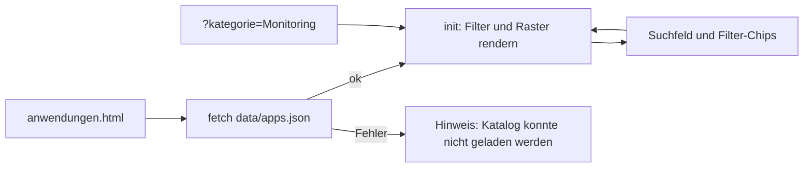

# Komponenten

Alle dynamischen Teile der Website. Die Seite besteht sonst aus statischem HTML. Es gibt weder Build-Schritt noch Framework, die einzigen Abhängigkeiten zur Laufzeit sind jQuery und die Zammad-Skripte.

Code: [js/](https://github.com/pkr-lab/EDV-Kretzer/tree/main/js), [data/](https://github.com/pkr-lab/EDV-Kretzer/tree/main/data), HTML-Seiten im [Repo-Root](https://github.com/pkr-lab/EDV-Kretzer)

---

## Überblick

| Komponente | Datei | Seiten | Datenquelle |
|---|---|---|---|
| Navigation, Header, Scroll-Reveal, 3D-Tilt, Info-Banner | `js/main.js` | alle | – |
| Status-Hinweis (Banner) | `js/main.js` | alle | `data/status.json` |
| Anwendungskatalog | `js/apps.js` | `anwendungen.html` | `data/apps.json` |
| Release-Verlauf | `js/updates.js` | `updates.html` | `data/releases.json` |
| Status-Widget | `js/updates.js` | `updates.html` | öffentliche Uptime-Kuma-Status-Page |
| Zammad-Chat | inline am Seitenende | alle 11 Seiten | Zammad (Host `support-tech`) |
| Kontaktformular | inline in `kontakt.html` | `kontakt.html` | Zammad |
| Stylesheet | `css/style.css`, `css/animations.css` | alle | – |

Die Seiten, die `js/apps.js` und `js/updates.js` einbinden, sind genau `anwendungen.html` und `updates.html`. Beide Skripte beenden sich selbst, wenn ihr Zielelement fehlt.

---

## Navigation und Seitenverhalten (`js/main.js`)

- **Sticky Header:** setzt die Klasse `scrolled` ab 12 px Scrollhöhe.
- **Mobile Navigation:** `.nav-toggle` schaltet `.mobile-menu` und sperrt das Scrollen des Hintergrunds. Escape und Klick auf einen Link schließen das Menü.
- **Aktiver Link:** vergleicht den Dateinamen der URL mit den `href`-Werten von Navigation, mobilem Menü und Footer und setzt `aria-current="page"`.
- **Dropdown „Projekt“:** öffnet und schließt per Klick, Escape oder Klick daneben. Der Auslöser wird `active`, wenn ein Eintrag der aktuellen Seite im Menü steht.
- **Scroll-Reveal:** Elemente mit Klasse `.reveal` erhalten per `IntersectionObserver` die Klasse `visible`. Nach 2,5 Sekunden werden alle übrigen als Sicherheitsnetz sichtbar. Ohne `IntersectionObserver` sind sie sofort sichtbar.
- **3D-Tilt:** Das Monitor-Bild (`.monitor-frame`) neigt sich beim Scrollen und mit der Maus (`.alarm-monitor-3d`). Bei `prefers-reduced-motion: reduce` entfällt die Animation.
- **Info-Banner:** `.info-banner` (auf allen Seiten außer Impressum und Datenschutz; Hinweis „nur technisch notwendige Funktionen“) erscheint nach 0,8 Sekunden, bis „Verstanden“ geklickt wurde. Die Wahl speichert `localStorage["edvkretzer_info_banner_dismissed"]`. Ist `localStorage` nicht nutzbar, erscheint der Banner bei jedem Aufruf.
- **Jahr im Footer:** Elemente mit `data-year` erhalten das aktuelle Jahr.

---

## Status-Hinweis (Banner)

Beim Laden jeder Seite ruft `main.js` `data/status.json` mit `cache: "no-store"` ab. Der Banner erscheint nur, wenn:

1. die Datei lesbar ist (HTTP 200, gültiges JSON),
2. `active` genau `true` ist und
3. `until` leer oder ungültig ist oder in der Zukunft liegt.

Er wird als erstes Element in den `<body>` eingefügt (`role="status"`, Klasse `status-banner status-<level>`).

| Feld | Bedeutung |
|---|---|
| `active` | Banner an oder aus |
| `level` | `maintenance` (Standardtitel „Wartung“), `incident` („Störung“), `info` („Hinweis“). Unbekannte Werte gelten als `info` |
| `title` | optional, leer = Standardtitel der Art |
| `message` | Text, wird als reiner Text eingesetzt (kein HTML) |
| `areas[]` | Anzeige „Betroffen: …“ |
| `since` | „Seit …“, vom Workflow gesetzt |
| `until` | „voraussichtlich bis …“, danach blendet sich der Banner von selbst aus |

Fehler beim Abruf werden verschluckt, der Banner bleibt dann aus. Die Datei schreiben die Workflows `status.yml` bzw. der n8n-Schalter, siehe [Automatisierung](automatisierung.md#status-hinweis) und [Nutzung](nutzung.md#status-hinweis-wartung-störung). Der Banner liegt bewusst auf dem Webserver bei netcup und nicht im Cluster, damit er auch bei einem Cluster-Ausfall sichtbar bleibt.

---

## Anwendungskatalog (`js/apps.js`)

- Lädt `data/apps.json` (derzeit 28 Anwendungen) und zeigt eine Karte je Eintrag mit Icon, Name, Kategorien, Beschreibung, Tags und Link „Projekt-Website“.
- Filter-Chips: *Alle* plus die sieben festen Kategorien. Die Liste der Kategorien steht **im Code** (`CATEGORIES` in `apps.js`), nicht in der JSON. Ein Eintrag mit einer anderen Kategorie erscheint nur unter *Alle*.
- Die Suche vergleicht Name, Beschreibung und Tags (Groß-/Kleinschreibung egal) und lässt sich mit dem Filter kombinieren.
- URL-Parameter `?kategorie=<Name>` wählt eine Kategorie vor, wenn der Name in `CATEGORIES` steht.
- Die Felder werden **ohne HTML-Escaping** in die Seite geschrieben. Inhalte in `apps.json` sind daher vertrauenswürdiger Text, kein Nutzereingabe-Feld.

Felder von `apps.json`: [Konfiguration](konfiguration.md#dataappsjson).

---

## Release-Verlauf (`js/updates.js`)

- Lädt `data/releases.json`, sortiert nach Datum absteigend und rendert eine Karte je Release: Datum, Tag (`Feature`, `Fix`, `Major`), Titel, Kurzfassung und Link „Release auf GitHub“. Der Link erscheint nur, wenn die URL mit `https://github.com/pkr-lab/capulus-core/releases/` beginnt.
- Die Daten erzeugt `scripts/build-releases.mjs`, siehe [Automatisierung](automatisierung.md#release-verlauf). Titel und Text sind schon dort HTML-escaped.
- Fehler: „Updates konnten nicht geladen werden.“ bzw. „Noch keine Releases.“

---

## Status-Widget (`js/updates.js`)

Zeigt den Live-Status der öffentlichen Dienste aus der **öffentlichen Status-Page** von Uptime Kuma ([Uptime Kuma](../capulus/capulus-core/3-apps-workloads/30080-uptime-kuma.md)). Es werden nur Daten angezeigt, kein Link und kein iframe zum Dienst.

- Zwei Abrufe parallel: `<basis>/api/status-page/<slug>` (Gruppen und Monitore) und `<basis>/api/status-page/heartbeat/<slug>` (Heartbeats, Uptime). Der Slug ist `homelab`. Die Basis-URL steht Base64-kodiert in `updates.js`, das ist nur Verschleierung gegen beiläufiges Auffinden, kein Schutz.
- Der Status je Monitor ist der letzte Heartbeat: `1` Online, `0` Down, `2` „Prüfung läuft“, `3` Wartung, sonst „Unbekannt“. Die Uptime der letzten 24 Stunden steht als Prozentwert daneben.
- Die Zusammenfassung zeigt „Alle N Dienste erreichbar“ oder „X von N Diensten aktuell nicht erreichbar“. `pending` zählt hier **nicht** als Ausfall.
- Der Browser ruft die Status-Page von der Website aus ab. Das funktioniert nur, weil der Uptime-Kuma-Ingress CORS-Header für die Website setzt ([Uptime Kuma: CORS](../capulus/capulus-core/3-apps-workloads/30080-uptime-kuma.md)). Fehlt der Header, bleibt das Widget auf „Status gerade nicht abrufbar.“

---

## Zammad-Chat und Kontaktformular

Beides wird aus dem Zammad-Ticketsystem eingebunden ([Zammad](../capulus/capulus-core/3-apps-workloads/30000-zammad.md)). Die Einbindung steht **inline am Ende der HTML-Seiten**, nicht in `main.js`:

- **Chat:** Skript `…/assets/chat/chat.min.js` plus jQuery 3.6.0 (von `code.jquery.com`). `new ZammadChat({chatId: 1, show: false, flat: true, …})`. Der Chat öffnet über den schwebenden Knopf `.open-zammad-chat` (`chat-fab`).
- **Formular:** nur auf `kontakt.html`. Skript `…/assets/form/form.js`, `$('#zammad-feedback-form').ZammadForm({modal: true, noCSS: true, attachmentSupport: true, …})`. Ein `MutationObserver` ergänzt einen Schließen-Button, sperrt das Scrollen, solange das Modal offen ist, und schließt mit Escape.
- **Vorbelegung:** `kontakt.html?interesse=<Text>` oder `?app=<Text>` trägt den Text als Betreff ein (`Anfrage: <Text>`) und zeigt eine Notiz.
- Mit deaktiviertem JavaScript erscheint ein Hinweis mit der E-Mail-Adresse.

Der Zammad-Host ist ein Cluster-Dienst im TECH-Bereich. Fällt er aus, bleiben Chat und Formular aus, der Rest der Website läuft weiter.

---

## Debugging und Fehlersuche

| Symptom | Ursache | Lösung |
|---|---|---|
| Katalog oder Verlauf bleibt leer, Hinweistext „… konnte nicht geladen werden“ | Seite per `file://` geöffnet oder `data/*.json` nicht erreichbar | Über Webserver öffnen (`python3 -m http.server 8000`), im Browser Netzwerk-Tab prüfen |
| Katalogkarte fehlt unter dem Filter | Kategorie nicht in `CATEGORIES` | Kategorie in `apps.js` ergänzen oder bestehende wählen |
| Katalog kaputt nach JSON-Änderung | JSON-Syntaxfehler | `python3 -m json.tool data/apps.json` |
| HTML aus `apps.json` wird ausgeführt | Felder ohne Escaping | keine Tags und Sonderzeichen unmaskiert in `apps.json` schreiben |
| Verlauf zeigt alte Releases | `releases.yml` lief nicht oder schlug fehl | Actions → „Release-Verlauf“ prüfen, [Automatisierung](automatisierung.md#debugging-und-fehlersuche) |
| „Status gerade nicht abrufbar.“ | Status-Page nicht erreichbar, Slug falsch oder CORS-Header fehlt | Entwicklertools → Konsole und Netzwerk; Ursachen siehe oben; [Uptime Kuma](../capulus/capulus-core/3-apps-workloads/30080-uptime-kuma.md) |
| „Noch keine öffentliche Status-Page konfiguriert.“ | Status-Page `homelab` enthält keine Monitore | Monitore in Uptime Kuma auf die Page legen |
| Alle Monitore „Unbekannt“ | Heartbeats leer (neuer Monitor) oder Heartbeat-Abruf lieferte keine Liste | kurz warten, `…/api/status-page/heartbeat/homelab` prüfen |
| Banner erscheint nicht trotz `active: true` | `until` liegt in der Vergangenheit, JSON ungültig, Datei nicht deployt | `data/status.json` im Repo und auf dem Server prüfen, Deployment-Lauf prüfen |
| Banner bleibt nach Wartungsende | `active` noch `true` und `until` leer | Workflow „Status-Hinweis“ mit `aktiv` aus starten |
| Chat-Knopf ohne Wirkung | jQuery oder Zammad-Skript nicht geladen (Zammad-Host down, Adblocker) | Konsole prüfen, [Zammad](../capulus/capulus-core/3-apps-workloads/30000-zammad.md) |
| Kontaktformular öffnet nicht | `form.js` nicht geladen oder JavaScript aus | Konsole, E-Mail-Weg aus dem Hinweis |
| Info-Banner erscheint bei jedem Besuch | `localStorage` blockiert (Privatmodus) | erwartet |
| Inhalte bleiben unsichtbar | `IntersectionObserver` löst nicht aus | nach 2,5 Sekunden Fallback, sonst Konsole prüfen |

Allgemeines: [Debugging und Fehlersuche](debugging.md).
