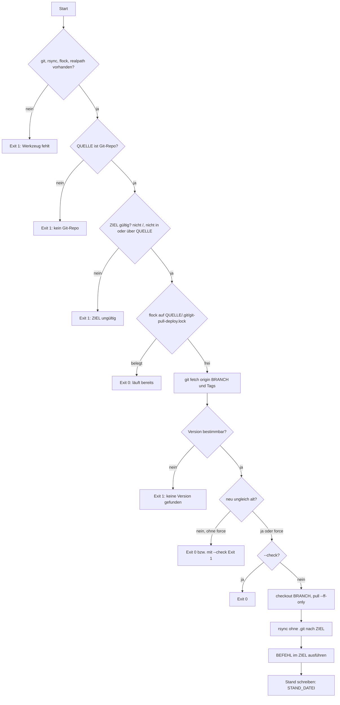

# git-pull-push (Bash)

Bash-Skript, das ein Git-Repository aktualisiert und bei einer neuen Version in ein Zielverzeichnis kopiert und dort einen Befehl ausführt (zum Beispiel `docker compose up -d`). Gedacht für Server, die von Git deployen sollen, ohne dass ein Dienst auf dem Server selbst Git-Zugriff von außen braucht. Das Skript ersetzt keinen GitOps-Controller. Das GitOps-Verfahren des Homelabs steht bei [ArgoCD](../capulus-core/b-kubernetes-gitops/b0010-argocd.md).

Code: `bash/git-pull-push/git-pull-push.sh` und `README.md` im Repo [pkr-lab/PowerShell](https://github.com/pkr-lab/PowerShell). Stand der Prüfung (2026-10-21): Die Dateien liegen im lokalen Arbeitsverzeichnis, aber noch nicht im Git-Index. TODO: prüfen, ob sie committet wurden und in welchem Pfad.

Namensunterschied: Die Datei heißt `git-pull-push.sh`, die Hilfe, die Log-Zeilen (`[git-pull-deploy]`) und die README sprechen von `git-pull-deploy.sh`. Beim Installieren den gewünschten Namen wählen und konsistent verwenden (TODO: prüfen, welcher Name gelten soll).

---

## Voraussetzungen

| Werkzeug | Wofür | Prüfen |
|---|---|---|
| `git` | Version holen | `git --version` |
| `rsync` | Kopieren ohne `.git` | `rsync --version` |
| `flock` | Sperre gegen Doppelläufe | `flock --version` |
| `realpath` | Pfadprüfung | `realpath --version` |
| Klon von `QUELLE` | muss einmalig angelegt sein | `git clone <URL> /opt/git/mein-projekt` |

Fehlt eines der vier Werkzeuge, meldet das Skript `<werkzeug> fehlt` und endet mit Exit-Code 1.

---

## Installation und Aufruf

```bash
git clone <URL> /opt/git/mein-projekt
install -m 0755 git-pull-push.sh /usr/local/bin/git-pull-push.sh
git-pull-push.sh --check                 # nur prüfen, nichts ändern
git-pull-push.sh                         # bei neuer Version ausrollen
git-pull-push.sh --force                 # auch ohne neue Version
```

Täglicher Lauf per Cron (nach der README):

```cron
0 4 * * * /usr/local/bin/git-pull-push.sh >> /var/log/git-pull-push.log 2>&1
```

| Option | Wirkung |
|---|---|
| `--check` | prüft nur (nach `fetch`): Exit 0 = neue Version vorhanden, 1 = keine |
| `--force` | zieht, kopiert und führt den Befehl auch ohne neue Version aus |
| `-h`, `--help` | Hilfe, Exit 0 |
| andere Argumente | Hilfe auf stderr, Exit 2 |

---

## Konfiguration (Umgebungsvariablen)

Alle Variablen stehen am Anfang des Skripts mit Standardwert und lassen sich per Umgebung überschreiben.

| Variable | Standard | Bedeutung |
|---|---|---|
| `QUELLE` | `/opt/git/mein-projekt` | lokaler Git-Klon |
| `ZIEL` | `/opt/stacks/mein-projekt` | Zielverzeichnis, wird angelegt |
| `BRANCH` | `main` | Branch, der beobachtet wird |
| `AUSLOESER` | `commit` | `commit` (jeder neue Commit), `tag` (neuer Tag nach `TAG_MUSTER`), `datei` (Inhalt von `VERSIONSDATEI` ändert sich) |
| `TAG_MUSTER` | `v*` | Tag-Muster für `AUSLOESER=tag` (zum Beispiel Tags von semantic-release) |
| `VERSIONSDATEI` | `VERSION` | Datei im Repo für `AUSLOESER=datei` |
| `BEFEHL` | `docker compose up -d` | wird im Ziel ausgeführt. Ist die Variable **gesetzt, aber leer**, entfällt der Befehl (`${BEFEHL-…}`) |
| `AUSNAHMEN` | leer | durch Leerzeichen getrennte rsync-Ausschlussmuster (zum Beispiel `.env data`), die beim Kopieren und Löschen unberührt bleiben |
| `LOESCHEN` | `false` | `true`: `rsync --delete`, im Ziel werden Dateien entfernt, die in der Quelle fehlen |
| `STAND_DATEI` | `$QUELLE/.git/git-pull-deploy.stand` | merkt die zuletzt ausgerollte Version |

---

## Ablauf



Die Version je Auslöser: `commit` ist der Commit-Hash von `origin/BRANCH`. `tag` ist der letzte Tag nach `TAG_MUSTER` auf `origin/BRANCH`, ausgecheckt wird der Tag als losgelöster Kopf. `datei` ist der Inhalt von `VERSIONSDATEI` (ohne Leerraum) in `origin/BRANCH`. Der Stand wird erst **nach** erfolgreichem Kopieren und Befehl geschrieben. Scheitert ein Schritt, bleibt er unverändert, und der nächste Lauf versucht es erneut.

Sicherheitsvorkehrungen: `ZIEL` darf nicht `/` sein und `QUELLE` weder enthalten noch darin liegen. Der Pull ist nur Fast-Forward (`--ff-only`). Die Sperre (`flock`) wird vor dem Befehl an `BEFEHL` nicht weitervererbt (`9>&-`).

---

## Debugging und Fehlersuche

Alle Meldungen gehen mit Zeitstempel und Präfix `[git-pull-deploy]` auf stderr. Das Skript hat kein eigenes Log-Level. Zum Nachverfolgen hilft `bash -x git-pull-push.sh --check`.

| Meldung | Ursache | Lösung |
|---|---|---|
| `<werkzeug> fehlt` (Exit 1) | `git`, `rsync`, `flock` oder `realpath` nicht installiert | Paket installieren (`sudo apt install git rsync util-linux coreutils`) |
| `<QUELLE> ist kein Git-Repo, einmalig: git clone <URL> <QUELLE>` (Exit 1) | Klon fehlt | klonen |
| `ZIEL=<ZIEL> ungültig: darf nicht / sein und QUELLE weder enthalten noch darin liegen` (Exit 1) | Ziel falsch gesetzt | `ZIEL` außerhalb von `QUELLE` wählen |
| `läuft bereits, Abbruch` (Exit 0) | ein anderer Lauf hält die Sperre | warten, `lsof <QUELLE>/.git/git-pull-deploy.lock` |
| `keine Version auf origin/<BRANCH> gefunden (AUSLOESER=<x>, erlaubt: commit, tag, datei)` (Exit 1) | Branch heißt anders, keine Tags nach `TAG_MUSTER`, `VERSIONSDATEI` fehlt, unbekannter `AUSLOESER` | Variablen prüfen, `git -C <QUELLE> tag -l '<muster>'` |
| `neue Version: <alt> -> <neu>` | Information | – |
| `keine neue Version (<version>)` | nichts zu tun | `--force` zum Erzwingen |
| `keine neue Version (<version>), wegen --force trotzdem` | Information | – |
| `nach <ZIEL> kopiert` | Information | – |
| `führe in <ZIEL> aus: <BEFEHL>` | Information | – |
| `Fehler in Zeile <n>, Stand wird nicht als ausgerollt markiert` | irgendein Befehl scheiterte (`set -e`), zum Beispiel `git fetch` ohne Zugang, `git pull --ff-only` bei abweichender Historie, `rsync` ohne Rechte, `BEFEHL` mit Fehlercode | Zeilennummer im Skript nachschlagen, den Befehl von Hand ausführen. Der nächste Lauf wiederholt alles |
| `fatal: Not possible to fast-forward, aborting.` (von git) | lokaler Klon weicht von `origin` ab (lokale Commits) | `git -C <QUELLE> status`, lokale Änderungen verwerfen oder rebasen |
| `Permission denied (publickey)` beim `fetch` | kein SSH-Zugang für den Cron-Benutzer | Deploy-Key hinterlegen, `ssh -T git@github.com` als derselbe Benutzer |
| Ziel unverändert, Stand aber weitergeschaltet | `BEFEHL` leer gesetzt oder nicht ausgeführt | `BEFEHL` prüfen |
| Dateien im Ziel verschwinden | `LOESCHEN=true` ohne `AUSNAHMEN` | `LOESCHEN=false` oder Ausnahmen setzen (zum Beispiel für `.env` und Datenordner) |
| Skript läuft unter Cron nicht, von Hand schon | Umgebung unter Cron (PATH, HOME, SSH-Agent) | absolute Pfade, `PATH` in der Crontab setzen |

Checkliste:

1. `git-pull-push.sh --check` von Hand als derselbe Benutzer: Exit-Code und Meldung lesen.
2. `git -C <QUELLE> fetch origin` ohne Skript: Zugang?
3. `cat <STAND_DATEI>` und `git -C <QUELLE> rev-parse origin/<BRANCH>`: Stand verglichen.
4. Befehl im Ziel von Hand (`cd <ZIEL> && <BEFEHL>`).
5. Cron-Log lesen (`/var/log/git-pull-push.log`).
