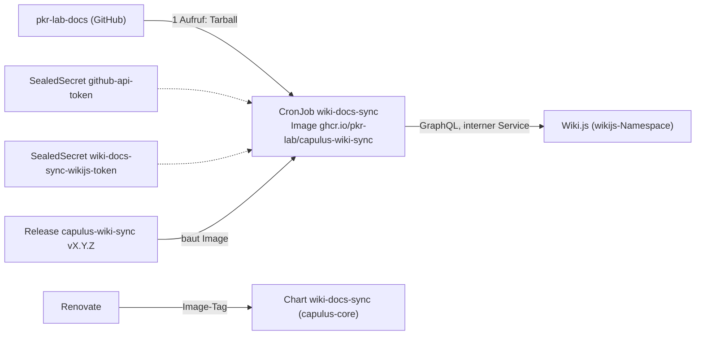

# Wiki-Sync (wiki-docs-sync)

Der Wiki-Sync spiegelt dieses Docs-Repo (`pkr-lab-docs`) nach Wiki.js im PROD-Cluster. Er läuft als CronJob alle 15 Minuten. Der Code liegt im Repo [capulus-wiki-sync](https://github.com/pkr-lab/capulus-wiki-sync), das Helm-Chart in [capulus-core](https://github.com/pkr-lab/capulus-core/tree/main/argocd/apps/prod/wiki-docs-sync).

## Überblick

| Frage | Antwort |
|---|---|
| Quelle | GitHub-Repo `pkr-lab/pkr-lab-docs`, Branch `main`, geladen als Tarball über die GitHub-API (ein API-Aufruf pro Lauf) |
| Ziel | Wiki.js im Namespace `wikijs`, Locale `en`, Pfad-Präfix `docs` |
| Auslöser | CronJob `*/15 * * * *` (Zeitzone Europe/Berlin), `concurrencyPolicy: Forbid` |
| Authentifizierung | GitHub-Token aus dem SealedSecret `github-api-token` (optional, hebt das Rate-Limit), Wiki.js-API-Key aus `wiki-docs-sync-wikijs-token` |
| Zustand | keiner im Cluster; GitHub ist bei jedem Lauf die einzige Quelle der Wahrheit |

## Was der Sync mit den Seiten macht

- **Seitenbaum:** Jede `*.md`-Datei wird zu einer Wiki-Seite, deren Pfad der Ordnerstruktur folgt: `capulus-core/3-apps-workloads/300d0-carplay-api.md` wird zu `/en/docs/capulus-core/3-apps-workloads/300d0-carplay-api`. Seitennamen sind damit über den Pfad eindeutig, ohne Präfixe wie `capulus-core--installation`.
- **Startseiten:** Eine `index.md` ersetzt ihren Ordner (`capulus-core/index.md` → `/en/docs/capulus-core`), die `README.md` im Repo-Root wird die Startseite `/en/docs`.
- **Übersichtsseiten:** Für jeden Ordner ohne `index.md` erzeugt der Sync eine Seite mit Links auf Unterordner und Seiten. Diese Seiten ersetzen die `_Sidebar.md` und `Home.md` des GitHub-Wikis. In Wiki.js unter Administration → Navigation den Modus „Site Tree“ wählen, dann zeigt die Seitenleiste denselben Baum.
- **Titel:** erste `# `-Überschrift; bei Dateinamen mit fünfstelliger Hex-ID (`a0000-…`) wird die ID vorangestellt (`a0000 - Ubuntu-Server-Installation`).
- **Links:** Relative Links werden auf Wiki-Pfade umgeschrieben (`/en/docs/…`, Anker bleiben erhalten). Bilder und Dateien, die nicht im Wiki liegen, zeigen auf `raw.githubusercontent.com` bzw. `github.com/…/blob/main/…`. Links in Code-Blöcken und Inline-Code bleiben unverändert.
- **Beschreibung:** Jede Seite trägt „Quelle: pkr-lab/pkr-lab-docs/<Pfad>“, damit man im Wiki sieht, wo man sie ändert. Änderungen im Wiki werden beim nächsten Lauf überschrieben.
- **Ausgeschlossen:** `.github/**`, `scripts/**`, `CLAUDE.md`, `LICENSE`, `CHANGELOG.md` und `capulus-core/archiv/**` (Variable `EXCLUDE`).

## Idempotenz und Löschen

- Der Sync liest jede vorhandene Seite und schreibt sie nur, wenn Inhalt, Titel oder Beschreibung abweichen. Ein Lauf ohne Änderung im Repo ändert nichts und erzeugt keine neuen Wiki.js-Versionen.
- Seiten unter dem Präfix, zu denen es keine Quelle mehr gibt, werden gelöscht. Das gilt für **alle** Seiten unter `docs/`, auch wenn jemand sie im Wiki von Hand angelegt hat.
- Schutz: Liefert die Quelle weniger als `MIN_PAGES` (20) Seiten oder schlägt das Laden fehl, bricht der Lauf ab und ändert nichts. Gleichnamige Zielpfade zweier Quelldateien führen ebenfalls zum Abbruch.
- Schlägt eine Seite fehl, laufen die übrigen weiter; der Job endet dann mit Exit-Code 1 und erscheint als fehlgeschlagen.

## Konfiguration

Alle Werte stehen in `argocd/apps/prod/wiki-docs-sync/values.yaml` und kommen als Umgebungsvariablen im Container an.

| Wert in `values.yaml` | Variable | Standard | Bedeutung |
|---|---|---|---|
| `image.repository`, `image.tag` | – | `ghcr.io/pkr-lab/capulus-wiki-sync`, `vX.Y.Z` | Image; der Tag wird von Renovate angehoben |
| `github.owner`, `repo`, `branch` | `GITHUB_OWNER`, `GITHUB_REPO`, `GITHUB_BRANCH` | `pkr-lab`, `pkr-lab-docs`, `main` | Quelle |
| `github.exclude` | `EXCLUDE` | siehe oben | Glob-Muster (kommagetrennt) |
| `github.tokenSecretName`, `tokenSecretKey` | `GITHUB_TOKEN` | `github-api-token`, `token` | GitHub-Token; leer = anonym |
| `wikijs.url` | `WIKIJS_API_URL` | `http://wikijs.wikijs.svc.cluster.local` | interner Service, nicht die öffentliche URL |
| `wikijs.locale` | `WIKIJS_LOCALE` | `en` | Locale; gehört **nicht** in den Pfad, Wiki.js setzt es selbst davor |
| `wikijs.pathPrefix` | `WIKIJS_PATH_PREFIX` | `docs` | Wurzel der gespiegelten Seiten |
| `wikijs.legacyPrefixes` | `WIKIJS_LEGACY_PREFIXES` | leer | Präfixe, deren Seiten einmalig gelöscht werden (siehe Umstellung) |
| `wikijs.dryRun` | `DRY_RUN` | `false` | `true` = nur protokollieren, nichts ändern; vor größeren Änderungen an Quelle oder Präfix einschalten |
| `wikijs.minPages` | `MIN_PAGES` | `20` | Mindestzahl an Seiten, sonst Abbruch |
| `wikijs.tokenSecretName`, `tokenSecretKey` | `WIKIJS_API_TOKEN` | `wiki-docs-sync-wikijs-token`, `token` | Wiki.js-API-Key |

Der GitHub-Token braucht für das öffentliche Docs-Repo nur Lesezugriff auf öffentliche Repos. Wird das Docs-Repo privat, braucht er Leserecht auf `pkr-lab-docs`.

## Releases und Image

`capulus-wiki-sync` wird mit semantic-release versioniert. Jedes Release baut das Image `ghcr.io/pkr-lab/capulus-wiki-sync:vX.Y.Z`. Renovate öffnet in capulus-core einen PR, der `image.tag` anhebt (Regel in `renovate.json`). Das Image enthält keine Zugangsdaten und kann öffentlich sein, dann braucht der Namespace kein Pull-Secret (`imagePullSecrets` in den Values).

## Umstellung vom alten Sync (durchgeführt am 2026-10-18)

Der alte Sync las `capulus-core/docs` (eine Ebene tief) und schrieb nach `Github/capulus-core/docs/…` samt Seite `Github/capulus-core/ReadMe`. Die Umstellung lief so, und derselbe Ablauf eignet sich für einen Wechsel des Präfixes:

1. Image `capulus-wiki-sync` veröffentlichen, Paket öffentlich stellen.
2. Chart mit `dryRun: true` mergen. Das Log des ersten Jobs zeigte `neu=274 gelöscht=0 Fehler=0`.
3. `dryRun: false` setzen. Der erste echte Lauf legte alle 274 Seiten an, der zweite meldete `unverändert=274`.
4. Einmalig `wikijs.legacyPrefixes: ["Github/capulus-core"]` setzen: Der nächste Lauf löschte die 145 alten Seiten, danach wurde der Wert wieder geleert.
5. `docs/` und die Komponenten-READMEs aus capulus-core entfernen.

Das Log eines Laufs liest man ohne Zugriff auf den PROD-Cluster über den ArgoCD-Hub: `argocd app logs prod-wiki-docs-sync --core --kind Job --name wiki-docs-sync-<Minuten seit Epoche des Slots>`. Offen bleibt in Wiki.js die Navigation: Administration → Navigation → „Site Tree“.

Die URLs der Seiten haben sich geändert. Verweise auf alte Wiki-Seiten müssen angepasst werden.

## Fehlersuche

| Symptom | Ursache und Abhilfe |
|---|---|
| Job endet mit `Quelle nicht verwendbar` | GitHub nicht erreichbar oder Rate-Limit; Token im Secret `github-api-token` prüfen |
| `Nur N Seiten, mindestens 20 erwartet` | Quelle leer oder Branch falsch; nichts wurde geändert |
| `HTTP 403 … error code 1010` | `wikijs.url` zeigt auf die öffentliche Cloudflare-URL; den internen Service verwenden |
| `API Key invalid` oder `API disabled` im Wechsel | Wiki.js läuft mit mehr als einem Pod; `maxReplicas` bleibt 1 (siehe [60050](6-hintergruende/60050-helm-charts-prod.md#wikijs-und-wiki-docs-sync)) |
| Verweise auf Überschriften im Wiki führen ins Leere | Wiki.js bildet Anker anders als GitHub (z. B. bei Umlauten); der Sync lässt Anker unverändert |
| Mermaid-Diagramme erscheinen als Code | In Wiki.js unter Administration → Rendering → Markdown „Mermaid“ aktivieren |
| Bilder fehlen | Das Docs-Repo ist privat; Bilder werden über `raw.githubusercontent.com` geladen und brauchen ein öffentliches Repo |
