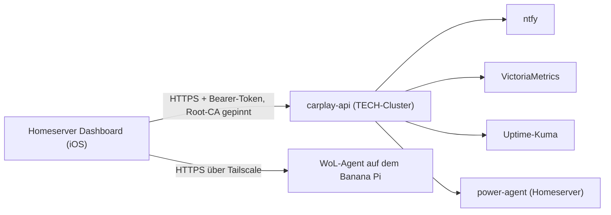

# Homeserver Dashboard (iOS)

Pure SwiftUI universal (iPhone + iPad) app for
[carplay-api](https://github.com/pkr-lab/capulus-core/tree/main/argocd/apps/tech/carplay-api) — alerts (ntfy), per-host
metrics (VictoriaMetrics) and service status (Uptime-Kuma) on a home
screen, plus two control subpages: Homeserver screen brightness, and
Wake-on-LAN/shutdown for the fleet.

No CarPlay: the CarPlay scene, its entitlement, and the `CarPlay.framework`
dependency have all been removed — this is a normal, App-Store-shippable
app with no special Apple entitlement request needed for any of it.

Repository: [pkr-lab/capulus-ios](https://github.com/pkr-lab/capulus-ios). Das Backend ist `carplay-api` in [capulus-core](../capulus-core/index.md) (Hintergründe: [60080](../capulus-core/6-hintergruende/60080-carplay-api-und-ios-app.md)).

## Überblick



Die App liest Alarme (ntfy), Host-Metriken (VictoriaMetrics) und Dienststatus (Uptime-Kuma) über `carplay-api`, steuert Helligkeit und Wake/Shutdown über denselben Weg und weckt den Windows-PC im Vereinsheim direkt über einen Agenten auf dem Banana Pi (Rolle `banana_pi_kiosk` in [capulus-ansible](../capulus-ansible/index.md)).

## Seiten

- [Installation](installation.md)
- [Konfiguration](konfiguration.md) (Transport, Zertifikats-Pinning, Einstellungen)
- [Nutzung](nutzung.md) (die drei Tabs, bekannte Lücken)
- [Releases](releases.md)

## Structure

```
capulus-ios/
├── project.yml                    # XcodeGen spec — source of truth, .xcodeproj is generated, not committed
├── .gitignore
├── Resources/homeserver-root-ca.pem  # Kopie der Root-CA aus capulus-core (pki/), wird ins Bundle gelegt
└── HomeserverDashboard/
    ├── HomeserverDashboardApp.swift # @main SwiftUI entry point
    ├── Info.plist                  # GENERATED by `xcodegen generate` from project.yml's info.properties — do not hand-edit, it gets overwritten every run
    ├── HomeserverDashboard.entitlements
    ├── Views/
    │   ├── RootTabView.swift        # 3-tab root: Übersicht / Helligkeit / Steuerung
    │   ├── HomeView.swift            # Tab 1: alerts + host cards + service status
    │   ├── HostCardsView.swift       # Per-host metric cards (Homeserver/NAS/worker-0/worker-1), online hosts only
    │   ├── AlertsGridView.swift
    │   ├── StatusGridView.swift
    │   ├── BrightnessView.swift      # Tab 2: Homeserver screen brightness slider
    │   ├── PowerView.swift           # Tab 3: wake/shutdown, incl. the Homeserver confirmation-code sheet
    │   ├── DetailView.swift          # Alert/service detail sheet
    │   └── SettingsView.swift        # API bearer token entry
    ├── ViewModels/
    │   ├── DashboardViewModel.swift  # 30s polling loop for GET /api/dashboard
    │   └── PowerViewModel.swift      # Brightness + wake/shutdown actions
    ├── Models/                       # Codable, mostly 1:1 with carplay-api's JSON (RemoteWolTarget is the one exception — talks to the Pi's own agent, not carplay-api)
    ├── Services/                     # API clients, Keychain, connectivity
    ├── Utilities/
    │   ├── Theme.swift                # Design tokens ported from github.com/pkr-lab/EDV-Kretzer + GlassCard/SectionCard/ScreenBackground
    │   ├── ColorHelper.swift          # Status (alert level / service state / percentage) → color
    │   ├── Constants.swift
    │   ├── FormatterHelper.swift
    │   └── MTLSDelegate.swift
    └── Assets.xcassets/
```

### Design

Colors/typography/glass-card styling are ported from
[github.com/pkr-lab/EDV-Kretzer](https://github.com/pkr-lab/EDV-Kretzer)
(`css/style.css` custom properties) — deep navy `#0f3a5d` + red `#d32f2f` on
a near-black `#0a0e27`→`#0d1230` gradient, translucent glass cards with a
hairline border. See `Utilities/Theme.swift` for the exact token values.
The app forces dark mode (`RootTabView`'s `.preferredColorScheme(.dark)`)
rather than adapting to the system appearance, since the brand itself has
no light variant to match.
