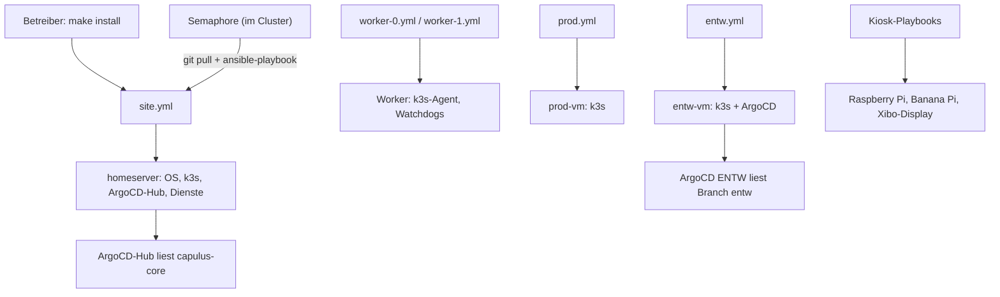

# capulus-ansible

Ansible-Playbooks und Rollen, die das Capulus-Homelab provisionieren: gehärtete Ubuntu-Hosts, drei k3s-Cluster (TECH, PROD, ENTW), KVM-VMs, Kiosk-Geräte (Raspberry Pi, Banana Pi) und die Host-Dienste (Tailscale, DNS, Power-Management, Watchdogs, Drucker). Die Workloads im Cluster rollt ArgoCD aus [capulus-core](../capulus-core/index.md) aus.

Repository: [pkr-lab/capulus-ansible](https://github.com/pkr-lab/capulus-ansible)

## Überblick

| Bereich | Inhalt |
|---|---|
| Playbooks | `site.yml` (Homeserver/TECH), `worker-0.yml`, `worker-1.yml`, `prod.yml`, `entw.yml`, Kiosk-Playbooks, `alert-caller.yml`, `vaultwarden-restore.yml`, `render-bootstrap.yml` |
| Rollen | 33 Rollen nach dem Prinzip „eine Rolle pro Aufgabe“, siehe [Rollen](rollen/index.md) |
| Inventory | `inventory/hosts.yml` mit den Gruppen `homeservers`, `k3s_agents`, `prod`, `entw`, `semaphore_targets`, `xibo_displays`, `banana_pis`, `raspberry_pis`, `alert_callers`, `alert_caller_pi` |
| Variablen | `group_vars/` und `host_vars/<host>/{vars,vault}.yml`; Secrets als `!vault`-Werte |
| Bedienung | `Makefile` mit einem Target je Rolle bzw. Playbook (`make help`) |

## Architektur

Zwei Wege führen Änderungen auf die Systeme: Ansible für alles auf den Hosts (Betriebssystem, k3s, Dienste außerhalb Kubernetes), GitOps über ArgoCD für alles in den Clustern. Die Rolle `argocd` verbindet beides: Sie installiert ArgoCD und legt das Bootstrap-ApplicationSet an, das capulus-core liest.

Der Gesamtüberblick über Hardware, Cluster und Schichten steht in [a0010 Architektur-Überblick](a-betriebssystem/a0010-overview.md).

## Beziehung zu den anderen Repos

| Richtung | Was | Wie gepinnt |
|---|---|---|
| capulus-ansible → capulus-core | `make render-bootstrap CORE_DIR=…` schreibt `argocd/bootstrap/root-applicationset.yaml` und `projects.yaml` aus den Templates der Rolle `argocd` | explizit per Parameter |
| capulus-core → capulus-ansible | Rolle `alert_caller` lädt `caller.py` und zwei Patches aus einem capulus-core-Tag | `alert_caller_core_ref` plus SHA-256 je Datei |
| capulus-core → capulus-ansible | Root-CA für vier Rollen | Kopie in `files/homeserver-root-ca.pem`, CI vergleicht mit `pki/` in capulus-core |

## Seiten

- [Installation](installation.md)
- [Konfiguration](konfiguration.md)
- [Nutzung](nutzung.md)
- [Releases](releases.md)
- [Rollen](rollen/index.md) (je Rolle mit Fehlersuche, [Übersicht](rollen/index.md#fehlersuche-je-rolle))
- [Zentrale Fehlersuche](../capulus-core/2-betrieb-hardware/20070-troubleshooting-zentral.md)
- Bestehende Fachdokumentation: [a-betriebssystem](a-betriebssystem/a0010-overview.md), [Rollen-Hintergründe](6-hintergruende/60020-ansible-rollen.md), [Semaphore](b-kubernetes-gitops/b0030-semaphore.md), [Power-Manager](2-betrieb-hardware/20020-cluster-power-manager.md), [nächtliches Worker-Update](2-betrieb-hardware/20030-nightly-worker-update.md), [Drucker](2-betrieb-hardware/20040-printer.md), [Hardware-Monitoring](2-betrieb-hardware/20060-hardware-monitoring.md), [Vereinsheim-Alarmmonitor](3-apps-workloads/30020-vereinsheim-alarmmonitor.md), [CrowdSec](d-sicherheit/d0020-crowdsec.md), [Secrets-Verschlüsselung und Audit-Log](d-sicherheit/d0050-secrets-encryption-audit-log.md)
