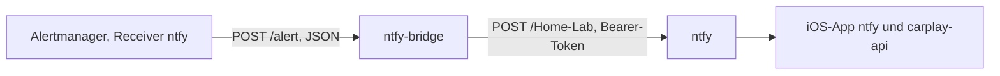

# ntfy-bridge — Alertmanager-Alarme nach ntfy

Kleiner HTTP-Dienst, der Webhooks des Alertmanagers (JSON) in einzelne ntfy-Nachrichten mit Titel, Priorität und Emoji-Tag übersetzt. Er verbindet das [Monitoring](../6-hintergruende/60060-monitoring-und-alerting.md) mit [ntfy](10010-ntfy.md).

> **Cluster:** TECH · Ordner `argocd/apps/tech/ntfy-bridge/` · Namespace `ntfy-bridge` · intern erreichbar unter `http://ntfy-bridge.ntfy-bridge.svc.cluster.local:8080/alert`, kein Ingress. `kubectl`-Befehle in diesem Doc gelten für den TECH-Cluster ([Zugriff je Cluster](../../capulus-ansible/a-betriebssystem/a0010-overview.md#kubectl-zugriff-je-cluster)).

---

## Architektur



| Teil | Wert |
|---|---|
| Programm | Python-Standardbibliothek ohne Zusatzpakete (`bridge.py` aus dem ConfigMap `<name>-script`, eingehängt nach `/app`, Image `python:3.14-slim`) |
| Port | 8080 (Service `ntfy-bridge`) |
| Ziel | `ntfy.url` (`http://ntfy.ntfy.svc.cluster.local`), `ntfy.topic` (`Home-Lab`) |
| Authentifizierung | Schreibtoken `publisher` aus dem SealedSecret `ntfy-bridge-ntfy-token` (Schlüssel `token`, Env `NTFY_TOKEN`), siehe [ntfy: Zugangsdaten](10010-ntfy.md#authentifizierung-und-zugangsdaten) |
| Skalierung | HPA 1 bis 3 Replikas bei 75 % CPU ([HPA](../b-kubernetes-gitops/b0040-hpa-autoscaling.md)) |
| Härtung | nicht root (UID 1000), `readOnlyRootFilesystem`, keine Capabilities, `RuntimeDefault`-Seccomp, Limits 100m und 64 MiB |
| Neustart bei Skriptänderung | Annotation `checksum/script` am Pod-Template |

Der Alertmanager-Receiver `ntfy` (in `argocd/apps/tech/monitoring/values.yaml`) sendet mit `send_resolved: false` nur **ausgelöste** Alarme. Welche Alarme es gibt und wie sie geroutet werden, steht in [Monitoring und Alerting](../6-hintergruende/60060-monitoring-und-alerting.md).

---

## Ablauf je Webhook

1. Die Bridge liest den Body als JSON und geht alle Einträge unter `alerts` durch.
2. Je Alarm: `alertname` (Titel `🔴 <alertname>` bei `firing`, `✅ <alertname>` bei `resolved`), `severity`, `namespace`, die Annotationen `summary` und `description`.
3. Nachrichtentext: Zusammenfassung, Beschreibung (wenn abweichend), `Namespace: …`, `Severity: …`, `Status: …`.
4. Priorität nach `severity`: `critical` 5, `warning` 4, `info` und unbekannt 3. Tag: `rotating_light` (firing, critical), `warning` (firing, warning), `information_source` (firing, info), `white_check_mark` (resolved), sonst `bell`.
5. `POST <ntfy.url>/<ntfy.topic>` mit den Headern `Title`, `Priority`, `Tags` (als UTF-8-Bytes, wegen der Emojis) und `Authorization: Bearer <token>`, Timeout 5 Sekunden.
6. Antwort an den Alertmanager: **immer** `200 ok`, auch wenn der Versand an ntfy scheiterte.

Die ntfy-Prioritäten 4 und 5 erscheinen in der iOS-App [capulus-ios](../../capulus-ios/uebersicht-und-alerts.md) als Warnung bzw. kritisch.

---

## Konfiguration

| Schlüssel (`values.yaml`) | Standard | Bedeutung |
|---|---|---|
| `ntfy.url` | `http://ntfy.ntfy.svc.cluster.local` | Adresse von ntfy (intern) |
| `ntfy.topic` | `Home-Lab` | Ziel-Topic. Auch `carplay-api` und die Telefon-Alarmierung lesen es ([Telefon-Alarm](10020-telefon-alarm.md)) |
| `secrets.ntfyToken.enabled`, `secretName`, `secretKey`, `encryptedData` | `true`, `ntfy-bridge-ntfy-token`, `token` | Token für den Schreibzugriff, versiegelt mit `scripts/seal-ntfy-tokens.sh` |
| `autoscaling.*` | 1 bis 3, 75 % | HPA |
| `image.repository`, `image.tag` | `python`, `3.14-slim` | Laufzeit, von Renovate gepflegt |

---

## Fehlersuche

Die Bridge schreibt auf stdout: `ntfy-bridge listening on :8080 → <url>/<topic>` beim Start, `[OK] <titel>` je erfolgreich gesendetem Alarm, `[ERR] <titel>: <fehler>` bei Sendefehlern sowie die Zugriffszeilen des HTTP-Servers.

```bash
kubectl -n ntfy-bridge get pods
kubectl -n ntfy-bridge logs deploy/ntfy-bridge --tail=100
# Testalarm
kubectl -n ntfy-bridge run curl --rm -it --image=curlimages/curl --restart=Never -- \
  curl -s -X POST http://ntfy-bridge:8080/alert -H 'Content-Type: application/json' \
  -d '{"alerts":[{"status":"firing","labels":{"alertname":"Test","severity":"warning"},"annotations":{"summary":"Testalarm"}}]}'
```

| Meldung oder Symptom | Ursache | Lösung |
|---|---|---|
| `[ERR] <titel>: HTTP Error 403: Forbidden` | Token fehlt, falsch oder ohne Schreibrecht auf `Home-Lab` | Secret `ntfy-bridge-ntfy-token` prüfen, mit `scripts/seal-ntfy-tokens.sh` neu versiegeln ([ntfy](10010-ntfy.md#authentifizierung-und-zugangsdaten)) |
| `[ERR] <titel>: HTTP Error 401` | Token ungültig oder abgelaufen | Token rotieren ([Secrets-Rotation](../d-sicherheit/d0060-secrets-rotation.md), Register-Eintrag `ntfy-bridge-ntfy-token`) |
| `[ERR] <titel>: <urlopen error [Errno -2] Name or service not known>` | `ntfy.url` falsch oder ntfy-Namespace/Service umbenannt | `ntfy.url` prüfen, `kubectl -n ntfy get svc` |
| `[ERR] <titel>: timed out` / `Connection refused` | ntfy-Pod nicht bereit, NetworkPolicy blockiert | `kubectl -n ntfy get pods`, [Network Policies](../d-sicherheit/d0030-network-policies.md) |
| Alarme kommen nicht an, in der Bridge steht `[OK]` | richtiges Topic? Abonnement in der App? ntfy-Cache | [ntfy: Troubleshooting](10010-ntfy.md#troubleshooting) |
| Alarme kommen nicht an, in der Bridge steht gar nichts | Alertmanager erreicht die Bridge nicht oder routet den Alarm anders | Receiver `ntfy` und Routen prüfen, Alertmanager-Log, [Monitoring](../6-hintergruende/60060-monitoring-und-alerting.md) |
| Alertmanager meldet Webhook-Fehler | Bridge nicht bereit oder bei ungültigem JSON abgestürzt: ein fehlerhafter Body führt zu einem Python-Fehler im Handler und die Antwort bleibt aus | Pod-Log lesen, Testalarm wie oben |
| Alarm ging verloren, obwohl ntfy kurz ausfiel | Die Bridge antwortet auch bei Sendefehlern mit 200, der Alertmanager wiederholt deshalb nicht | `[ERR]`-Zeilen im Log suchen. Der Alarm erscheint erst bei der nächsten Wiederholung des Alertmanagers (`repeat_interval`) erneut |
| Titel zeigt kaputte Zeichen | Header nicht UTF-8 | im Bridge-Code werden Header als UTF-8-Bytes gesendet. Bei Änderung am Skript beibehalten |
| Pod `CreateContainerConfigError` | SealedSecret `ntfy-bridge-ntfy-token` fehlt oder nicht entschlüsselt | [Sealed Secrets](../b-kubernetes-gitops/b0070-sealed-secrets.md#fehlersuche) |
| `ImagePullBackOff` | `python:3.14-slim` nicht ziehbar | Netz und Registry prüfen |

Allgemeine Fehlersuche: [zentrale Fehlersuche](../2-betrieb-hardware/20070-troubleshooting-zentral.md).
