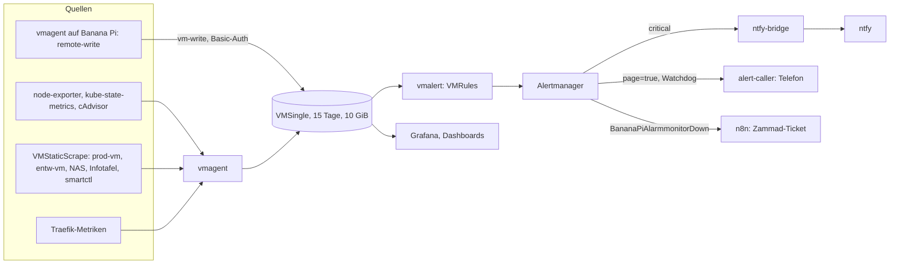

# Monitoring — VictoriaMetrics, Grafana und Alertmanager

Der Monitoring-Stack sammelt Metriken aller drei Cluster, des NAS und der Kiosk-Geräte, wertet Regeln aus, zeigt sie in Grafana und schickt Alarme an ntfy und das Telefon. Die Begründungen zu Routing, Regeln und Scrapes stehen in [60060](../6-hintergruende/60060-monitoring-und-alerting.md), die Logs in [Logging](300j0-logging.md), die Hardware-Dashboards in [Hardware-Monitoring](../../capulus-ansible/2-betrieb-hardware/20060-hardware-monitoring.md). Diese Seite beschreibt Betrieb und Fehlersuche.

> **Cluster:** TECH · Ordner `argocd/apps/tech/monitoring/` · Namespace `monitoring` · Grafana `https://grafana.tech.homeserver` (öffentlich über den Tunnel `grafana-tech.pke-lab.de`). `kubectl`-Befehle in diesem Doc gelten für den TECH-Cluster ([Zugriff je Cluster](../../capulus-ansible/a-betriebssystem/a0010-overview.md#kubectl-zugriff-je-cluster)).

---

## Architektur



| Teil | Wert |
|---|---|
| Chart | Wrapper um `victoria-metrics-k8s-stack` (Version `*`, nicht fest gepinnt) von `victoriametrics.github.io/helm-charts` |
| VMSingle | Aufbewahrung `15d`, ein Replika, PVC 10 GiB `local-path`, auf dem Node `homeserver` |
| Grafana | PVC 2 GiB `local-path`, Plugins `victoriametrics-metrics-datasource`, `yesoreyeram-infinity-datasource`, `victoriametrics-logs-datasource`, `grafana-polystat-panel`, Admin aus dem Secret `grafana-admin`, Sidecar liest Dashboards und Datenquellen aus ConfigMaps (Namespaces `monitoring` und `pacman`) |
| Alertmanager | ein Replika, Routen siehe [60060](../6-hintergruende/60060-monitoring-und-alerting.md#alertmanager-routing) |
| Dashboards | Ordner Hardware, Plattform (TECH), Anwendungen (TECH), je App aus der Liste `dashboardApps`, Rhein-Pegel, Zammad, Pis |
| Schreibzugang | Ingress `vm-write` mit Basic-Auth `vm-writer` (`writeAuth.enabled`, derzeit `false`), für `vmagent` der Pis, siehe [vmagent](../../capulus-ansible/rollen/vmagent.md) |
| Secrets | `grafana-admin`, `alert-caller-token`, `n8n-webhook-token`, `vm-write-auth` (SealedSecrets) |

### Regeln (VMRules)

| Datei | Alarme |
|---|---|
| `vmrule-app-availability.yaml` | `DeploymentUnavailable`, `StatefulSetUnavailable` (5 Minuten) |
| `vmrule-argocd.yaml` | `ArgoAppDegraded`, `ArgoAppOutOfSync`, `ArgoAppProgressing`, `ArgoSyncOperationStuck`, `ArgoMetricsMissing` ([20050](../2-betrieb-hardware/20050-gitops-und-backup-alerts.md)) |
| `vmrule-cronjobs.yaml` | `BackupJobStale`, `CronJobStale` |
| `vmrule-resources.yaml` | `HostHighCPULoad` (80 %), `HostHighMemoryUsage` (70 %), `HostHighDiskUsage`, je zwei Minuten, `warning` |
| `vmrule-temperature.yaml` | `HostHighTemperature` (95 °C, drei Minuten, `critical`) |
| `vmrule-host-services.yaml` | `JournalUploadFailed` (`systemd-journal-upload` seit 15 Minuten `failed`) |
| `vmrule-banana-pi.yaml`, `vmrule-worker-0.yaml`, `vmrule-worker-1.yaml` | `BananaPiAlarmmonitorDown`, `worker-0Down`, `worker-1Down` |
| `vmrule-paging.yaml` | `NodeDownPaging`, `PodCrashLoopPaging`, `DiskFailurePaging`, `KubeApiDownPaging` (Telefon-Anruf, siehe [Telefon-Alarm](../1-benachrichtigungen/10020-telefon-alarm.md)) |

Nur `severity=critical` löst einen Push aus, `warning` ist nur in Alertmanager und Grafana sichtbar.

---

## Bedienung

```bash
kubectl -n monitoring get pods,pvc,ingress
kubectl -n monitoring get vmrule,vmservicescrape,vmstaticscrape,vmpodscrape
kubectl -n monitoring get secret grafana-admin -o jsonpath='{.data.admin-password}' | base64 -d; echo
```

- **Grafana-Zugang:** Benutzer `admin`, Passwort aus dem Secret `grafana-admin`. Neu erzeugen: `scripts/regenerate-grafana-admin.sh` ([Skripte-Referenz](../f-cicd-automatisierung/f00c0-skripte-und-workflows-referenz.md#skripte-zum-versiegeln-und-für-tokens)).
- **Neues Dashboard:** ConfigMap mit Label `grafana_dashboard: "1"` und Annotation `grafana_folder` im Namespace `monitoring` (oder `pacman`).
- **Neue App im Dashboard-Ordner:** Eintrag in `dashboardApps` der `values.yaml`.
- **Neuer Host:** `VMStaticScrape` (Label `host` setzen, alle Regeln nutzen `host`), siehe `templates/vmstaticscrape-vms.yaml`.

---

## Fehlersuche

| Symptom | Ursache | Lösung |
|---|---|---|
| Grafana nicht erreichbar | Pod, Ingress, VPN, DNS | `kubectl -n monitoring get pods,ingress`, [DNS](../c-netzwerk-dns/c0000-dns-architecture.md#fehlersuche) |
| Grafana-Anmeldung scheitert | Passwort geändert oder Secret ausgetauscht | `scripts/regenerate-grafana-admin.sh` (Passwort erscheint im Terminal) |
| Dashboards fehlen oder zeigen „No data“ | Sidecar findet die ConfigMaps nicht (falscher Namespace, Label), Datenquelle | `kubectl -n monitoring logs deploy/monitoring-grafana -c grafana-sc-dashboard`, Label `grafana_dashboard: "1"` |
| Dashboard-Ordner fehlen | Post-Install-Job `monitoring-dashboard-folders` nicht gelaufen | `kubectl -n monitoring get job`, `helm`-Hook-Log |
| Host fehlt in den Dashboards | Scrape-Ziel (`VMStaticScrape`) nicht erreichbar (Host aus, Port 9100 gesperrt) oder falsches Label `host` | `kubectl -n monitoring get vmstaticscrape`, in VMUI unter *Targets* prüfen, [node_exporter](../../capulus-ansible/rollen/node_exporter.md#fehlersuche) |
| Banana-Pi-Metriken fehlen | Push scheitert (Basic-Auth, Netz) | [vmagent](../../capulus-ansible/rollen/vmagent.md#fehlersuche) |
| Metriken verschwinden für eine Weile | VMSingle neu gestartet oder PVC voll (15 Tage Aufbewahrung, 10 GiB) | `kubectl -n monitoring get pods,pvc`, Speicher prüfen |
| Alarm feuert nicht, obwohl der Zustand zutrifft | `for`-Dauer nicht erreicht, Ausdruck trifft kein Label (`host`, `job`, `instance` verwechselt) | in VMUI den Ausdruck ausführen ([60060](../6-hintergruende/60060-monitoring-und-alerting.md#telefon-alarm)) |
| Alarm feuert, aber kein Push | Route, `severity` nicht `critical`, ntfy-bridge scheitert | Alertmanager-Konfiguration (`amtool config routes test`), [ntfy-bridge](../1-benachrichtigungen/10030-ntfy-bridge.md#fehlersuche) |
| Kein Anruf bei `page=true` | Caller-Token, Pod, SIP | [Telefon-Alarm](../1-benachrichtigungen/10020-telefon-alarm.md#fehlersuche), Secret `alert-caller-token` |
| `AlertmanagerFailedToSendAlerts` | Empfänger nicht erreichbar (Bridge, Caller, n8n) | Pods der Empfänger, Webhook-Token ([n8n](30070-n8n.md#fehlerbehebung)) |
| Zu viele Meldungen | niedrige Schwellen, mehrere Sensoren | [60060: Lautstärke der ntfy-Meldungen](../6-hintergruende/60060-monitoring-und-alerting.md#lautstärke-der-ntfy-meldungen) |
| `Watchdog` feuert nicht, Caller meldet „Wachhund ausgefallen“ | Alertmanager oder vmalert down | Pods im Namespace `monitoring` prüfen |
| ArgoCD-App `monitoring` hängt in `Progressing` | wartet auf einen nie gesund werdenden DaemonSet (node-exporter) | Vorfall: [20050](../2-betrieb-hardware/20050-gitops-und-backup-alerts.md), `kubectl -n monitoring get ds` |
| `VMRule`-Fehler beim Sync (`parse error`) | PromQL oder Helm-Escaping der vmalert-Platzhalter (Schreibweise siehe [60060](../6-hintergruende/60060-monitoring-und-alerting.md#telefon-alarm), Abschnitt „Helm-Escaping“) | Chart rendern: `helm template argocd/apps/tech/monitoring` |
| Traefik-Metriken fehlen | `VMServiceScrape traefik-metrics` | [Traefik-Konfiguration](../b-kubernetes-gitops/b0080-traefik-config.md#fehlersuche) |

Allgemeine Fehlersuche: [zentrale Fehlersuche](../2-betrieb-hardware/20070-troubleshooting-zentral.md).
