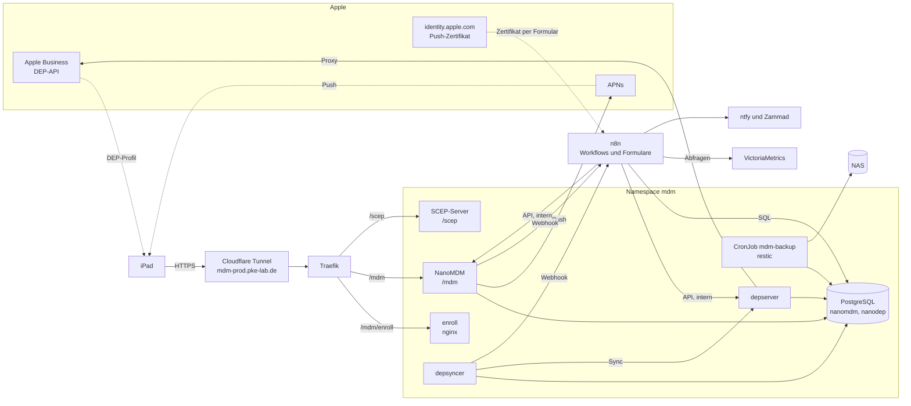

# MDM für iPads — NanoMDM, NanoDEP und SCEP

Eigener, rein quelloffener Mobile-Device-Management-Server für die Vereins-iPads. Die iPads melden sich per Automated Device Enrollment (Apple Business) automatisch an, werden beaufsichtigt (supervised) und bekommen als erste Konfiguration eine Nachricht auf dem Sperrbildschirm. Alles, was sich automatisieren lässt, übernimmt n8n; was Apple nur per Browser-Login erlaubt, steht als kurze Checkliste in [300t0](300t0-mdm-apple-setup.md).

> **Cluster:** TECH · Ordner `argocd/apps/tech/mdm/` · Namespace `mdm` · URL `https://mdm-prod.pke-lab.de` (extern, nur die iPad-Pfade), `mdm.prod.homeserver` (intern, gleiche Pfade). `kubectl`-Befehle in diesem Doc gelten für den TECH-Cluster ([Zugriff je Cluster](../../capulus-ansible/a-betriebssystem/a0010-overview.md#kubectl-zugriff-je-cluster)).

| Doc | Inhalt |
|---|---|
| [300r0](300r0-mdm.md) (dieses Doc) | Überblick, Architektur, Komponenten und Versionen |
| [300s0](300s0-mdm-installation.md) | Was deployt wird, wo es liegt, Erstinstallation, neu deployen |
| [300t0](300t0-mdm-apple-setup.md) | Manuelle Checkliste für Apple Business, Apple Push Certificates und Apple Configurator, End-to-End-Test |
| [300u0](300u0-mdm-automatisierung.md) | Die zwölf n8n-Workflows |
| [300v0](300v0-mdm-betrieb.md) | Jährliche Verlängerung, Backup und Restore, Updates, Troubleshooting, Notfälle |
| [300w0](300w0-mdm-sicherheit.md) | Exponierte Endpunkte, Secrets, NetworkPolicies, Risiken |
| [600d0](../6-hintergruende/600d0-mdm.md) | Begründungen und Fallstricke zum Code |

---

## Architektur

Der Ablauf bei einem neuen iPad:

1. Die Seriennummer taucht in Apple Business auf, `depsyncer` synchronisiert sie (alle 10 Minuten) und weist ihr das DEP-Enrollment-Profil zu (Assigner). n8n prüft das Ergebnis.
2. Beim Einrichten des iPads holt es von `https://mdm-prod.pke-lab.de/mdm/enroll` das Enrollment-Profil (`enroll`-Pod), bezieht per SCEP sein Geräte-Identitätszertifikat und meldet sich bei `/mdm` an.
3. NanoMDM schickt bei jedem Check-in einen Webhook an n8n. Beim ersten `TokenUpdate` reiht n8n alle aktiven Basisprofile (heute: die Sperrbildschirm-Nachricht) per `InstallProfile` ein. Wiederholte Check-ins senden nichts doppelt.
4. Das iPad quittiert (`Acknowledged`), n8n vermerkt `installed` in der Datenbank.

---

## Komponenten und Versionen

| Komponente | Version | Image | Aufgabe |
|---|---|---|---|
| NanoMDM | v0.9.0 | `ghcr.io/micromdm/nanomdm:0.9.0@sha256:…` | MDM-Kern: Check-in, Befehlswarteschlange, APNs-Push, Admin-API |
| NanoDEP `depserver` | v0.7.0 | `ghcr.io/micromdm/nanodep:0.7.0@sha256:…` | Apple-Business-/DEP-API, Token-Verwaltung, Proxy |
| NanoDEP `depsyncer` | v0.7.0 | dasselbe Image (`/app/depsyncer`) | Geräte aus Apple Business synchronisieren, Assigner |
| SCEP-Server | `micromdm/scep` v2.3.0 | `ghcr.io/pkr-lab/mdm-scep:sha-…` (selbst gebaut) | Geräte-Identitätszertifikate |
| PostgreSQL | 17 (`17-alpine3.24`) | `postgres:17-alpine3.24@sha256:…` | Speicher für NanoMDM und NanoDEP, Zustand der Automatisierung |
| Enrollment-Server | nginx 1.31 | `nginx:1.31-alpine3.24@sha256:…` | liefert das Enrollment-Profil unter `/mdm/enroll` aus |
| Backup | restic (Alpine-Paket) | `alpine:3.24.3@sha256:…` | `pg_dump` und SCEP-Depot nach restic auf dem NAS |
| n8n | 2.x (bestehend) | — | Workflows, Formulare, Erinnerungen |

Die exakten Tags und Digests stehen in `argocd/apps/tech/mdm/values.yaml`. Renovate bumpt die Upstream-Images, das SCEP-Image baut `build-images.yml` (`image.tag`, siehe [300s0](300s0-mdm-installation.md#scep-image)).

---

## Wo was liegt

| Pfad | Inhalt |
|---|---|
| `argocd/apps/tech/mdm/` | Helm-Chart (ein Chart, alle Komponenten) |
| `argocd/apps/tech/mdm/files/` | Datenbankschemas (NanoMDM v0.9.0, NanoDEP v0.7.0) und Tabellen der Automatisierung |
| `argocd/apps/tech/mdm/profiles/` | Vorlage des Sperrbildschirm-Profils, DEP-Enrollment-Profil (JSON) |
| `argocd/apps/tech/mdm/scripts/` | Admin-Skripte (Secrets, CSR, DEP-Schlüssel, Enrollment-Profil, n8n-Import) |
| `argocd/apps/tech/mdm/image/scep/` | Dockerfile des SCEP-Images |
| `argocd/apps/tech/n8n/workflows/mdm-*.json` | die zwölf n8n-Workflows |
| `capulus-ansible: roles/argocd/defaults/main.yml` | Namespace `mdm` in den Listen, Freigabe n8n ↔ mdm |

---

## Öffentlich und intern

| Pfad | Ziel | Von wo erreichbar |
|---|---|---|
| `/mdm` | NanoMDM (Check-in und Befehle der iPads) | öffentlich |
| `/mdm/enroll` | nginx mit dem Enrollment-Profil | öffentlich |
| `/scep` | SCEP-Server | öffentlich |
| NanoMDM-API (`/v1/...`), `/version`, `/migration` | `mdm-nanomdm.mdm.svc.cluster.local:9000` | nur im Cluster (n8n, kubectl) |
| NanoDEP-API (`/v1/...`, `/proxy/...`) | `mdm-depserver.mdm.svc.cluster.local:9001` | nur im Cluster (n8n, kubectl) |
| PostgreSQL | `mdm-postgres.mdm.svc.cluster.local:5432` | nur im Cluster |

Der Ingress kennt ausschließlich die drei öffentlichen Pfade. Alles andere liefert Traefik als 404. Details: [300w0](300w0-mdm-sicherheit.md).
