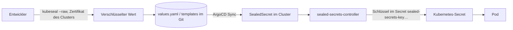

# Sealed Secrets — verschlüsselte Secrets im Git

Der Sealed-Secrets-Controller entschlüsselt `SealedSecret`-Objekte aus Git zu normalen Kubernetes-Secrets. So liegen alle Zugangsdaten verschlüsselt im Repo, und nur der Cluster kann sie lesen. Jeder Cluster hat einen eigenen Schlüssel.

> **Cluster:** TECH, PROD und ENTW (je ein eigener Controller) · Ordner `argocd/apps/{tech,prod,entw}/sealed-secrets/` · Namespace `sealed-secrets` · Deployment `sealed-secrets-controller`. `kubectl`-Befehle in diesem Doc gelten für den jeweiligen Cluster ([Zugriff je Cluster](../../capulus-ansible/a-betriebssystem/a0010-overview.md#kubectl-zugriff-je-cluster)).

---

## Architektur



| Objekt | Zweck |
|---|---|
| Chart `sealed-secrets` (Subchart `sealed-secrets` 2.20.0 von `bitnami.github.io/sealed-secrets`) | installiert den Controller, `fullnameOverride: sealed-secrets-controller` |
| Secret `sealed-secrets-key<suffix>` im Namespace `sealed-secrets`, Label `sealedsecrets.bitnami.com/sealed-secrets-key=active` | privater Schlüssel (und Zertifikat) des Controllers. Alte Schlüssel bleiben erhalten |
| `SealedSecret` in einem Chart-Template oder per Helm-Wert | verschlüsselte Daten, Entschlüsselung nur für Namespace und Name, für die versiegelt wurde (strikter Scope) |

Die Controller-Version steht in `values.yaml` unter `sealed-secrets.image.tag` und kann je Cluster abweichen (Stand der Prüfung: TECH und PROD `0.40.0` bzw. `0.39.1`, ENTW `0.39.1`). Der Controller läuft mit `readOnlyRootFilesystem`, `runAsNonRoot` (UID 1001) und ohne Linux-Capabilities, mit Limits 150m CPU und 256 MiB.

Die Rotation des Schlüssels und die Rolle im Secret-Betrieb: [Secrets-Rotation](../d-sicherheit/d0060-secrets-rotation.md). Aufbau von ArgoCD und Bootstrap: [60030](../6-hintergruende/60030-argocd-und-bootstrap.md).

---

## Secrets versiegeln

Der übliche Weg ist `kubeseal --raw` mit dem Controller als Ziel (der Controller muss dazu erreichbar sein, der `kubectl`-Kontext auf den Ziel-Cluster zeigen):

```bash
printf '%s' "$WERT" | kubeseal --raw --namespace <ns> --name <secret> \
  --controller-namespace sealed-secrets --controller-name sealed-secrets-controller \
  --from-file=/dev/stdin
```

Ohne Cluster-Zugriff genügt das Zertifikat:

```bash
kubeseal --fetch-cert --controller-name sealed-secrets-controller --controller-namespace sealed-secrets > cert.pem
printf '%s' "$WERT" | kubeseal --raw --cert cert.pem --namespace <ns> --name <secret> --from-file=/dev/stdin
```

Alternative per Weboberfläche: [kubeseal-webgui](../3-apps-workloads/300o0-kubeseal-webgui.md). Hilfsskripte für wiederkehrende Fälle (`seal-*.sh`, `reseal-for-prod.sh`): [f00c0](../f-cicd-automatisierung/f00c0-skripte-und-workflows-referenz.md#skripte-zum-versiegeln-und-für-tokens). Jeden neuen Wert trägt man zusätzlich im [Token-Register](https://github.com/pkr-lab/capulus-core/blob/main/ops/token-register.yaml) ein (Prüfung in der CI, siehe [f0070](../f-cicd-automatisierung/f0070-ci-lint.md)).

Wichtig:

- **Name und Namespace sind Teil der Verschlüsselung.** Wer ein Secret in einen anderen Namespace oder unter anderem Namen verwendet, bekommt es nicht entschlüsselt.
- Ein SealedSecret ist an **einen Cluster** gebunden. Für PROD muss man mit dessen Zertifikat versiegeln (`scripts/reseal-for-prod.sh`).
- Der Klartext verlässt den Rechner nie, versiegelt wird per Pipe, nicht über eine Datei im Repo.

---

## Schlüssel sichern und wiederherstellen

Der Controller erzeugt standardmäßig alle 30 Tage einen neuen aktiven Schlüssel. Alte Schlüssel bleiben im Namespace, weil bereits versiegelte Secrets sie brauchen. Geht der Namespace (oder der Cluster) verloren, sind alle SealedSecrets des Clusters nicht mehr entschlüsselbar. Deshalb gehört eine Sicherung der Schlüssel an einen Ort außerhalb des Clusters ([d0060](../d-sicherheit/d0060-secrets-rotation.md), Vorfall mit Wiederherstellung: [50010](../5-incidents/50010-prod-vm-basis-image-ersetzt.md)).

```bash
kubectl -n sealed-secrets get secret -l sealedsecrets.bitnami.com/sealed-secrets-key -o yaml > sealed-secrets-keys.yaml   # sicher ablegen, enthält private Schlüssel
```

Wiederherstellung auf einem neuen Cluster: Secrets aus der Sicherung anwenden, bevor der Controller startet, oder Controller neu starten (`kubectl -n sealed-secrets rollout restart deployment/sealed-secrets-controller`).

---

## Konfiguration

| Schlüssel (`values.yaml`, unter `sealed-secrets:`) | Wert | Bedeutung |
|---|---|---|
| `fullnameOverride` | `sealed-secrets-controller` | Name, den `kubeseal` und die Skripte erwarten |
| `image.tag` | siehe oben | Controller-Version (von Renovate gepflegt) |
| `resources` | 150m/256Mi Limit, 50m/128Mi Request | Ressourcen |
| `rbac.clusterRole` | `true` | Controller darf Secrets in allen Namespaces anlegen |
| `containerSecurityContext` | read-only, nicht root, ohne Capabilities | Härtung |

---

## Fehlersuche

```bash
kubectl -n sealed-secrets get pods
kubectl -n sealed-secrets logs deploy/sealed-secrets-controller --tail=100
kubectl get sealedsecret -A
kubectl -n <ns> describe sealedsecret <name>
```

| Symptom | Ursache | Lösung |
|---|---|---|
| Secret fehlt, Pod `CreateContainerConfigError` | `SealedSecret` konnte nicht entschlüsselt werden | `kubectl -n <ns> describe sealedsecret <name>`, Events lesen, Controller-Log prüfen |
| Event `no key could decrypt secret (<feld>)` | falscher Cluster (zum Beispiel TECH-Wert in PROD), anderer Name oder Namespace | mit dem Zertifikat des Ziel-Clusters und mit exakt dem Secret-Namen und -Namespace neu versiegeln (`reseal-for-prod.sh` für PROD) |
| Event `Failed to unseal: …` / `decryption error` | Schlüssel nicht mehr im Cluster (Neuaufbau) | Schlüssel aus der Sicherung wiederherstellen, sonst neu versiegeln |
| `kubeseal` meldet `cannot fetch certificate` | falscher Kontext, Controller nicht erreichbar oder falsche Namen | `--controller-name sealed-secrets-controller --controller-namespace sealed-secrets` setzen, `kubectl config current-context` prüfen |
| `kubeseal`-Version passt nicht zum Controller | zu alte oder zu neue CLI | CLI auf die Controller-Version bringen |
| `SealedSecret` wird nach dem Sync nicht zum Secret | ArgoCD zeigt `OutOfSync` oder `Degraded`, Namespace nicht im AppProject | [AppProjects](b0020-argocd-projects.md), [ArgoCD](b0010-argocd.md) |
| Secret existiert schon ohne `SealedSecret` als Besitzer | Controller überschreibt fremde Secrets nicht | altes Secret löschen oder Annotation `sealedsecrets.bitnami.com/managed: "true"` setzen |
| CI meldet `SealedSecret ohne Register-Eintrag` | neues Secret nicht im Token-Register | Eintrag ergänzen ([f00c0](../f-cicd-automatisierung/f00c0-skripte-und-workflows-referenz.md#token-register)) |
| Controller-Pod startet nicht | Ressourcen, Image-Pull | `kubectl -n sealed-secrets describe pod` |

Allgemeine Fehlersuche: [zentrale Fehlersuche](../2-betrieb-hardware/20070-troubleshooting-zentral.md).
