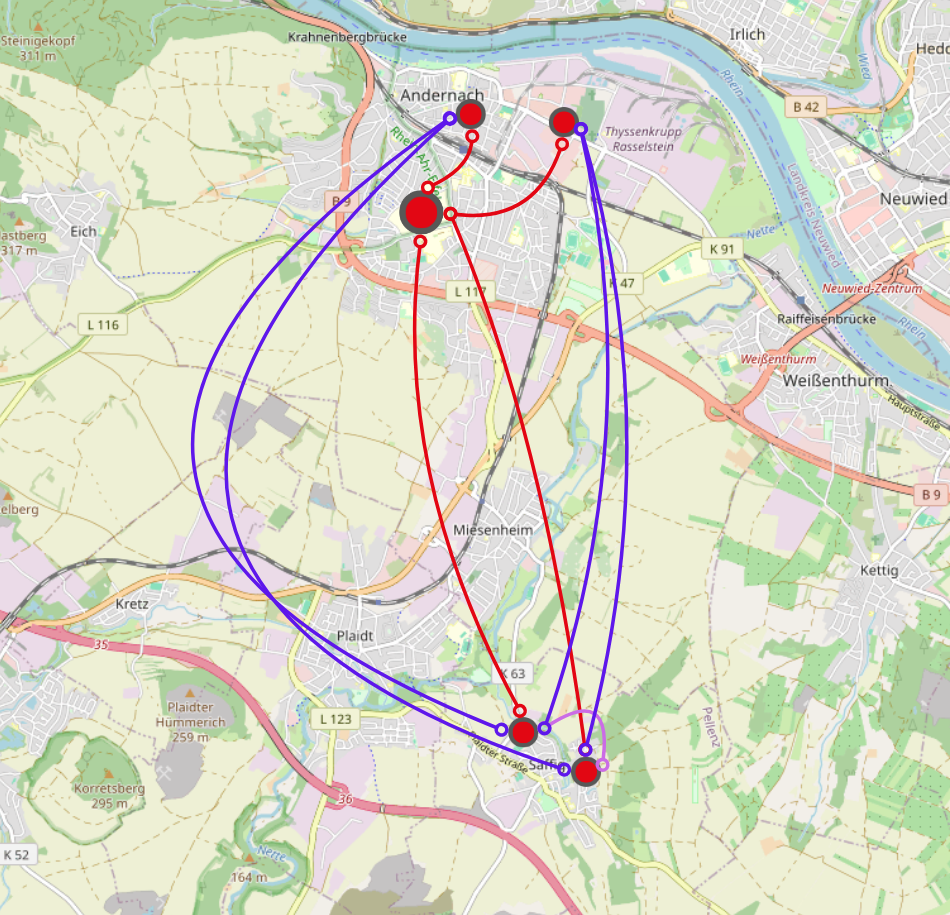
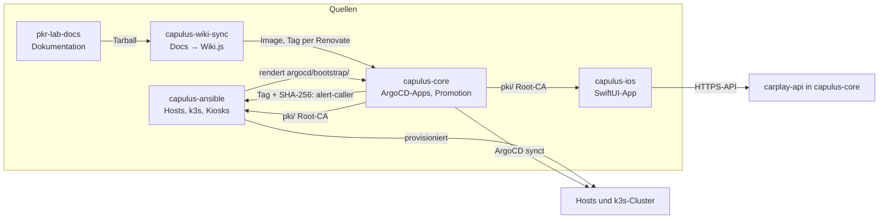

<p align="center">
  
</p>

<p align="center">
  <a href="https://ubuntu.com/server"></a>&nbsp;
  <a href="https://k3s.io"></a>&nbsp;
  <a href="https://argo-cd.readthedocs.io"></a>&nbsp;
  <a href="https://tailscale.com"></a>&nbsp;
  <a href="https://www.cloudflare.com/products/tunnel/"></a>&nbsp;
  <a href="https://www.ansible.com"></a>
</p>

<p align="center">
  &nbsp;
  &nbsp;
  &nbsp;
  
</p>

<br/>

<p align="center">
  <strong>Vollständig automatisierter, GitOps-getriebener Home-Server mit drei getrennten Clustern.</strong><br/>
  Ansible liefert gehärtete Ubuntu-Hosts, drei schlanke Kubernetes-Cluster (<a href="https://k3s.io">k3s</a>: <b>TECH</b>, <b>PROD</b>, <b>ENTW</b>), Continuous Delivery aus Git (<a href="https://argo-cd.readthedocs.io">ArgoCD</a>) und Zero-Config-Remote-Access (<a href="https://tailscale.com">Tailscale</a>). Neue Versionen laufen erst auf ENTW und wandern nach bestandenem Gesundheits-Gate automatisch als PR nach TECH und PROD.
</p>

<br/>

---

## Zweck

capulus-core ist das GitOps-Repository des Capulus-Homelabs: Es enthält alle ArgoCD-Applications (Helm-Charts und Manifeste) für die Cluster TECH, PROD und ENTW, die Bootstrap-Konfiguration von ArgoCD, die Promotion-Kette ENTW → TECH → PROD, das Token-Register und die Hilfsskripte (Versiegeln, Promotion, Checks). Ein Merge nach `main` rollt auf TECH und PROD aus.

Die Hosts und Cluster selbst provisioniert [capulus-ansible](../capulus-ansible/index.md), die iOS-App liegt in [capulus-ios](../capulus-ios/index.md). Beide Repos werden von capulus-core aus nur über Tags und veröffentlichte Dateien referenziert, nie über relative Pfade.

---

## Was du bekommst

<table>
<thead>
<tr>
<th>Schicht</th>
<th>Komponente</th>
<th>Hinweis</th>
</tr>
</thead>
<tbody>
<tr><td>Betriebssystem</td><td><strong>Ubuntu Server 26.04 LTS</strong></td><td>Gehärtet, UFW-Firewall, CrowdSec, NTP-synced, Swap off</td></tr>
<tr><td>Kubernetes</td><td><strong>k3s</strong> (Kanal <code>stable</code>)</td><td><b>Drei Cluster</b>: TECH (bare metal), PROD und ENTW (KVM-VMs); Traefik, CoreDNS, local-path, metrics-server</td></tr>
<tr><td>Virtualisierung</td><td><strong>KVM/libvirt</strong></td><td>PROD-VM auf dem Homeserver, ENTW-VM auf worker-1, Bridge-Netz direkt im LAN</td></tr>
<tr><td>GitOps</td><td><strong>ArgoCD</strong> + ApplicationSets</td><td>Ein Hub für TECH + PROD, eine eigene Instanz für ENTW. Ordner unter <code>argocd/apps/&lt;cluster&gt;/</code> anlegen → mergen → deployed</td></tr>
<tr><td>Promotion</td><td><strong>GitHub Actions</strong></td><td>Version läuft erst auf ENTW (24 h), dann TECH (2 h), dann PROD — jeweils als PR mit Gesundheits-Gate</td></tr>
<tr><td>Identität</td><td><strong>lldap</strong></td><td>Nutzer im LDAP-Verzeichnis</td></tr>
<tr><td>Split-DNS</td><td><strong>dnsmasq</strong> auf <code>tailscale0</code></td><td><code>*.homeserver</code> aus LAN und Tailnet auflösbar, verteilt auf TECH, PROD und ENTW</td></tr>
<tr><td>Werbeblocking</td><td><strong>Pi-hole</strong></td><td>Filtert DNS-Anfragen für alle Geräte, die dnsmasq bereits als DNS nutzen — kein Router-Eingriff nötig</td></tr>
<tr><td>Web-Ansible</td><td><strong>Semaphore UI</strong></td><td>Ein-Klick-<code>git pull &amp;&amp; ansible-playbook</code> gegen das eigene LAN</td></tr>
<tr><td>Monitoring &amp; Logs</td><td><strong>VictoriaMetrics + Grafana + VictoriaLogs</strong></td><td>Single-Node TSDB, vmagent, vmalert, Alertmanager, Hardware-Dashboards, zentrale Logs</td></tr>
<tr><td>Kubernetes-UI</td><td><strong>Headlamp</strong></td><td>Browser-Dashboard für den TECH-Cluster</td></tr>
<tr><td>Secrets</td><td><strong>Sealed Secrets + kubeseal-webgui</strong></td><td>Verschlüsselte Secrets in Git, je Cluster nur dort entschlüsselbar</td></tr>
<tr><td>Internes TLS</td><td><strong>cert-manager</strong></td><td>Eigene Root-CA, HTTPS auf <code>*.tech</code>/<code>*.prod.homeserver</code></td></tr>
<tr><td>Notifications</td><td><strong>ntfy</strong></td><td>Self-hosted Push — ntfy (iOS + Android)</td></tr>
<tr><td>Live-Streaming</td><td><strong>MediaMTX</strong></td><td>RTMP/RTSP-Ingest → HLS-Playback; Publish/Zuschauer per interner mediamtx-Auth (Nutzername/Passwort)</td></tr>
<tr><td>Speicher</td><td><strong>UGREEN NAS (NFS)</strong></td><td>RAID1, StorageClasses <code>nas</code> und <code>immich-nas</code> für alle Cluster, restic-Backup auf USB-Platte</td></tr>
<tr><td>Remote-Access</td><td><strong>Tailscale</strong></td><td>WireGuard-Mesh-VPN — keine Portfreigaben, keine öffentliche IP</td></tr>
<tr><td>Externe Erreichbarkeit</td><td><strong>Cloudflare Tunnel</strong></td><td>Je Cluster ein Tunnel: ausgewählte Dienste öffentlich erreichbar, ohne VPN und ohne offene Ports</td></tr>
<tr><td>CI/CD intern</td><td><strong>Argo Workflows + MinIO</strong></td><td>Private CI/CD-Pipeline + S3-Artifact-Store im Cluster</td></tr>
<tr><td>Ingress</td><td><strong>Traefik</strong> (k3s bundled)</td><td>HTTP/HTTPS-Routing, je Cluster eine eigene Instanz</td></tr>
<tr><td>Provisioning</td><td><strong>Ansible</strong> (≥ 2.14)</td><td>Vollständig idempotent, Role-per-Concern, Vault für Secrets</td></tr>
</tbody>
</table>

> **Ziel-Hardware (nur TECH):** kleine Box mit ≥ 4 GB RAM und ≥ 20 GB Disk.
> **Referenz-Build:** HP ProBook 450 G9 (12 vCPU, ~61 GB RAM) als 24/7-Homeserver und Hypervisor, zwei per Wake-on-LAN
> geweckte Worker (Lenovo M90q, MSI Tower), ein UGREEN NAS. Die Größen der VMs stehen unter [Drei Cluster](#drei-cluster).

<details>
<summary><strong>Auto-Upgrade-Details</strong></summary>

`auto_upgrade: true` (Default) hält bei jedem Playbook-Run den gesamten Stack aktuell:

| Komponente | Mechanismus |
|---|---|
| **APT-Pakete** | `apt dist-upgrade` + `unattended-upgrades` für tägliche Sicherheits-Patches |
| **Tailscale** | `state: latest` für das `tailscale`-Paket |
| **k3s** | Folgt `k3s_channel` (Default `stable`), pin via `k3s_version` |
| **Helm** | Re-Run des offiziellen Installers bei neuem Release |
| **ArgoCD** | `helm upgrade --install` ohne `--version`, pin via `argocd_version` |
| **Reboot** | Auto-Reboot wenn APT `/var/run/reboot-required` setzt (togglebar via `auto_reboot_if_required`) |

Für reproduzierbare Builds: `auto_upgrade: false` in `ansible/group_vars/all.yml`.

</details>

---

## Drei Cluster

<p align="center">
  <br/>
  <sub>Standortübersicht der Cluster-Knoten — wird später um das Standby-HA-Paar mit den Pis erweitert (siehe <a href="4-planung/40090-standby-cluster-ha-paar.md">40090</a>).</sub>
</p>

Der Stack besteht seit September 2026 aus **drei getrennten k3s-Clustern**
([Architektur und Begründung](4-planung/40080-multi-cluster-entw-prod-tech.md),
[Überblick](../capulus-ansible/a-betriebssystem/a0010-overview.md#1-drei-cluster-im-überblick)):

| Cluster | Läuft auf | IP | Für | ArgoCD | Ordner |
|---|---|---|---|---|---|
| **TECH** | `homeserver` (bare metal, 24/7) + Worker `worker-0`/`worker-1` | `192.168.178.94` | Infrastruktur und Betriebsdienste: Identität, Secrets, Monitoring, CI/CD, DNS, Zammad, Vaultwarden, n8n | **Hub**, verwaltet TECH **und** PROD | `argocd/apps/tech/` |
| **PROD** | KVM-VM `prod-vm` auf dem Homeserver (6 vCPU / 24 GiB) | `192.168.178.99` | Apps mit echtem Nutzerkreis: Nextcloud, Immich, Paperless-ngx, Wiki.js, Xibo | — (vom Hub verwaltet) | `argocd/apps/prod/` |
| **ENTW** | KVM-VM `entw-vm` auf `worker-1` (3 vCPU / 12 GiB) | `192.168.178.100` | Entwicklung und Tests, absichtlich verwundbare Trainingsumgebung | eigene, isolierte Instanz (Branch `entw`) | `argocd/apps/entw/` |

```
Branch entw ──► ArgoCD ENTW ──► ENTW-Cluster
                    │  (24 h gesund, Smoke-Checks)
                    ▼
Branch main ──► ArgoCD-Hub ──► TECH-Cluster   (Promotion-PR, Auto-Merge optional)
                    │  (2 h gesund)
                    ▼
                 ArgoCD-Hub ──► PROD-Cluster  (Promotion-PR, du bestätigst)
```

> Ein Hostname wie `n8n.prod.homeserver` sagt nur etwas über das **Tier**, nicht über den Cluster: welcher
> Cluster antwortet, entscheidet das DNS ([c0040](c-netzwerk-dns/c0040-domain-tiers.md#dns-tier-und-cluster-sind-zwei-verschiedene-dinge)).
> `kubectl`-Befehle in den App-Docs gelten für den Cluster, in dem die App läuft
> ([Zugriff je Cluster](../capulus-ansible/a-betriebssystem/a0010-overview.md#kubectl-zugriff-je-cluster)).

Der Aufbau der Cluster steht in [installation.md](installation.md#cluster-aufbauen).

---

## Repository-Landschaft



| Repo | Inhalt | Verbindung zu capulus-core |
|---|---|---|
| [capulus-core](https://github.com/pkr-lab/capulus-core) | ArgoCD-Apps, Bootstrap, Promotion, Skripte, Token-Register, Root-CA unter `pki/` | – |
| [capulus-ansible](https://github.com/pkr-lab/capulus-ansible) | Playbooks und Rollen für Hosts, k3s, Kiosks | rendert `argocd/bootstrap/` (`make render-bootstrap CORE_DIR=…`), lädt alert-caller-Quellen aus einem core-Tag |
| [capulus-ios](https://github.com/pkr-lab/capulus-ios) | SwiftUI-App „Homeserver Dashboard“ | spricht die API von `carplay-api` an, trägt eine Kopie der Root-CA |
| [pkr-lab-docs](https://github.com/pkr-lab/pkr-lab-docs) | diese Dokumentation | – |
| [capulus-wiki-sync](https://github.com/pkr-lab/capulus-wiki-sync) | Code des Wiki-Syncs (Docs → Wiki.js) | läuft als Image im Chart `argocd/apps/prod/wiki-docs-sync`, siehe [wiki-sync](wiki-sync.md) |

---

## Repository-Layout

```
capulus-core/
├── README.md                         # Kurzfassung mit Link zur Doku
├── CLAUDE.md                         # Arbeitsregeln für KI-Assistenten
├── Makefile                          # help, lint
├── renovate.json                     # Renovate-Konfiguration
├── CHANGELOG.md                      # von semantic-release geschrieben
├── .github/
│   ├── dependabot.yml
│   └── workflows/                    # ci, codeql, build-images, release, renovate, promote-*, sync-entw, mirror-gitlab, …
├── pki/                              # homeserver-root-ca.pem
├── ops/token-register.yaml           # Register aller Tokens und Passwörter
├── scripts/                          # promote-chain.py, sync-entw.sh, reseal-for-prod.sh, seal-*.sh, token-watch.py, …
└── argocd/
    ├── promotion.yaml                # Gates und Smoke-Checks der Promotion-Kette
    ├── bootstrap/                    # TECH-Hub (GENERIERT durch capulus-ansible)
    ├── bootstrap-prod/               # PROD im Hub (handgeschrieben)
    ├── pending/                      # vorbereitete, noch nicht ausgerollte Apps
    └── apps/
        ├── tech/                     # Projekt "tech"
        ├── prod/                     # Projekt "prod", vom TECH-Hub synchronisiert
        └── entw/                     # Projekt "entw", ENTW-ArgoCD liest den Branch entw
```

Die Apps je Cluster stehen in [capulus-core/b-kubernetes-gitops/b0020-argocd-projects.md](b-kubernetes-gitops/b0020-argocd-projects.md), die Ansible-Rollen in [capulus-ansible](../capulus-ansible/index.md).

---

## Dokumentation

Alle Docs von capulus-core liegen in diesem Ordner, sortiert in Kategorie-Unterordner; Docs, die vor allem Host-Provisionierung betreffen, liegen unter [capulus-ansible](../capulus-ansible/index.md). Jede
Datei trägt eine 5-stellige Hex-ID (erstes Zeichen = Kategorie) — Details
und Konventionen für neue Docs: **[capulus-core/TEMPLATE.md](TEMPLATE.md)**.
Neu hier? Der beste Einstieg ist der **[Architektur-Überblick](../capulus-ansible/a-betriebssystem/a0010-overview.md)**.

### Betriebssystem & Grundlagen (`a-betriebssystem/`)

| Dokument | Inhalt |
|---|---|
| [Ubuntu-Server-Installation](../capulus-ansible/a-betriebssystem/a0000-ubuntu-server-install.md) | ISO, USB-Stick, Installer, erster Boot |
| [Architektur-Überblick](../capulus-ansible/a-betriebssystem/a0010-overview.md) | Drei Cluster, Schichten, Traffic-Flows, App-Matrix, Ansible-Rollen |
| [Voraussetzungen](../capulus-ansible/a-betriebssystem/a0020-prerequisites.md) | Was vor dem Ansible-Run nötig ist |
| [Installationsleitfaden](../capulus-ansible/a-betriebssystem/a0030-installation.md) | Vollständiger Step-by-Step-Walkthrough |
| [Troubleshooting](../capulus-ansible/a-betriebssystem/a0040-troubleshooting.md) | Diagnose-Playbook für häufige Probleme |

### Kubernetes & GitOps (`b-kubernetes-gitops/`)

| Dokument | Inhalt |
|---|---|
| [k3s-Referenz](b-kubernetes-gitops/b0000-k3s.md) | Config, kubectl-Cheatsheet, Upgrades |
| [ArgoCD-GitOps](b-kubernetes-gitops/b0010-argocd.md) | Hub und ENTW-Instanz, App-Workflow je Cluster, CLI, Sync-Policies |
| [ArgoCD-Projects](b-kubernetes-gitops/b0020-argocd-projects.md) | Ein Projekt je Cluster (`tech`/`prod`/`entw`), ApplicationSets, neue App hinzufügen |
| [Semaphore-UI](../capulus-ansible/b-kubernetes-gitops/b0030-semaphore.md) | Web-UI zum Ausführen von Playbooks |
| [Autoskalierung (HPA)](b-kubernetes-gitops/b0040-hpa-autoscaling.md) | Welche Apps per HorizontalPodAutoscaler mitskalieren, welche bewusst nicht, und mit welchen Schwellenwerten |
| [ENTW-ArgoCD](b-kubernetes-gitops/b0050-entw-argocd.md) | Eigene ArgoCD-Instanz für ENTW, liest nur `argocd/apps/entw/`; neue App deployen, Rollout, Zugriff |
| [MetalLB](b-kubernetes-gitops/b0060-metallb.md) | LoadBalancer-Adresse `192.168.178.200` für Traefik: von Hand installiert, Ist-Zustand, Neuaufbau, Auffälligkeiten |
| [Sealed Secrets](b-kubernetes-gitops/b0070-sealed-secrets.md) | Controller, Secrets versiegeln, Schlüssel sichern, Fehlersuche |
| [Traefik-Konfiguration](b-kubernetes-gitops/b0080-traefik-config.md) | HTTP→HTTPS-Weiterleitung, Metriken, Standard-Zertifikat (`TLSStore`) |
| [Beispiel-Apps](b-kubernetes-gitops/b0090-beispiel-apps.md) | `demo-app` (Self-Heal-Demo) und `example-whoami` auf ENTW und PROD |

### Netzwerk & DNS (`c-netzwerk-dns/`)

| Dokument | Inhalt |
|---|---|
| [DNS-Architektur](c-netzwerk-dns/c0000-dns-architecture.md) | Warum der Home-Server NICHT dein LAN-DNS ist |
| [Tailscale-VPN](c-netzwerk-dns/c0010-tailscale.md) | Auth-Keys, MagicDNS, Subnet-Routes |
| [WireGuard-Backup](c-netzwerk-dns/c0011-wireguard-backup.md) | Notfall-Tunnel für den Fall, dass die Tailscale-Control-Plane ausfällt |
| [Pi-hole](c-netzwerk-dns/c0020-pihole.md) | Netzwerkweites Werbeblocking als DNS-Filter vor der Fritz!Box — kein Router-Eingriff nötig |
| [Port-Übersicht](c-netzwerk-dns/c0030-port-uebersicht.md) | Interner Service-Port, LAN- und externe Erreichbarkeit für jede App |
| [Domain-Tiers](c-netzwerk-dns/c0040-domain-tiers.md) | dev/tech/prod-URL-Konvention (`app.tier.homeserver`), Tier vs. Cluster im DNS, externe Hosts, Cross-App-Referenzen |
| [CoreDNS-Erweiterung](c-netzwerk-dns/c0050-coredns-custom.md) | `*.homeserver` im Cluster auflösen: Weiterleitung an dnsmasq |

### Sicherheit (`d-sicherheit/`)

| Dokument | Inhalt |
|---|---|
| [Incident-Report 12.08.2026](d-sicherheit/d0000-incident-2026-08-12.md) | Postmortem: ApplicationSet-Migration löschte versehentlich 32 Apps, Ursache + Gegenmaßnahmen |
| [Security-Härtung — Roadmap](d-sicherheit/d0010-security-hardening-roadmap.md) | Phasenplan der Security-Härtung nach dem Incident vom 12.08.2026 |
| [CrowdSec](../capulus-ansible/d-sicherheit/d0020-crowdsec.md) | Brute-Force-Schutz für SSH und Traefik, Firewall-Bouncer, Whitelist für LAN/Tailnet |
| [Cluster-NetworkPolicies](d-sicherheit/d0030-network-policies.md) | NetworkPolicies je Namespace, Default-Deny + explizite Ausnahmen (Härtung Phase 3) |
| [Internes TLS](d-sicherheit/d0040-internal-tls.md) | cert-manager + eigene CA für HTTPS auf `*.homeserver`, PROD mit eigener Intermediate-CA (Härtung Phase 5) |
| [Secrets-Encryption + Audit-Log](../capulus-ansible/d-sicherheit/d0050-secrets-encryption-audit-log.md) | k3s Secrets-at-Rest-Verschlüsselung + API-Audit-Log (Härtung Phase 4) |
| [Secrets-Rotation-Checkliste](d-sicherheit/d0060-secrets-rotation.md) | Checkliste zur regelmäßigen Rotation aller Cluster-Secrets (Härtung Phase 7) |
| [lldap](d-sicherheit/d0072-lldap.md) | Nutzer- und Gruppenverwaltung (LDAP) |
| [CodeQL, Dependabot, Security-Issues](d-sicherheit/d0080-codeql-dependabot.md) | Code-Scanning, Fix-PRs für verwundbare Abhängigkeiten, automatische Security-Issues, Vergleich mit Open-Source-Alternativen (Härtung Phase 10) |

### Externe Erreichbarkeit (`e-externe-erreichbarkeit/`)

| Dokument | Inhalt |
|---|---|
| [Cloudflare Tunnel — Setup](e-externe-erreichbarkeit/e0000-cloudflare-tunnel.md) | Externe Erreichbarkeit ohne VPN: Konzept, zwei Tunnel (TECH/PROD), Tunnel-Einrichtung, Absicherung |
| [Cloudflare Tunnel — Deploy](e-externe-erreichbarkeit/e0010-cloudflare-deploy.md) | Rollout, neuen Dienst freigeben, Rotation, Troubleshooting |

### CI/CD & Automatisierung (`f-cicd-automatisierung/`)

| Dokument | Inhalt |
|---|---|
| [Argo Workflows](f-cicd-automatisierung/f0000-argo-workflows.md) | Private CI/CD-Pipeline mit MinIO-Artifact-Store |
| [Renovate](f-cicd-automatisierung/f0020-renovate.md) | Automatische Update-PRs für Helm-Chart-Versionen und Image-Tags (Sicherheits-PRs kommen von Dependabot) |
| [Release-Automatisierung](f-cicd-automatisierung/f0030-release-automation.md) | GitHub Release + Changelog bei jedem Merge auf `main` via semantic-release |
| [GitHub Release Watcher](f-cicd-automatisierung/f0040-github-release-watcher.md) | Neue GitHub-Releases erkennen und per Zammad-Ticket eine E-Mail-Benachrichtigung auslösen |
| [GitLab-Mirror](f-cicd-automatisierung/f0050-gitlab-mirror.md) | Vollspiegelung (alle Branches + Tags) zu GitLab als Redundanz für den Fall eines GitHub-Ausfalls |
| [Workload-Images bauen](f-cicd-automatisierung/f0060-build-images.md) | Eigene Workload-Images per GitHub Actions nach GHCR bauen (auf PRs als Probebuild) |
| [CI-Pflicht-Gate](f-cicd-automatisierung/f0070-ci-lint.md) | `make lint`, kubeconform (Charts, Manifeste, Bootstrap), Go-Check und gitleaks auf jedem PR |
| [ENTW → main Promotion](f-cicd-automatisierung/f0080-entw-promotion.md) | Neue `entw`-Commits nach grüner CI als PR an `main`, `main` → `entw` per Sync-Workflow, Rulesets |
| [Branch-Schutz `main`](f-cicd-automatisierung/f0090-branch-schutz-main.md) | Ruleset: `main` nur per Pull Request, vier CI-Jobs als Pflicht-Checks, Admin-Notausgang |
| [Tailscale-Runner-PoC](f-cicd-automatisierung/f00a0-tailscale-runner-poc.md) | Diagnose: GitHub-Runner erreicht Hub- und ENTW-ArgoCD über Tailscale |
| [Promotion-Kette](f-cicd-automatisierung/f00b0-promotion-chain.md) | Versionen ENTW → TECH → PROD als PRs nach bestandenem Gesundheits-Gate (24 h ENTW, 2 h TECH), Smoke-Checks |
| [Skripte und Workflows: Referenz](f-cicd-automatisierung/f00c0-skripte-und-workflows-referenz.md) | alle 20 Skripte und 15 Workflows mit Aufruf, Umgebung, Meldungen und Fehlerbildern |

### Benachrichtigungen (`1-benachrichtigungen/`)

| Dokument | Inhalt |
|---|---|
| [ntfy iOS-Push](1-benachrichtigungen/10010-ntfy.md) | Self-hosted ntfy mit iOS APNs-Relay |
| [Telefon-Alarm](1-benachrichtigungen/10020-telefon-alarm.md) | Anruf mit deutscher Sprachansage bei schweren Ausfällen (SIP über Linphone, baresip, Piper). Läuft als Pod in TECH, eine externe VM (Ansible-Rolle) ist vorbereitet |
| [ntfy-bridge](1-benachrichtigungen/10030-ntfy-bridge.md) | Alertmanager-Webhook → ntfy: Ablauf, Prioritäten, Fehlersuche |

### Betrieb & Hardware (`2-betrieb-hardware/`)

| Dokument | Inhalt |
|---|---|
| [NAS-Storage](2-betrieb-hardware/20000-nas-storage.md) | NFS-StorageClass gegen die UGREEN NAS (RAID1), Migration einzelner Apps von local-path |
| [NAS-Backup](2-betrieb-hardware/20010-nas-backup.md) | Externe USB-Platte am NAS: regelmäßige restic-Backups von volume1 + volume2 |
| [Cluster Power Manager](../capulus-ansible/2-betrieb-hardware/20020-cluster-power-manager.md) | worker-0/worker-1 per Wake-on-LAN je nach Homeserver-Last automatisch dazu- und wieder abschalten |
| [Nightly Worker Update](../capulus-ansible/2-betrieb-hardware/20030-nightly-worker-update.md) | worker-0/worker-1 nachts um 01:00 Uhr per Wake-on-LAN wecken, apt-Update fahren (max. 20 Min.), wieder herunterfahren |
| [Drucker (CUPS)](../capulus-ansible/2-betrieb-hardware/20040-printer.md) | Samsung Xpress M2026 per USB am Homeserver, Freigabe im Heimnetz + Tailnet via IPP/AirPrint |
| [GitOps- und Backup-Alerts](2-betrieb-hardware/20050-gitops-und-backup-alerts.md) | Alerts auf ArgoCD-Gesundheit (Degraded, OutOfSync, hängender Sync) und auf CronJobs/Backups ohne Erfolg der letzten 30–36 h |
| [Hardware-Monitoring](../capulus-ansible/2-betrieb-hardware/20060-hardware-monitoring.md) | Grafana-Ordner "Hardware": Waben-Übersicht aller Server/VMs/NAS, Server-Detail (CPU, RAM, Netzwerk, Disk, Temp), Füllstand + S.M.A.R.T. |
| [Zentrale Fehlersuche](2-betrieb-hardware/20070-troubleshooting-zentral.md) | Einstieg für alle Störungen: Symptom → richtige Anleitung, die ersten fünf Minuten, Übersicht aller Fehlersuche-Abschnitte |

### Apps & Workloads (`3-apps-workloads/`)

Die Spalte *Cluster* zeigt, wo die App läuft (Ordner unter `argocd/apps/`).

| Dokument | Cluster | Inhalt |
|---|---|---|
| [Zammad](3-apps-workloads/30000-zammad.md) | TECH | Helpdesk-/Ticket-System, u. a. Ziel für github-release-watcher-Benachrichtigungen |
| [Alarmmonitor-Kiosks](3-apps-workloads/30010-alamos-apager.md) | TECH | Raspberry-Pi-Kiosks für ALAMOS AMweb, zentral verwaltet |
| [Vereinsheim-Alarmmonitor](../capulus-ansible/3-apps-workloads/30020-vereinsheim-alarmmonitor.md) | TECH | Banana-Pi-Kiosk fürs Vereinsheim, Alarmstatus-Anzeige + Heartbeat-Monitoring |
| [Vereinsheim-Windows-PC](3-apps-workloads/30021-vereinsheim-windows-pc-steuerung.md) | — | Windows-PC am Standort: Online-Check und Herunterfahren |
| [Wiki.js](3-apps-workloads/30030-wikijs.md) | PROD | Team-Wiki, die Doku wird per [wiki-docs-sync](wiki-sync.md) automatisch gespiegelt |
| [MediaMTX Live-Streaming](3-apps-workloads/30040-mediamtx.md) | TECH | RTMP/RTSP-Ingest → HLS, Publish- und Zuschauer-Autorisierung über mediamtx' eingebaute interne Benutzerverwaltung (HTTP Basic Auth) |
| [Paperless-ngx](3-apps-workloads/30050-paperless-ngx.md) | PROD | Dokumentenmanagement mit OCR — Briefe, Rechnungen, Verträge scannen und durchsuchen |
| [n8n](3-apps-workloads/30070-n8n.md) | TECH | Low-Code-Automatisierung — Dienste verknüpfen ohne Programmieren |
| [Uptime Kuma](3-apps-workloads/30080-uptime-kuma.md) | TECH | Status-Seite und Alerting für alle Dienste |
| [Rhein-Dashboard](3-apps-workloads/30090-rhein-dashboard.md) | TECH | Grafana: Pegelonline, DWD-Warnungen, ELWIS, Hochwasservorhersage RLP |
| [Vaultwarden](3-apps-workloads/300a0-vaultwarden.md) | TECH | Bitwarden-kompatibler Passwort-Manager für Browser/Mobile-Clients |
| [Nextcloud](3-apps-workloads/300b0-nextcloud.md) | PROD | Datei-Sync, Kalender, Kontakte |
| [Immich](3-apps-workloads/300c0-immich.md) | PROD | Foto-/Video-Backup vom Handy inkl. Gesichtserkennung, eigener NAS-Storage-Export |
| [Homeserver-Dashboard-API](3-apps-workloads/300d0-carplay-api.md) | TECH | Go/Gin-API + power-agent für die reine iOS-App Homeserver Dashboard (Metriken, Alerts, Status, Helligkeit, Wake/Shutdown) |
| [xibosignage](3-apps-workloads/300e0-xibosignage.md) | PROD | Xibo CMS + Bilder-Slideshow auf Raspberry Pi 3B+, n8n-Workflow für automatisches Einspielen |
| [Infotafel-Kiosk](../capulus-ansible/3-apps-workloads/300e8-infotafel-kiosk.md) | — | Raspberry-Pi-3-B+-Kiosk der Infotafel: Startablauf, Mauszeiger, lokaler Bilder-Cache |
| [pacman — Besuchertracking](3-apps-workloads/300f0-pacman-visitor-tracking.md) | TECH | IP/GeoIP-Besucher-Tracking-Demo für die IT-Security-Schulung |
| [Ollama](3-apps-workloads/300g0-ollama.md) | TECH | Lokales LLM, nur bei Bedarf hochgefahren (vom n8n-Workflow gesteuert) |
| [ALAMOS-Einsatzalarm → Zammad](3-apps-workloads/300h0-alamos-einsatz-zammad.md) | TECH | n8n-Workflow: Einsatzalarm wird zum Zammad-Ticket |
| [ALAMOS-Webhook-Relay](3-apps-workloads/300i0-alamos-relay.md) | TECH | Öffentlicher Mini-Proxy vor n8n, damit ALAMOS den Einsatzalarm-Webhook erreicht, ohne n8n selbst öffentlich zu machen |
| [ISC-News-Bot](3-apps-workloads/300k0-isc-news-bot.md) | TECH | News im DLRG ISC per API anlegen (Playwright-RPA), aufgerufen aus n8n, cluster-intern |
| [Instagram-Post per Mail](3-apps-workloads/300l0-instagram-post-per-mail.md) | TECH | n8n-Workflow: Mail mit JSON und Bildern wird zum Instagram-Beitrag (Graph API), Bilder kurz über einen einzelnen öffentlichen Pfad für Meta |
| [ISC-Urkunden melden](3-apps-workloads/300m0-isc-urkunden-melden.md) | TECH | n8n-Workflow + ISC-News-Bot: donnerstags 17:30–20:00 neue Seepferdchen-, Schwimmabzeichen- und Juniorretter-Urkunden per Mail |
| [Zentrales Logging](3-apps-workloads/300j0-logging.md) | TECH | VictoriaLogs: journald aller Hosts und Pod-Logs an einem Ort |
| [Headlamp](3-apps-workloads/300n0-headlamp.md) | TECH | Kubernetes-Dashboard im Browser, Anmeldung mit kurzlebigem Lese-Token |
| [kubeseal-webgui](3-apps-workloads/300o0-kubeseal-webgui.md) | TECH | Secrets im Browser versiegeln (Zertifikat des TECH-Controllers) |
| [MinIO](3-apps-workloads/300p0-minio.md) | TECH | S3-Speicher für Argo Workflows (Bucket `argo-artifacts`) |
| [Monitoring](3-apps-workloads/300q0-monitoring.md) | TECH | VictoriaMetrics, Grafana, Alertmanager, Regeln, Fehlersuche |
| [MDM für iPads](3-apps-workloads/300r0-mdm.md) | TECH | Eigener Apple-MDM-Server (NanoMDM, NanoDEP, SCEP) mit n8n-Automatisierung: Überblick, [Installation](3-apps-workloads/300s0-mdm-installation.md), [Apple-Setup](3-apps-workloads/300t0-mdm-apple-setup.md), [Automatisierung](3-apps-workloads/300u0-mdm-automatisierung.md), [Betrieb](3-apps-workloads/300v0-mdm-betrieb.md), [Sicherheit](3-apps-workloads/300w0-mdm-sicherheit.md) |

### Planung (`4-planung/`)

Pläne und Analysen. Ein Doc trägt in seiner Statuszeile, wie weit es umgesetzt ist.

| Dokument | Inhalt |
|---|---|
| [Authelia-SSO](4-planung/40000-authelia-sso.md) | Ursprünglicher SSO-Plan mit Authelia, wieder abgelöst |
| [Öffentliches Teilen ohne Gast-Accounts](4-planung/40010-oeffentliches-teilen-ohne-authelia.md) | Immich/Nextcloud: Teilen von Inhalten ohne Gast-Accounts |
| [Vereinsheim WoL + Router-VPN](4-planung/40020-vereinsheim-wol-router-vpn.md) | Wake-on-LAN am Standort Vereinsheim, Router-VPN als Fallback |
| [GitLab + Proxmox — Prüfung](4-planung/40030-gitlab-hosting-proxmox-pruefung.md) | Analyse: GitLab self-hosted und Proxmox als Hypervisor |
| [Zammad-Kalender → Nextcloud](4-planung/40040-zammad-kalender-n8n-nextcloud-ios-sync.md) | Kalendereinladung aus Zammad über n8n nach Nextcloud und iOS |
| [GitHub-Repos versionieren](4-planung/40050-github-repos-versionierung.md) | Versionierung für alle GitHub-Repos |
| [Einsatz-Alarm per E-Mail](4-planung/40060-alamos-einsatz-email-benachrichtigung.md) | E-Mail mit den wichtigsten Einsatzdaten |
| [Multi-Cluster ENTW/PROD/TECH](4-planung/40080-multi-cluster-entw-prod-tech.md) | Architektur und Umsetzungsplan der Drei-Cluster-Umstellung, Phasen und offene Punkte |

### Incidents (`5-incidents/`)

| Dokument | Inhalt |
|---|---|
| [NAS-Platte rot, homeserver unerreichbar](5-incidents/50000-nas-disk-red-homeserver-unreachable.md) | Vorfall vom 02.09.2026: Hypothese und Prüfschritte |
| [PROD-VM startet nicht mehr, Basis-Image ausgetauscht](5-incidents/50010-prod-vm-basis-image-ersetzt.md) | Vorfall vom 23.09.2026: Ursache, Behebung und Lehren |
| [Pi-hole-Update legt DNS und Tunnel lahm](5-incidents/50020-pihole-update-dns-deadlock.md) | Vorfall vom 05.10.2026: DNS-Deadlock beim Image-Pull, Notfall-Ablauf und Umstellung auf RollingUpdate |
| [Infotafel: altes Bildformat, keine neuen Bilder, Slides zu schnell übersprungen](5-incidents/50030-infotafel-altes-bildformat-und-nas-sync.md) | Vorfall vom 22.10.2026: fehlendes EDID, Tailscale-Routing zum NAS, Race Condition beim Bilder-Sync |

### Hintergründe (`6-hintergruende/`)

Warum der Code so gebaut ist: Begründungen, Fallstricke und Vorfall-Regeln. Der Code selbst enthält keine Kommentare, was früher daneben stand, steht hier.
Einstieg und Zuordnung von Dateien zu Docs: **[capulus-core/6-hintergruende/60000-uebersicht.md](6-hintergruende/60000-uebersicht.md)**.

| Dokument | Inhalt |
|---|---|
| [Ansible: Hosts, VMs und Playbooks](6-hintergruende/60010-ansible-hosts-und-playbooks.md) | ENTW-/PROD-VM, `libvirt_host` (Bridge, dnsmasq-Snippet, Basis-Image), DNS der VMs, Worker-Playbooks, WireGuard-Notzugang |
| [Ansible: Rollen](../capulus-ansible/6-hintergruende/60020-ansible-rollen.md) | Kiosk-Geräte, Energie-Rollen, Watchdogs, vmagent, `journal_upload`, Semaphore-Rollen |
| [ArgoCD, Bootstrap und SealedSecrets](6-hintergruende/60030-argocd-und-bootstrap.md) | Bootstrap-Dateien, `ignoreDifferences`, PROD im Hub, Migrationen, Promotion-Konfiguration, Fallstricke beim Versiegeln |
| [Helm-Charts im TECH-Cluster](6-hintergruende/60040-helm-charts-tech.md) | Gemeinsame Muster, Zertifikate und TLS, Traefik-Metriken, alle TECH-Apps |
| [Helm-Charts im PROD-Cluster](6-hintergruende/60050-helm-charts-prod.md) | PROD-Kopien, Nextcloud, Immich, Wiki.js und wiki-docs-sync, Xibo, Paperless-ngx |
| [Monitoring und Alerting](6-hintergruende/60060-monitoring-und-alerting.md) | Alertmanager-Routing, VMRules, Scrapes und Labels, Grafana-Ordner, Logging |
| [lldap](6-hintergruende/60070-lldap.md) | Chart-Entscheidungen und Secrets |
| [carplay-api und iOS-App](6-hintergruende/60080-carplay-api-und-ios-app.md) | Verträge, Absicherung, Datenquellen, Transport über Tailscale |
| [pacman (Schulungsobjekt)](6-hintergruende/60090-pacman-schulungsobjekt.md) | Server, Bestenliste, Trainingsmodus, Frontend-Skripte |
| [CI-Workflows, Skripte und Lint](6-hintergruende/600a0-ci-workflows-und-skripte.md) | Workflows, Promotions- und Sync-Skripte, Ruleset, Dependabot/Renovate, Lint-Konfiguration |
| [Nachprüfung nach der Repo-Aufspaltung](6-hintergruende/600b0-nachpruefung-repo-aufspaltung.md) | Befunde, Fixes, Testmatrix, Renovate und Rulesets, offene Entscheidungen |
| [capulus-operator](6-hintergruende/600c0-capulus-operator.md) | Entscheidungen, Backup-Controller, Alerts, Chart und CI |
| [MDM](6-hintergruende/600d0-mdm.md) | Cloudflare und Geräte-Authentifizierung, SCEP-Image, Datenbank, NanoMDM-/NanoDEP-Fallstricke, n8n-Workflows |

Komponenten-Seiten (früher Ordner-READMEs): [ENTW-Ordner](komponenten/entw-apps.md) (ENTW-Ordner),
[PROD im Hub](komponenten/bootstrap-prod.md) (PROD im Hub anbinden, Umzug mit Daten),
[pacman](komponenten/pacman.md), [carplay-api](komponenten/carplay-api.md),
[capulus-ios](../capulus-ios/index.md) (iOS-App).

---

<p align="center">
  MIT — siehe <a href="https://github.com/pkr-lab/capulus-core/blob/main/LICENSE">LICENSE</a>
  &nbsp;·&nbsp;
  Made with ☕ &amp; GitOps
</p>


## Fehlersuche

Einstieg bei Störungen: **[Zentrale Fehlersuche](2-betrieb-hardware/20070-troubleshooting-zentral.md)**. Jede App und jede Komponente hat in ihrer Doku einen Abschnitt „Fehlersuche“ (Meldungen, Ursachen, Lösungen). Skripte und Workflows: [Referenz](f-cicd-automatisierung/f00c0-skripte-und-workflows-referenz.md).
