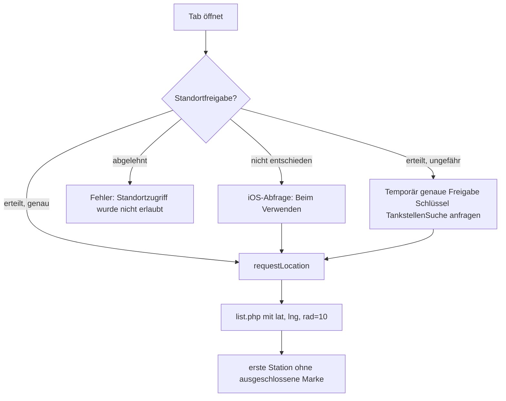

# Alltag-Modus

Der zweite Modus der App („Alltag“ im Segmentschalter oben): Wetter, Rhein-Pegel, Links zu den selbst gehosteten Diensten, Tankstellenpreise und Nachrichten. Der Modus braucht weder `carplay-api` noch den Homeserver. Er nutzt öffentliche APIs direkt vom Gerät.

Code: [AlltagDashboardView.swift](https://github.com/pkr-lab/capulus-ios/blob/main/HomeserverDashboard/Views/AlltagDashboardView.swift), [TankstellenView.swift](https://github.com/pkr-lab/capulus-ios/blob/main/HomeserverDashboard/Views/TankstellenView.swift), [NewsView.swift](https://github.com/pkr-lab/capulus-ios/blob/main/HomeserverDashboard/Views/NewsView.swift), [Services/WeatherAPIClient.swift](https://github.com/pkr-lab/capulus-ios/blob/main/HomeserverDashboard/Services/WeatherAPIClient.swift), [PegelAPIClient.swift](https://github.com/pkr-lab/capulus-ios/blob/main/HomeserverDashboard/Services/PegelAPIClient.swift), [TankerkoenigAPIClient.swift](https://github.com/pkr-lab/capulus-ios/blob/main/HomeserverDashboard/Services/TankerkoenigAPIClient.swift), [NewsAPIClient.swift](https://github.com/pkr-lab/capulus-ios/blob/main/HomeserverDashboard/Services/NewsAPIClient.swift), [LocationManager.swift](https://github.com/pkr-lab/capulus-ios/blob/main/HomeserverDashboard/Services/LocationManager.swift), [Utilities/Constants.swift](https://github.com/pkr-lab/capulus-ios/blob/main/HomeserverDashboard/Utilities/Constants.swift)

Alle Werte (Standort, Stationen, Quellen) sind in `Constants.swift` fest eingetragen, siehe [Konfiguration](konfiguration.md#konstanten-constantsswift). Alle Aufrufe laufen ohne Authentifizierung, außer Tankerkönig (API-Key aus dem Keychain). Keine der Anfragen nutzt das Root-CA-Pinning und keine beeinflusst die Erreichbarkeitsanzeige des PKR-Lab-Modus.

---

## Dashboard (Wetter, Pegel, Dienste)

Beim Öffnen und beim Ziehen (Pull-to-Refresh) lädt die Ansicht Wetter und Pegel gleichzeitig.

### Wetter

- Quelle: Open-Meteo (`/v1/forecast`) mit den Koordinaten von Andernach, Zeitzone `Europe/Berlin`, `forecast_days=2`, aktuelle Temperatur und die Tageswerte Höchst- und Tiefsttemperatur, Wettercode, Regenwahrscheinlichkeit, Windgeschwindigkeit, Sonnenauf- und -untergang.
- **Heute:** Wettersymbol und Beschreibung, aktuelle Temperatur, Min/Max, Regen in %, Wind in km/h, Sonnenbahn mit Auf- und Untergang. Die Sonne markiert die aktuelle Position auf der Kurve, außerhalb des Tageslichts erscheint ein Mond am Anfang (vor Sonnenaufgang) oder Ende der Bahn.
- **Morgen:** Beschreibung, Min/Max, Regenwahrscheinlichkeit und Wind.
- Wettercodes werden zu Texten und Symbolen zusammengefasst: 0 Klar, 1 bis 3 Bewölkt, 45/48 Nebel, 51 bis 55 Nieselregen, 61 bis 65 Regen, 71 bis 75 Schnee, 80 bis 82 Regenschauer, 95/96/99 Gewitter, sonst „Wechselhaft“.

### Rhein-Pegel

Pegelonline (`/stations/<UUID>/W/currentmeasurement.json`): aktueller Wasserstand in cm und die Einstufung (`low` Niedrig, `normal` Normal, `high` Hoch, sonst der Rohwert oder „—“). Der Wasserstand ist fest an die Station „Rhein-Pegel Andernach“ gebunden.

### Dienste

Eine Kachel je selbst gehostetem Dienst (Nextcloud, Immich, Vaultwarden, Paperless-ngx, n8n, Wiki.js, Zammad). Tippen öffnet `https://<host>` im System-Browser. Die Hosts liegen in `*.prod.homeserver` und `*.tech.homeserver`, siehe [Domain-Tiers](../capulus-core/c-netzwerk-dns/c0040-domain-tiers.md). Der Browser des Geräts braucht die Root-CA im Trust Store und Zugang zum Heimnetz oder Tailnet ([Internes TLS](../capulus-core/d-sicherheit/d0040-internal-tls.md)). Die Kacheln prüfen die Erreichbarkeit nicht.

---

## Tankstellen

Der Tab zeigt zwei Karten.

**Tankstellen (fest):** Preise für drei Stationen mit fester Tankerkönig-ID (Andernach, Plaidt, Mülheim-Kärlich) über `prices.php`. Pro Station `Super` (E5) und `Super E10` mit drei Nachkommastellen in €. Hat die Station nicht den Status `open`, steht „Geschlossen“. Fehlt ein Preis, steht „—“.

**Nächste (ohne Shell/Aral):** `list.php` mit dem Standort des Geräts, Umkreis 10 km, nach Entfernung sortiert. Die erste Station, deren Marke nicht in der Ausschlussliste (Shell, Aral, Esso, Agip, Eni) steht, wird angezeigt, mit Adresse, Entfernung in km und Preisen. Findet sich keine: „Keine passende Station im Umkreis von 10 km gefunden.“

### Ablauf Standort

Der Standort wird mit 100 m Genauigkeit angefragt. Bei nur ungefährer Freigabe fragt die App temporär die genaue Position an (Text aus `NSLocationTemporaryUsageDescriptionDictionary`), weil eine nahe Station sonst knapp außerhalb des Radius liegen könnte.

### API-Key

Beide Karten brauchen den Tankerkönig-API-Key aus dem Keychain. Eingabe über das Zahnrad auf dem Tab (*Tankerkönig API-Key*), kostenlos registrierbar auf creativecommons.tankerkoenig.de. Ohne Key zeigt jede Karte „Kein Tankerkönig-API-Key hinterlegt — in den Einstellungen ergänzen.“

---

## News

Je eine Karte pro Quelle mit der obersten Meldung: Tagesschau (JSON-API `api2u/homepage`, erste Meldung mit erstem Satz und Link), Heise (Atom-Feed) und WELT (RSS-Feed). Bei den Feeds liest ein `XMLParser` den ersten `item` bzw. `entry` (Titel, Link, Beschreibung). Die Zusammenfassung wird von HTML-Tags und Entities (`&amp;`, `&quot;`, …) bereinigt und auf 160 Zeichen gekürzt. Tippen öffnet den Link im Browser. Jede Quelle lädt unabhängig, ein Ausfall betrifft nur die eigene Karte.

---

## Randfälle

- Alle Quellen sind einmalig beim Öffnen des Tabs und beim Ziehen aktuell, es gibt keinen automatischen Intervall.
- Ändert sich das Datenformat einer Quelle, zeigt die Karte „Nicht verfügbar“ (News), „Wetter konnte nicht geladen werden.“, „Pegelstand konnte nicht geladen werden.“ bzw. „Keine Daten“.
- Die festen Tankstellen- und Pegel-IDs sind im Code, ein Umzug oder eine Stilllegung der Station bedeutet Änderung in `Constants.swift` und neuen Build.
- Wetter und Pegel gelten nur für Andernach, nicht für den Gerätestandort.

---

## Debugging und Fehlersuche

| Meldung (in der Karte) | Ursache | Lösung |
|---|---|---|
| `Wetter konnte nicht geladen werden.` | Open-Meteo antwortete nicht mit HTTP 200 | Netzwerk prüfen, `curl "https://api.open-meteo.com/v1/forecast?latitude=50.4205&longitude=7.4061&daily=temperature_2m_max&forecast_days=2"` |
| Systemtext (zum Beispiel „The data couldn’t be read because it is missing.“) im Wetterbereich | Antwort ließ sich nicht decodieren (Feldänderung bei Open-Meteo) | Antwort mit `curl` prüfen, `WeatherForecast.swift` anpassen |
| `Pegelstand konnte nicht geladen werden.` | Pegelonline nicht erreichbar oder HTTP ≠ 200 | `curl https://www.pegelonline.wsv.de/webservices/rest-api/v2/stations/<UUID>/W/currentmeasurement.json`; Station evtl. außer Betrieb |
| Pegel zeigt „—“ als Einstufung | `stateMnwMhw` fehlt in der Antwort | normal bei einigen Stationen |
| `Kein Tankerkönig-API-Key hinterlegt — in den Einstellungen ergänzen.` | Key fehlt im Keychain | Zahnrad → Key speichern |
| `Tankerkönig antwortete mit HTTP <n>.` | API-Fehler oder Rate-Limit | `curl` mit eigenem Key, Nutzungsbedingungen beachten |
| `Antwort von Tankerkönig konnte nicht gelesen werden.` | JSON-Format weicht ab | Antwort prüfen, `FuelModels.swift` |
| Meldung der API (`message`), „Tankpreise konnten nicht geladen werden.“ oder „Tankstellen in der Nähe konnten nicht geladen werden.“ | `ok: false` in der Antwort, meist ungültiger Key | Key prüfen oder neu registrieren |
| `Standortzugriff wurde nicht erlaubt — in den iOS-Einstellungen für diese App aktivieren.` | Standortfreigabe abgelehnt | iOS-Einstellungen → Datenschutz → Ortungsdienste → Homeserver Dashboard |
| `Keine Station in der Nähe gefunden.` | noch nicht geladen oder keine Treffer | Ziehen zum Aktualisieren |
| `Keine passende Station im Umkreis von 10 km gefunden.` | alle Treffer sind ausgeschlossene Marken | `excludedBrands` oder Radius in `Constants.swift` anpassen |
| `Nicht verfügbar` (News) | Quelle nicht erreichbar oder Format geändert | `curl` auf die URL aus `Constants.News`; leerer Feed erzeugt dieselbe Meldung |
| `Keine Meldung verfügbar` (News) | Laden beendet, aber keine Meldung und kein Fehler | Ziehen zum Aktualisieren |
| Dienst-Kachel öffnet Seite nicht | Gerät kann `*.homeserver` nicht auflösen oder Root-CA nicht vertraut | Tailscale und DNS prüfen, Root-CA im System installieren |

Alle Fehler sind im Alltag-Modus sichtbar (rote Zeilen), weil die Ansichten die Fehler der Services anzeigen. Zur Diagnose im Debugger siehe [Debugging](debugging.md#in-xcode-debuggen).

Allgemeines: [Debugging und Fehlersuche](debugging.md).
