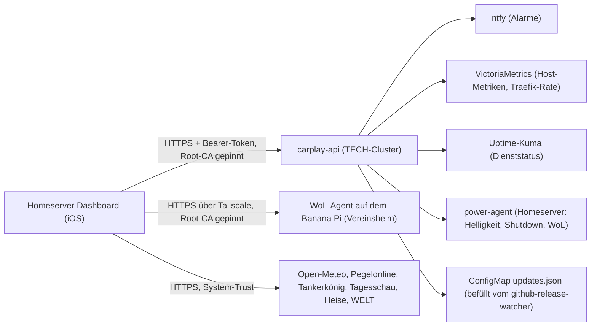

# Homeserver Dashboard (iOS)

SwiftUI-App für iPhone und iPad. Sie zeigt Alarme, Host-Metriken und Dienststatus des Capulus-Homelabs, steuert Helligkeit und Wake/Shutdown der Server und bietet einen zweiten Modus „Alltag“ mit Wetter, Rhein-Pegel, Tankstellenpreisen und Nachrichten.

Repository: [pkr-lab/capulus-ios](https://github.com/pkr-lab/capulus-ios). Das Backend ist `carplay-api` im TECH-Cluster von [capulus-core](../capulus-core/index.md) ([Dienst](../capulus-core/3-apps-workloads/300d0-carplay-api.md), [Hintergründe](../capulus-core/6-hintergruende/60080-carplay-api-und-ios-app.md)). Trotz des Namens der API enthält die App kein CarPlay: Szene, Entitlement und `CarPlay.framework` sind entfernt.

---

## Einordnung



| Teil | Wo | Doku |
|---|---|---|
| App | dieses Repo | diese Seiten |
| Backend `carplay-api` | [capulus-core](https://github.com/pkr-lab/capulus-core/tree/main/argocd/apps/tech/carplay-api) | [carplay-api](../capulus-core/3-apps-workloads/300d0-carplay-api.md) |
| power-agent (Host-Dienst) | [capulus-ansible](https://github.com/pkr-lab/capulus-ansible/tree/main/roles/power_agent) | [Rolle power_agent](../capulus-ansible/rollen/power_agent.md) |
| WoL-Agent auf dem Banana Pi | [capulus-ansible](https://github.com/pkr-lab/capulus-ansible/tree/main/roles/banana_pi_kiosk) | [Vereinsheim-Alarmmonitor](../capulus-ansible/3-apps-workloads/30020-vereinsheim-alarmmonitor.md), [Rolle banana_pi_kiosk](../capulus-ansible/rollen/banana_pi_kiosk.md) |
| Root-CA | `Resources/homeserver-root-ca.pem` (Kopie von `pki/homeserver-root-ca.pem` in capulus-core) | [Internes TLS](../capulus-core/d-sicherheit/d0040-internal-tls.md) |
| Design | Farben und Glas-Karten aus der Website | [EDV-Kretzer](../EDV-Kretzer/index.md) |

---

## Funktionen

Zwei Modi, umschaltbar mit dem Segmentschalter „PKR-Lab / Alltag“ oben. Die Wahl bleibt gespeichert (`@AppStorage("dashboardMode")`, Standard PKR-Lab).

| Modus | Tab | Inhalt | Seite |
|---|---|---|---|
| PKR-Lab | Übersicht | Hosts, Dienststatus, Dienst-Aktivität, Updates | [Übersicht und Alerts](uebersicht-und-alerts.md) |
| PKR-Lab | Steuerung | Helligkeit, Wake/Shutdown, Vereinsheim-PC | [Steuerung](steuerung.md) |
| PKR-Lab | Alerts | aktive Alarme aus ntfy | [Übersicht und Alerts](uebersicht-und-alerts.md) |
| Alltag | Dashboard | Wetter heute und morgen, Rhein-Pegel Andernach, Links zu den selbst gehosteten Diensten | [Alltag-Modus](alltag-modus.md) |
| Alltag | Tankstellen | drei feste Stationen plus nächste Station ohne Konzernmarke | [Alltag-Modus](alltag-modus.md) |
| Alltag | News | je eine Top-Meldung von Tagesschau, Heise und WELT | [Alltag-Modus](alltag-modus.md) |
| beide | Einstellungen (Zahnrad auf Steuerung und Tankstellen) | Tokens und API-Key im Keychain | [Konfiguration](konfiguration.md) |

Die Verbindung zum Homeserver (TLS-Pinning, Bearer-Token, Erreichbarkeitsanzeige) beschreibt [Verbindung und Sicherheit](verbindung-und-sicherheit.md).

---

## Aufbau des Codes

```
capulus-ios/
├── project.yml                      XcodeGen-Spezifikation (Quelle der Wahrheit)
├── Resources/homeserver-root-ca.pem Root-CA, wird als Bundle-Ressource eingebunden
├── .github/workflows/               ci, codeql, commitlint, release
└── HomeserverDashboard/
    ├── HomeserverDashboardApp.swift @main, öffnet RootTabView
    ├── Views/                       SwiftUI-Ansichten (13 Dateien)
    ├── ViewModels/                  DashboardViewModel, PowerViewModel
    ├── Models/                      Codable-Modelle
    ├── Services/                    API-Clients, Keychain, Standort, Erreichbarkeit
    ├── Utilities/                   Constants, Theme, Formatter, MTLSDelegate
    └── Assets.xcassets/             App-Icon, Akzentfarbe
```

`.xcodeproj` und `Info.plist` werden nicht eingecheckt: `xcodegen generate` erzeugt beide aus `project.yml` und überschreibt Handänderungen.

| Datei | Aufgabe |
|---|---|
| `Views/RootTabView.swift` | Modus-Schalter und Tab-Leiste, dunkles Farbschema erzwungen |
| `Views/HomeView.swift` | Übersicht inklusive `ServiceActivityCard`, `UpdatesCard`, `OfflineBanner` |
| `Views/HostCardsView.swift`, `StatusGridView.swift`, `AlertsGridView.swift`, `AlertsView.swift`, `DetailView.swift` | Karten und Detail-Sheet |
| `Views/PowerView.swift` | Helligkeit, Wake/Shutdown, Homeserver-Bestätigungs-Sheet, Vereinsheim-WoL |
| `Views/AlltagDashboardView.swift`, `TankstellenView.swift`, `NewsView.swift` | Alltag-Modus |
| `Views/SettingsView.swift` | drei Keychain-Einträge |
| `ViewModels/DashboardViewModel.swift` | 30-Sekunden-Schleife für `GET /api/dashboard`, Updates |
| `ViewModels/PowerViewModel.swift` | Aktionen für Helligkeit, Wake, Shutdown, Vereinsheim-WoL |
| `Services/HomeserverAPIClient.swift` | Zugriffe auf `carplay-api` |
| `Services/RemoteWolAgentClient.swift` | Zugriff auf den WoL-Agent |
| `Services/KeychainService.swift` | Keychain-Zugriff |
| `Services/TailscaleConnectivity.swift` | Erreichbarkeitsanzeige |
| `Services/LocationManager.swift` | Standort für die Tankstellen-Suche |
| `Services/WeatherAPIClient.swift`, `PegelAPIClient.swift`, `TankerkoenigAPIClient.swift`, `NewsAPIClient.swift` | externe Datenquellen |
| `Utilities/MTLSDelegate.swift` | Root-CA-Pinning |
| `Utilities/Constants.swift` | alle Adressen und festen Werte |
| `Utilities/Theme.swift`, `ColorHelper.swift`, `FormatterHelper.swift` | Design-Token, Statusfarben, Formatierung |

Alle Dateipfade beziehen sich auf [pkr-lab/capulus-ios](https://github.com/pkr-lab/capulus-ios/tree/main/HomeserverDashboard).

### Design

Farben, Typografie und Glas-Karten stammen aus [EDV-Kretzer](https://github.com/pkr-lab/EDV-Kretzer) (`css/style.css`): Marineblau `#0f3a5d` und Rot `#d32f2f` auf einem fast schwarzen Verlauf `#0a0e27` → `#0d1230`. Die Werte stehen in `Utilities/Theme.swift`. Die App erzwingt den Dark Mode, weil die Marke keine helle Variante hat.

---

## Seiten

| Seite | Inhalt |
|---|---|
| [Installation](installation.md) | Voraussetzungen, Projekt erzeugen, Token einrichten, auf Gerät starten |
| [Konfiguration](konfiguration.md) | Adressen, Keychain-Einträge, Projekteinstellungen |
| [Nutzung](nutzung.md) | Bedienung in Kurzform |
| [Übersicht und Alerts](uebersicht-und-alerts.md) | Hosts, Dienste, Aktivität, Updates, Alarme |
| [Steuerung](steuerung.md) | Helligkeit, Wake, Shutdown, Vereinsheim-PC |
| [Alltag-Modus](alltag-modus.md) | Wetter, Pegel, Dienste-Links, Tankstellen, News |
| [Verbindung und Sicherheit](verbindung-und-sicherheit.md) | TLS-Pinning, Token, Keychain, Erreichbarkeit |
| [Debugging und Fehlersuche](debugging.md) | Fehlermeldungen, Checkliste, Debugging in Xcode |
| [Entwicklung](entwicklung.md) | Build, CI, Tests, Erweiterung |
| [Releases](releases.md) | Release-Prozess |


## Fehlersuche

Fehlermeldungen, Checkliste und Debugging in Xcode: [Debugging und Fehlersuche](debugging.md). Funktionsbezogen: [Übersicht und Alerts](uebersicht-und-alerts.md#debugging-und-fehlersuche), [Steuerung](steuerung.md#debugging-und-fehlersuche), [Alltag-Modus](alltag-modus.md#debugging-und-fehlersuche), [Verbindung und Sicherheit](verbindung-und-sicherheit.md#debugging-und-fehlersuche).
