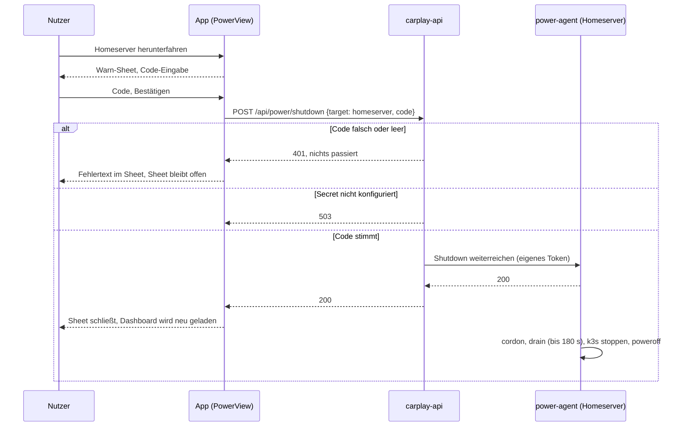

# Steuerung

Der Tab **Steuerung** im Modus PKR-Lab: Bildschirmhelligkeit des Homeservers, Wake und Shutdown der Worker, Shutdown des Homeservers und Wake-on-LAN für den Windows-PC im Vereinsheim.

Code: [Views/PowerView.swift](https://github.com/pkr-lab/capulus-ios/blob/main/HomeserverDashboard/Views/PowerView.swift), [ViewModels/PowerViewModel.swift](https://github.com/pkr-lab/capulus-ios/blob/main/HomeserverDashboard/ViewModels/PowerViewModel.swift), [Services/HomeserverAPIClient.swift](https://github.com/pkr-lab/capulus-ios/blob/main/HomeserverDashboard/Services/HomeserverAPIClient.swift), [Services/RemoteWolAgentClient.swift](https://github.com/pkr-lab/capulus-ios/blob/main/HomeserverDashboard/Services/RemoteWolAgentClient.swift), [Models/PowerModels.swift](https://github.com/pkr-lab/capulus-ios/blob/main/HomeserverDashboard/Models/PowerModels.swift), [Models/RemoteWolTarget.swift](https://github.com/pkr-lab/capulus-ios/blob/main/HomeserverDashboard/Models/RemoteWolTarget.swift)

Das Backend dazu: [carplay-api](../capulus-core/3-apps-workloads/300d0-carplay-api.md) mit dem [power-agent](../capulus-ansible/rollen/power_agent.md) auf dem Homeserver. Der Cluster-Betrieb (Worker nachts aus): [Cluster Power Manager](../capulus-ansible/2-betrieb-hardware/20020-cluster-power-manager.md).

---

## Was es tut

| Karte | Aktion | Wirkung |
|---|---|---|
| **Bildschirmhelligkeit** | Slider 0 bis 100 % in 5er-Schritten | Setzt die Helligkeit des eingebauten Bildschirms des Homeservers (HP ProBook 450 G9) |
| **Worker 0**, **Worker 1** | *Aufwecken* (aktiv, wenn der Host offline ist), *Ausschalten* (aktiv, wenn online) | Wake-on-LAN bzw. Shutdown über `carplay-api`. Ausschalten fragt vorher „… wirklich herunterfahren?“ |
| **Homeserver** | *Homeserver herunterfahren* | Öffnet ein Warn-Sheet mit Code-Eingabe. Kein Wake-on-LAN möglich, weil der Homeserver der einzige Dauerläufer im Cluster ist |
| **Windows-PC (Vereinsheim)** | *Aufwecken* | Sendet ein Magic Packet über den Banana Pi am Standort. Kein Online-Status, keine Rückfrage |

Der Online-Status der Karten kommt aus den Host-Metriken der Übersicht (`hosts[]`, Kennung `worker-0`, `worker-1`, `homeserver`). Ist ein Host dort nicht aufgeführt, gilt er auf den Worker-Karten als offline, auf der Homeserver-Karte als online.

---

## Technische Umsetzung

| Aktion | Aufruf | Authentifizierung |
|---|---|---|
| Helligkeit lesen | `GET /api/brightness` → `{"percent": n}` | Bearer-Token `carplay-api` |
| Helligkeit setzen | `PUT /api/brightness` mit `{"percent": n}` | wie oben |
| Wake | `POST /api/power/wake` mit `{"target": "worker-0"\|"worker-1"}` | wie oben |
| Shutdown | `POST /api/power/shutdown` mit `{"target": …, "code": …}`; `code` nur beim Homeserver | wie oben, Code serverseitig geprüft |
| Windows-PC wecken | `POST https://100.123.214.4:9102/wol` mit `{"target": "windows-pc"}` | eigenes Token des WoL-Agents |

`carplay-api` reicht Helligkeit, Wake und Shutdown an den power-agent auf dem Host weiter, weil der Pod selbst keinen Zugriff auf Backlight, `poweroff` oder SSH hat. Den Vereinsheim-PC erreicht die App direkt, am Backend vorbei, weil das Vereinsheim kein Dashboard-Eintrag ist ([Planung: WoL über Router/VPN](../capulus-core/4-planung/40020-vereinsheim-wol-router-vpn.md), [Alarmmonitor](../capulus-ansible/3-apps-workloads/30020-vereinsheim-alarmmonitor.md)).

---

## Ablauf: Homeserver herunterfahren

Der Code ist **derselbe wie das ArgoCD-Admin-Passwort**, wird aber nicht live dagegen geprüft: Er steht als SealedSecret `carplay-api-shutdown-code` im Cluster und wird bei jeder Passwort-Rotation von Hand erneuert ([carplay-api: Ersteinrichtung](../capulus-core/3-apps-workloads/300d0-carplay-api.md#ersteinrichtung), Schritt 4). Der Shutdown ist nicht sofort: Der Node wird geleert, k3s gestoppt, erst dann folgt der Poweroff, was einige Minuten dauert. Ein Wiedereinschalten geht nur vor Ort.

Nach jeder Wake- oder Shutdown-Aktion lädt die App das Dashboard neu (`DashboardViewModel.fetchDashboard()`), damit der Online-Status nachzieht. Ein gerade geweckter Host erscheint erst als online, wenn er hochgefahren ist und Metriken liefert.

---

## Einschränkungen

- Die Helligkeit wird beim Loslassen des Sliders gesendet (nicht während des Ziehens). Der Slider springt optimistisch auf den Wert und danach auf die Antwort des Backends.
- Es gibt **kein** Feedback über den Fortschritt eines Shutdowns und kein Rückgängigmachen.
- Fehlertexte der drei Aufrufgruppen stehen als rote Zeile unten auf der Seite (`actionError`, `remoteWolError`) bzw. in der Helligkeitskarte (`brightnessError`). Der Erfolg eines Wake/Shutdown wird nur beim Vereinsheim-PC angezeigt („Magic Packet gesendet.“).
- „Magic Packet gesendet.“ heißt nicht, dass der PC an ist: Der Agent bestätigt nur das Senden.
- Das Zahnrad oben rechts öffnet die [Einstellungen](konfiguration.md#keychain-einträge) (Tokens).

---

## Debugging und Fehlersuche

| Meldung (rote Zeile) | Ursache | Lösung |
|---|---|---|
| `carplay-api returned HTTP 401` oder die Fehlermeldung des Servers | Bearer-Token fehlt oder falsch | Token unter Einstellungen neu eingeben (Wert wie beim Versiegeln) |
| Nach Homeserver-Shutdown: 401 mit Fehlertext im Sheet | Code stimmt nicht mit `secrets.shutdownConfirmationCode` überein, meist nach einer ArgoCD-Passwort-Rotation | Secret im Backend nachziehen ([Ersteinrichtung](../capulus-core/3-apps-workloads/300d0-carplay-api.md#ersteinrichtung)) |
| `… HTTP 503` beim Homeserver-Shutdown | `secrets.shutdownConfirmationCode.enabled` ist `false` | im Backend aktivieren und versiegeln |
| `… HTTP 502` bei Helligkeit, Wake oder Shutdown | power-agent nicht erreichbar oder Token passt nicht zu `/etc/power-agent/token` | `systemctl status power-agent` auf dem Homeserver, Secret `carplay-api-power-agent-token` prüfen, [Rolle power_agent](../capulus-ansible/rollen/power_agent.md) |
| `… HTTP 403` | IP-Allowlist im Backend blockt das Gerät | `config.trustedProxies` und Allowlist prüfen |
| `… HTTP 429` | Rate-Limit pro Minute überschritten | kurz warten |
| `The request timed out.` / `Zeitüberschreitung` (iOS-Systemtext) | 10 Sekunden Timeout, Host oder VPN nicht erreichbar | Tailscale prüfen ([Tailscale](../capulus-core/c-netzwerk-dns/c0010-tailscale.md)) |
| `cancelled` / `abgebrochen` (iOS-Systemtext) bei allen Aufrufen | TLS-Pinning lehnt das Zertifikat ab (Root-CA fehlt, falsche CA, abgelaufen) | [Verbindung und Sicherheit](verbindung-und-sicherheit.md#debugging-und-fehlersuche) |
| Vereinsheim: `No API token stored in Keychain — open Settings to add one.` | Token des WoL-Agents fehlt | im Einstellungs-Sheet eintragen, Auslesen siehe [Alarmmonitor](../capulus-ansible/3-apps-workloads/30020-vereinsheim-alarmmonitor.md#ios-app) |
| Vereinsheim: `HTTP 401` mit Fehlertext | falsches Agent-Token | Token neu auslesen (`/etc/banana-pi-wol-agent/token` auf dem Pi) |
| Vereinsheim: Timeout oder Verbindungsfehler | Banana Pi nicht im Tailnet, Agent läuft nicht | `tailscale status`, `systemctl status` des WoL-Agents, [Rolle banana_pi_kiosk](../capulus-ansible/rollen/banana_pi_kiosk.md) |
| Helligkeitskarte zeigt dauerhaft Spinner | `GET /api/brightness` hängt, power-agent nicht erreichbar | wie 502 oben |
| „Aufwecken“ ist ausgegraut | App hält den Host für online (Metriken da) | Übersicht prüfen, ggf. Metriken im Backend |
| Worker wird nach „Aufwecken“ nicht online | WoL kommt nicht an (Router, BIOS, Kabel) oder Host bootet noch | [Wake-on-LAN](../capulus-ansible/rollen/wake_on_lan.md), [Cluster Power Manager](../capulus-ansible/2-betrieb-hardware/20020-cluster-power-manager.md) |
| Homeserver-Shutdown meldet Erfolg, Host läuft minutenlang weiter | Erwartet: `drain` mit bis zu 180 s Timeout läuft zuerst | `journalctl -u power-agent -f` auf dem Homeserver |

Checkliste „Steuerung funktioniert nicht“:

1. Zeigt die Übersicht Daten? Wenn nicht: [Übersicht und Alerts](uebersicht-und-alerts.md#debugging-und-fehlersuche) zuerst.
2. Token vorhanden? Einstellungen → „Es ist bereits ein Token gespeichert.“
3. Backend direkt prüfen: `curl -H "Authorization: Bearer <TOKEN>" https://carplay-api.prod.homeserver/api/brightness`.
4. `kubectl -n carplay-api logs deploy/carplay-api` und `journalctl -u power-agent` auf dem Homeserver.
5. Vereinsheim: Agent direkt prüfen (Token, `curl -k` nur zur Diagnose, TLS-Zertifikat mit IP-SAN).

Allgemeines: [Debugging und Fehlersuche](debugging.md).
