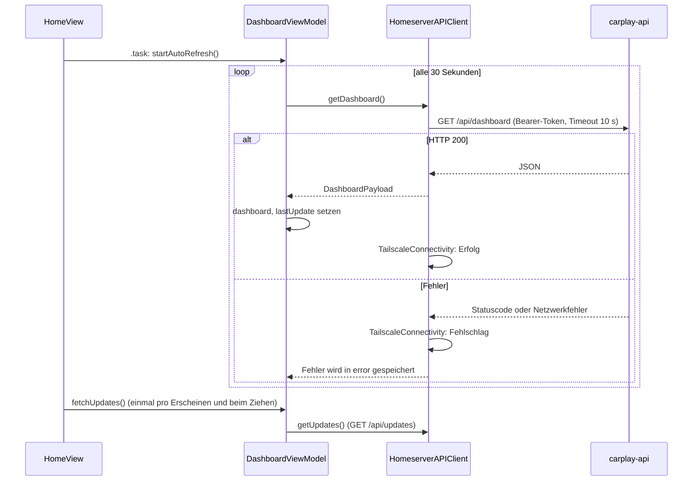

# Übersicht und Alerts

Die Tabs **Übersicht** und **Alerts** im Modus PKR-Lab. Sie zeigen den Zustand des Homelabs aus `GET /api/dashboard` und `GET /api/updates` der [carplay-api](../capulus-core/3-apps-workloads/300d0-carplay-api.md).

Code: [Views/HomeView.swift](https://github.com/pkr-lab/capulus-ios/blob/main/HomeserverDashboard/Views/HomeView.swift), [HostCardsView.swift](https://github.com/pkr-lab/capulus-ios/blob/main/HomeserverDashboard/Views/HostCardsView.swift), [StatusGridView.swift](https://github.com/pkr-lab/capulus-ios/blob/main/HomeserverDashboard/Views/StatusGridView.swift), [AlertsView.swift](https://github.com/pkr-lab/capulus-ios/blob/main/HomeserverDashboard/Views/AlertsView.swift), [AlertsGridView.swift](https://github.com/pkr-lab/capulus-ios/blob/main/HomeserverDashboard/Views/AlertsGridView.swift), [DetailView.swift](https://github.com/pkr-lab/capulus-ios/blob/main/HomeserverDashboard/Views/DetailView.swift), [ViewModels/DashboardViewModel.swift](https://github.com/pkr-lab/capulus-ios/blob/main/HomeserverDashboard/ViewModels/DashboardViewModel.swift), [Services/HomeserverAPIClient.swift](https://github.com/pkr-lab/capulus-ios/blob/main/HomeserverDashboard/Services/HomeserverAPIClient.swift), [Models/](https://github.com/pkr-lab/capulus-ios/tree/main/HomeserverDashboard/Models)

---

## Was es tut

| Bereich | Quelle im Backend | Darstellung |
|---|---|---|
| **Hosts** | VictoriaMetrics (node-exporter) | Eine Karte je Host, der **online** ist: CPU, RAM und Disk als Prozentwerte mit Farbe, Temperatur (wenn der Host einen Sensor meldet, also Wert > 0) und Uptime. Offline-Hosts erscheinen nicht, statt mit 0 % verwirrend auszusehen. Gibt es keinen Host: „Kein Host ist gerade erreichbar.“ |
| **Status** | Uptime-Kuma-Status-Page | Eine Zeile je Monitor: `UP · <Ping> · <Uptime>`, `DOWN`, `MAINTENANCE`, `PAUSED`, mit Symbol und Farbe. Tippen öffnet ein Detail-Sheet (Status, Ping, Uptime 24 h, letzter Check). Leer: „Keine Monitore konfiguriert“ |
| **Dienst-Aktivität** | VictoriaMetrics (Traefik-Request-Rate) | Balken je Dienst, sortiert nach Requests pro Sekunde. Die Zahl ist eine Näherung für Aktivität, keine Nutzerzahl |
| **Updates** | ConfigMap des [github-release-watcher](../capulus-core/f-cicd-automatisierung/f0040-github-release-watcher.md) | Karte nur, wenn die Liste nicht leer ist: Apps mit neuer Version (`aktuell → neu`, Link auf das Release) oder „Alle Apps aktuell.“. Bei Apps ohne bekannte aktuelle Version steht ein Hinweis, `currentVersion` im Watcher nachzutragen |
| **Alerts** (eigener Tab) | ntfy über `ntfy-bridge` und Host-Skripte | Liste aktiver Alarme mit Symbol und Farbe nach Stufe (`critical` rot, `warning` orange, `info` grün). Titel auf 20, Nachricht auf 30 Zeichen gekürzt. Tippen öffnet das Detail (Topic, Level, Empfangen, volle Nachricht). Leer: „Keine aktiven Alerts“ |

Unter den Karten steht „Aktualisiert vor …“ (relative Zeit des letzten erfolgreichen Abrufs). Pull-to-Refresh lädt Dashboard und Updates neu, auf dem Alerts-Tab nur das Dashboard.

Die Alarme erscheinen **nicht** auf der Übersicht, sondern nur im Tab Alerts. Woher die Alarme kommen: [ntfy](../capulus-core/1-benachrichtigungen/10010-ntfy.md), [Monitoring und Alerting](../capulus-core/6-hintergruende/60060-monitoring-und-alerting.md).

---

## Ablauf



Die 30-Sekunden-Schleife startet, sobald die Übersicht zum ersten Mal erscheint, und wird nie gestoppt (`stopAutoRefresh()` wird im Code nicht aufgerufen). Der Alerts-Tab nutzt dieselbe Instanz (`DashboardViewModel.shared`) und zeigt daher die Daten, die die Schleife liefert. Startet die App im Modus Alltag, läuft die Schleife erst, wenn man einmal zum Modus PKR-Lab wechselt.

Der Abruf der Updates ist einmalig, nicht Teil der Schleife (Fehler werden still verworfen: ein leeres `catch`).

### Tolerantes Decodieren

| Feld | Verhalten bei fehlendem oder unbekanntem Wert |
|---|---|
| `alerts`, `hosts`, `service_activity` | fehlt: leere Liste |
| `status`, `updated_at` | **Pflicht**: fehlt eins, schlägt das Decodieren fehl (`Could not parse response: …`) |
| `level` eines Alerts | unbekannt: `info` |
| `status` eines Monitors | unbekannt: `down` |
| `hasUpdate` | `null`: Eintrag erscheint nur im Hinweis „kein bekannter aktueller Stand“ |

### Farben

Prozentwerte (CPU, RAM, Disk, Temperatur) färben sich nach Schwelle: unter 50 grün, 50 bis 75 gelb, 75 bis 90 orange, ab 90 rot (`StatusPalette.color(forPercentage:)`). Die Temperatur nutzt dieselbe Skala, auch wenn sie in °C gemessen wird.

---

## Randfälle und Einschränkungen

- **Fehler sind unsichtbar.** `DashboardViewModel.error` wird gesetzt, aber **von keiner Ansicht angezeigt**. Schlägt ein Abruf fehl, bleibt der zuletzt bekannte Stand stehen, und es erscheint nur der gelbe Hinweis „Homeserver nicht erreichbar — zeige letzten bekannten Stand.“ (siehe unten). Die Ursache sieht man im Debugger, siehe [Debugging](debugging.md#in-xcode-debuggen).
- Der Hinweis erscheint, sobald **kein Netzpfad** besteht oder die **letzte Anfrage an `carplay-api` fehlschlug**. Dazu zählt jeder Statuscode ≠ 200, also auch ein falsches Token (401). „Nicht erreichbar“ heißt deshalb nicht zwingend, dass das Netzwerk fehlt.
- Wetter-, News- und Tankerkönig-Aufrufe beeinflussen den Hinweis nicht.
- Beim ersten Start ohne Daten sind die Karten leer (`hosts: []`, `status: []`), bis der erste Abruf gelungen ist.
- Gelöschte Alarme gibt es nicht: Das Backend liefert nur die Nachrichten der letzten Stunden (`NTFY_SINCE`, Standard 12 Stunden). Ältere Alarme verschwinden von selbst.
- Es gibt keine Push-Benachrichtigungen. Alarme erreichen das Telefon über ntfy bzw. den [Telefon-Alarm](../capulus-core/1-benachrichtigungen/10020-telefon-alarm.md), nicht über diese App.

---

## Debugging und Fehlersuche

Das Backend liefert eigene Fehlertexte (JSON `{"error": "…"}`), die die App nicht anzeigt. Zur Diagnose ruft man die Endpunkte direkt auf:

```bash
TOKEN=<TOKEN>
curl --cacert pki/homeserver-root-ca.pem -H "Authorization: Bearer $TOKEN" https://carplay-api.prod.homeserver/api/dashboard | jq .
curl --cacert pki/homeserver-root-ca.pem https://carplay-api.prod.homeserver/health
kubectl -n carplay-api logs deploy/carplay-api --tail=100     # Logs des Backends
```

| Symptom | Ursache | Lösung |
|---|---|---|
| Gelber Hinweis „Homeserver nicht erreichbar …“ | Netzwerk, VPN oder TLS-Pinning, oder HTTP-Fehler (zum Beispiel 401) | [Debugging](debugging.md#checkliste-feature-funktioniert-nicht), `curl` wie oben |
| Karten bleiben leer, Hinweis fehlt | Abruf gelungen, aber `hosts` und `status` leer | Backend: `config.hosts`, Uptime-Kuma-Slug prüfen ([carplay-api: Fehlerbehebung](../capulus-core/3-apps-workloads/300d0-carplay-api.md#fehlerbehebung)) |
| Host fehlt, obwohl er läuft | im Backend steht `online: false`, `instance` passt nicht zum Label | `instance` in `config.hosts` gegen `…/api/v1/targets` prüfen |
| Host zeigt 0 % | Metriken fehlen | Backend-Log: PromQL-Fehler, [Monitoring](../capulus-core/6-hintergruende/60060-monitoring-und-alerting.md) |
| Status-Liste leer („Keine Monitore konfiguriert“) | Status-Page-Slug falsch oder Monitore fehlen auf der Page | [Uptime-Kuma](../capulus-core/3-apps-workloads/30080-uptime-kuma.md), Slug in `values.yaml` |
| Alerts leer, obwohl ntfy Nachrichten hat | `config.ntfy.topic` oder `NTFY_SINCE` | [ntfy](../capulus-core/1-benachrichtigungen/10010-ntfy.md) |
| Alle Alerts erscheinen grün (`info`) | ntfy-Priorität 1 bis 3 wird zu `info` | Priorität im Absender setzen (4 = warning, 5 = critical, siehe [60080](../capulus-core/6-hintergruende/60080-carplay-api-und-ios-app.md#datenquellen-und-ihre-eigenheiten)) |
| Dienst-Aktivität leer oder 0 req/s | Traefik-Label passt nicht zu `ServiceConfig.match` oder noch nicht gescrapt | Backend-Konfiguration, `curl $VM_URL/api/v1/label/service/values` |
| Karte „Updates“ fehlt | `/api/updates` leer (ConfigMap nicht vorhanden, Watcher lief noch nicht) oder Abruf fehlgeschlagen (still verworfen) | [github-release-watcher](../capulus-core/f-cicd-automatisierung/f0040-github-release-watcher.md), Backend-Log „reading updates configmap failed“ |
| Update-Karte nennt „Kein bekannter aktueller Stand …“ | `currentVersion` im Watcher nicht gepflegt | `currentVersion` in `values.yaml` des github-release-watcher nachtragen |
| „Aktualisiert vor …“ bleibt alt | Schleife läuft nicht (App im Modus Alltag gestartet) oder Abrufe schlagen fehl | in den Modus PKR-Lab wechseln, ziehen zum Aktualisieren |
| `Could not parse response: …` (nur im Debugger sichtbar) | Pflichtfeld `status` oder `updated_at` fehlt | Backend-Version und Antwort prüfen |

Allgemeines: [Debugging und Fehlersuche](debugging.md).
