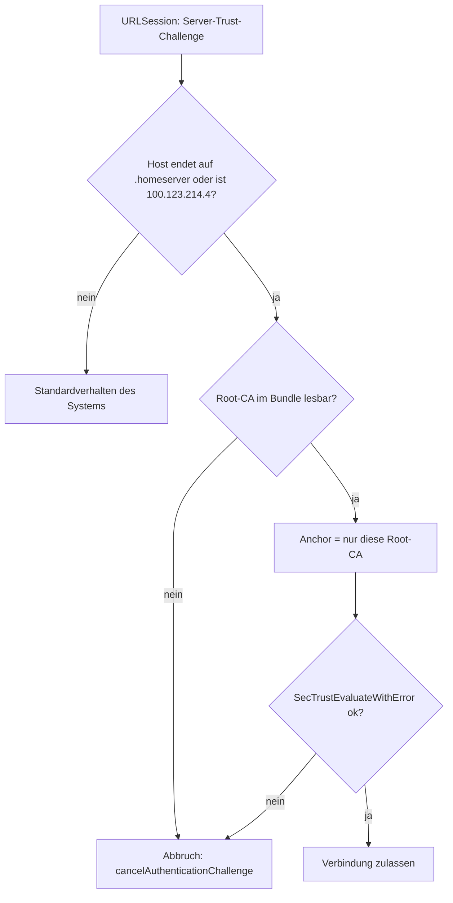

# Verbindung und Sicherheit

Wie die App `carplay-api` und den WoL-Agent erreicht, wie sie sich absichert und woran sie Verbindungsprobleme erkennt.

Code: [Utilities/MTLSDelegate.swift](https://github.com/pkr-lab/capulus-ios/blob/main/HomeserverDashboard/Utilities/MTLSDelegate.swift), [Services/KeychainService.swift](https://github.com/pkr-lab/capulus-ios/blob/main/HomeserverDashboard/Services/KeychainService.swift), [Services/TailscaleConnectivity.swift](https://github.com/pkr-lab/capulus-ios/blob/main/HomeserverDashboard/Services/TailscaleConnectivity.swift), [Services/HomeserverAPIClient.swift](https://github.com/pkr-lab/capulus-ios/blob/main/HomeserverDashboard/Services/HomeserverAPIClient.swift), [Resources/homeserver-root-ca.pem](https://github.com/pkr-lab/capulus-ios/blob/main/Resources/homeserver-root-ca.pem)

Hintergrund zu den Entscheidungen: [Hintergründe carplay-api und iOS-App](../capulus-core/6-hintergruende/60080-carplay-api-und-ios-app.md), [Internes TLS](../capulus-core/d-sicherheit/d0040-internal-tls.md), [Security-Incident 018: Klartext-HTTP mit Bearer-Token](../capulus-core/7-security-incidents/018-ios-app-klartext-http-mit-bearer-token.md).

---

## Schichten

| Schicht | Mittel | Wo |
|---|---|---|
| Netzwerk | `*.homeserver` ist nur im Heimnetz oder Tailnet erreichbar | Traefik, Tailscale ([Tailscale](../capulus-core/c-netzwerk-dns/c0010-tailscale.md)) |
| Transport | nur HTTPS, keine ATS-Ausnahme, Root-CA gepinnt | `MTLSDelegate` |
| Anwendung | Bearer-Token je Backend, zusätzlicher Code für den Homeserver-Shutdown | `HomeserverAPIClient`, `RemoteWolAgentClient`, [Steuerung](steuerung.md) |
| Gerät | Tokens im Keychain, nur bei entsperrtem Gerät lesbar, nicht übertragbar | `KeychainService` |

Der Name `MTLSDelegate` führt in die Irre: Es gibt kein Client-Zertifikat. Die Klasse prüft nur das Serverzertifikat gegen die gepinnte Root-CA. `KeychainService.clientIdentity()` liefert immer `nil` und ist der vorgesehene Haken für ein späteres Client-Zertifikat. Das Backend erzwingt auch kein mTLS: Der Ingress terminiert keine Client-Zertifikate, die Grenze ist Netzwerk plus Bearer-Token.

---

## TLS-Pinning (`MTLSDelegate`)

- `rootCertificate` lädt `homeserver-root-ca.pem` aus dem Bundle, entfernt die PEM-Zeilen mit `-----`, decodiert Base64 und bildet ein `SecCertificate`. Fehlt die Datei oder ist sie nicht lesbar, ist das Ergebnis `nil` und **jede** gepinnte Anfrage wird abgebrochen (fail closed).
- Für gepinnte Hosts gilt als Trust-Anker nur diese eine CA (`SecTrustSetAnchorCertificatesOnly`). Zertifikate anderer CAs, auch vom Nutzer installierte, werden abgelehnt.
- Hosts außer `*.homeserver` und `100.123.214.4` (Wetter, News, Tankerkönig) nutzen das Standardverhalten, ohne Pinning.
- `HomeserverAPIClient` und `RemoteWolAgentClient` setzen den Delegate in ihrer `URLSession`. Die übrigen Clients (Wetter, Pegel, Tankerkönig, News) nutzen `URLSession(configuration: .default)` ohne Delegate.
- Das Zertifikat des WoL-Agents trägt die Tailscale-IP als Subject Alternative Name und stammt von derselben Root-CA.
- Die Root-CA läuft am 2036-08-10 ab. Beim Austausch: `Resources/homeserver-root-ca.pem` ersetzen und neu bauen. Die CI prüft die Übereinstimmung mit [`pki/homeserver-root-ca.pem`](https://github.com/pkr-lab/capulus-core/blob/main/pki/homeserver-root-ca.pem) (Job `ca-checksum`).

---

## Token und Keychain

- Das Token von `carplay-api` wird bei **jeder** Anfrage als `Authorization: Bearer …` gesendet, sofern eins im Keychain steht. Fehlt es, sendet die App die Anfrage ohne Header und bekommt vom Backend `401`. Die Meldung „No API token stored in Keychain — open Settings to add one.“ gibt es nur für den WoL-Agent.
- Beim Speichern löscht die App einen vorhandenen Eintrag und legt ihn neu an (`SecItemDelete`, `SecItemAdd`), Zugriff `kSecAttrAccessibleWhenUnlockedThisDeviceOnly`.
- Die App loggt weder Tokens noch Antworten.

---

## Erreichbarkeitsanzeige (`TailscaleConnectivity`)

iOS gibt einer App keinen Einblick in den VPN-Status einer anderen App. Die Klasse kombiniert deshalb zwei Signale:

| Signal | Quelle |
|---|---|
| `hasNetworkPath` | `NWPathMonitor` meldet `satisfied` (irgendein Netz vorhanden) |
| `lastRequestSucceeded` | Ergebnis der letzten Anfrage an `carplay-api` (HTTP 200 oder nicht) |

`isLikelyReachable` ist die Und-Verknüpfung. Die Übersicht zeigt „Homeserver nicht erreichbar — zeige letzten bekannten Stand.“, wenn sie `false` ist. Die Anzeige erkennt also keinen VPN-Zustand, sondern nur, dass die letzte Anfrage scheiterte. Auch ein 401, 403, 502 oder ein Decodierfehler löst sie aus. Die Anfragen an den WoL-Agent und die externen Dienste zählen nicht mit.

---

## Debugging und Fehlersuche

| Symptom | Ursache | Lösung |
|---|---|---|
| Alle Anfragen an `*.homeserver` scheitern mit `cancelled` bzw. `abgebrochen` | Pinning lehnt das Zertifikat ab: Root-CA fehlt im Bundle, Serverzertifikat von anderer CA, Zertifikat abgelaufen oder Name nicht in der SAN-Liste | Zertifikat des Servers prüfen: `openssl s_client -connect carplay-api.prod.homeserver:443 -CAfile pki/homeserver-root-ca.pem -verify_return_error </dev/null`, [Internes TLS](../capulus-core/d-sicherheit/d0040-internal-tls.md) |
| Safari lädt die Seite, die App nicht | Safari nutzt den System-Trust, die App nur die gebündelte CA | Bundle-CA mit der Server-CA vergleichen (`openssl x509 -in Resources/homeserver-root-ca.pem -noout -subject -dates`) |
| App lädt nach Austausch der Root-CA nicht mehr | alte CA im Bundle | `Resources/homeserver-root-ca.pem` ersetzen, neu bauen |
| `A server with the specified hostname could not be found.` (iOS-Systemtext) | `carplay-api.prod.homeserver` nicht auflösbar (kein Tailscale-DNS, kein Heimnetz) | Tailscale starten, [DNS-Architektur](../capulus-core/c-netzwerk-dns/c0000-dns-architecture.md) |
| `The request timed out.` | Host nicht erreichbar, Timeout 10 s | VPN, Heimnetz, Cluster prüfen |
| `HTTP 401` | Token fehlt oder falsch | Einstellungen, Wert wie beim Versiegeln |
| `HTTP 403` | IP-Allowlist im Backend | `config.trustedProxies`, [carplay-api: Absicherung](../capulus-core/3-apps-workloads/300d0-carplay-api.md#absicherung) |
| Hinweis „Homeserver nicht erreichbar“ trotz Netz | letzte Anfrage schlug fehl (auch HTTP-Fehler) | Ursache per `curl` klären, siehe [Debugging](debugging.md) |
| Hinweis verschwindet nicht | nächster Abruf erst nach 30 s oder Fehler besteht | Ziehen zum Aktualisieren |
| „Speichern fehlgeschlagen: …“ in den Einstellungen | Keychain-Fehler | Gerät entsperren, `OSStatus` nachschlagen |
| Pinning auf eigenem Testserver | Host endet nicht auf `.homeserver` | Test mit Host im Muster oder `MTLSDelegate.pinnedHosts` erweitern |

Allgemeines: [Debugging und Fehlersuche](debugging.md).
