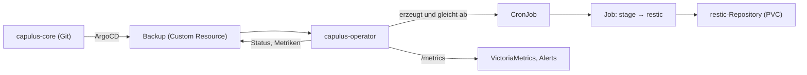

# capulus-operator

Kubernetes-Operator des Capulus-Homelabs. Er ersetzt kopierte CronJobs, Skripte und manuelle Abläufe durch deklarative Ressourcen: Ein Eintrag im Git-Repo beschreibt den Soll-Zustand, der Operator setzt ihn im Cluster um und meldet den Ist-Zustand zurück.

Repository: [pkr-lab/capulus-operator](https://github.com/pkr-lab/capulus-operator). Ausgerollt wird er wie jede andere App über ArgoCD aus [capulus-core](../capulus-core/index.md) (Chart `argocd/apps/tech/capulus-operator`), Hintergründe und Fallstricke stehen in [600c0](../capulus-core/6-hintergruende/600c0-capulus-operator.md).

---

## Einordnung

Pro Cluster läuft eine eigene Instanz. Aktuell ist der TECH-Cluster ausgerollt.

---

## Stand

| Bereich | Ressource | Controller |
|---|---|---|
| Backups (restic, SQLite, Postgres) | `Backup` | fertig |
| Datenbanken (CloudNativePG ansteuern) | `Database` | geplant |
| Zertifikate / PKI | `ManagedCertificate` | geplant |
| Token- und Secret-Rotation (Änderung per Pull Request) | `SecretRotation` | geplant |

Die Ressourcen der geplanten Bereiche sind Entwürfe. Ihr Schema kann sich ändern, solange kein Controller sie verarbeitet.

---

## Seiten

| Seite | Inhalt |
|---|---|
| [Installation](installation.md) | Deployment, Reihenfolge, Pull-Secret |
| [Konfiguration](konfiguration.md) | Flags, Chart-Values, `Backup`-Spec |
| [Nutzung](nutzung.md) | Backup anlegen, Status, Metriken, Alerts, Wiederherstellung, Fehlersuche |
| [Releases](releases.md) | Versionierung und Image-Build |
