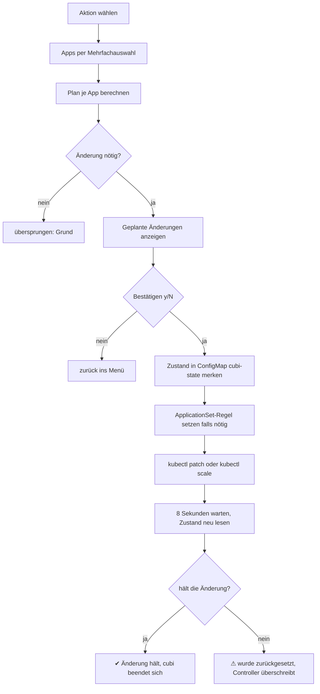

# ArgoCD-Features

Die drei Features ändern die ArgoCD-`Application` über `kubectl patch` (das Skalieren der Pods zusätzlich über `kubectl scale`). Das ist derselbe Weg, über den Cubi die Applications schon liest (`kubectl get applications.argoproj.io -n <argocd.namespace>`). Es kommt kein neuer Zugriffsweg dazu. Der Kontext von `kubectl` muss auf den Cluster mit ArgoCD zeigen und Patch-Rechte auf `applications.argoproj.io` haben.

Aufruf:

```bash
cubi autosync     # oder: cubi sync
cubi feature-testing
cubi scale
```

Alle drei stehen auch im Hauptmenü, und in der ArgoCD-App-Liste öffnen `s` (Auto-Sync), `t` (Feature-Testing) und `z` (Pods skalieren) sie direkt.

**Cubi beendet sich nach der Ausführung.** Hat eines der drei Features eine Änderung durchgeführt (nach dem Bestätigen und der Nachkontrolle), kehrt Cubi zur Shell zurück, egal ob es direkt, aus dem Hauptmenü oder aus der ArgoCD-Liste gestartet wurde. Dann lassen sich sofort andere Befehle eingeben. Abbrechen mit Esc, ein verneintes `(y/N)` oder „Nichts zu tun“ führen weiter zurück ins Menü.

---

## Apps aus einem ApplicationSet

Gehört eine Application einem ApplicationSet (`ownerReferences` mit Kind `ApplicationSet`), gleicht der ApplicationSet-Controller ihre `spec` laufend mit dem Template ab. Eine Änderung per `kubectl patch` an der Application wird dadurch nach wenigen Sekunden überschrieben, auch `selfHeal`, `targetRevision` und alle Annotationen. Das ist auch der Grund, warum Cubi sich nichts in Annotationen merkt.

Cubi geht deshalb zwei Wege, die in der Zusammenfassung stehen:

- **Regel im ApplicationSet.** Vor der Änderung trägt Cubi in `spec.ignoreApplicationDifferences` des ApplicationSets eine Regel für genau diese App ein, zum Beispiel `{name: pacman, jsonPointers: [/spec/syncPolicy]}`. Der Controller lässt dieses Feld dann in Ruhe. Beim Zurückstellen entfernt Cubi die Regel wieder, und der Controller setzt die Application aus dem Template zurück. Andere Regeln im ApplicationSet bleiben unberührt. Der Eintrag wird mit einem Test auf die `resourceVersion` geschrieben, eine parallele Änderung bricht ihn ab.
- **Gedächtnis in einer ConfigMap.** Gemerkte Einstellungen (prune/selfHeal, Replikas) stehen in der ConfigMap `cubi-state` im ArgoCD-Namespace, je App unter `<app>.sync` und `<app>.scale`. Cubi legt sie bei Bedarf an. Sie bleibt nach dem Zurückstellen leer bestehen.

Die ApplicationSets werden dafür im Cluster verändert. Spielt man sie aus dem Repo neu ein (`kubectl apply`), verschwinden die Regeln, und Auto-Sync gilt wieder aus dem Template.

**Nachkontrolle.** Nach jeder Änderung wartet Cubi einige Sekunden, liest den Zustand neu und meldet pro App `✔ Änderung hält` oder `⚠ wurde zurückgesetzt`. Wirkt ein anderer Controller dagegen (etwa eine übergeordnete App mit selfHeal), erscheint die Warnung.

---

## Auto-Sync deaktivieren und aktivieren

1. Aktion wählen: *Auto-Sync deaktivieren* oder *Auto-Sync aktivieren*.
2. Apps per Mehrfachauswahl wählen. Die Liste zeigt pro App den aktuellen Zustand:

   | Spalte | Bedeutung |
   | --- | --- |
   | Auto-Sync | `auto (prune, selfHeal)` oder `manual` |
   | Gemerkt | die beim Deaktivieren gespeicherten Einstellungen, sonst `-` |

   Apps, für die die Aktion nichts ändern würde, erscheinen abgeblendet und werden übersprungen.
3. Cubi zeigt die geplanten Änderungen und fragt `(y/N)`.

**Deaktivieren** merkt zuerst die bisherigen Einstellungen als JSON in der ConfigMap `cubi-state` (`prune`, `selfHeal`, `allowEmpty`) und entfernt dann `spec.syncPolicy.automated`. Bei ApplicationSet-Apps kommt vorher die Regel im ApplicationSet dazu.

**Aktivieren** schreibt die gemerkten Einstellungen zurück nach `spec.syncPolicy.automated`, entfernt die ApplicationSet-Regel und löscht den Eintrag in der ConfigMap. Bei ApplicationSet-Apps gilt danach das Template. Gibt es keine gemerkten Einstellungen (oder sind sie nicht lesbar), setzt Cubi `automated` ohne `prune` und `selfHeal` und weist in der Zusammenfassung darauf hin.

Wird die App von einer übergeordneten App verwaltet (App of Apps), warnt Cubi, weil diese die Änderung zurücksetzen kann. Dafür gibt es keine automatische Regel.

Beispiel:

```
$ cubi autosync
? Auto-Sync › Auto-Sync deaktivieren
? Apps: Auto-Sync deaktivieren › 2 gewählt: app-a, app-c

──────────── Geplante Änderungen ────────────
  app-a  auto (prune, selfHeal) → manual
    Einstellungen werden gemerkt (prune, selfHeal)
  app-c  auto → manual
    Einstellungen werden gemerkt (ohne prune/selfHeal)
    ApplicationSet apps: die Sync-Policy wird per ignoreApplicationDifferences festgehalten
  app-b  übersprungen (bereits manual)
? 2 App(s) ändern? › Ja
✔ app-a: Auto-Sync deaktiviert (manual)
✔ app-c: Auto-Sync deaktiviert (manual)
Prüfe, ob die Änderung hält …
✔ app-a: Änderung hält
✔ app-c: Änderung hält
```

Später wieder einschalten:

```
$ cubi autosync
? Auto-Sync › Auto-Sync aktivieren
? Apps: Auto-Sync aktivieren › 1 gewählt: app-a
  app-a  manual → auto (prune, selfHeal)
    gemerkte Einstellungen werden wiederhergestellt (prune, selfHeal)
```

Von Hand nachsehen:

```bash
kubectl get configmap cubi-state -n argocd -o jsonpath='{.data.app-a\.sync}'
kubectl get applicationset <name> -n argocd -o jsonpath='{.spec.ignoreApplicationDifferences}'
```

---

## Feature-Testing: Branch einer App umstellen

`cubi feature-testing` stellt Apps auf einen Feature-Branch um, damit man eine Änderung im Cluster testen kann, bevor sie in `main` landet. Der Befehl hieß früher `cubi branch`, dieser Name funktioniert weiter als Alias (ebenso `cubi ft`).

1. Modus wählen: *Branch umstellen* oder *Auf main zurücksetzen*.
2. Apps per Mehrfachauswahl wählen. Die Liste zeigt den aktuellen Branch (`spec.source.targetRevision`, `HEAD` wenn leer), den Auto-Sync-Zustand und das Quell-Repository. Bei Multi-Source-Apps stehen die Branches mit `|` getrennt in der Spalte, hinter dem Repository steht `(+n)`. Im Modus *Auf main zurücksetzen* sind alle Apps vorgewählt, die nicht auf `main` stehen.
3. Beim Umstellen fragt Cubi den Ziel-Branch ab (Standard `main`).
4. Bei Apps mit `spec.sources` wählen Sie pro App, welche Source gemeint ist.
5. Cubi prüft, ob der Branch im Remote-Repo existiert, zeigt die Zusammenfassung mit Hinweisen und fragt `(y/N)`.

Geändert wird nur die gewählte `targetRevision`. Der Patch ist ein JSON-Patch mit vorgeschaltetem `test` auf die `repoURL`. Hat sich die App zwischenzeitlich verändert, bricht der Patch ab, statt die falsche Source zu treffen.

**Existenzprüfung.** Bei GitHub-Repositories fragt Cubi über `gh api` nach Branches und Tags (auch für private Repos, soweit `gh` angemeldet ist). Bei anderen Remotes nutzt es `git ls-remote` ohne Passwortabfrage. Fehlt der Branch, steht in der Zusammenfassung `⚠ Branch … existiert nicht` und die Rückfrage bleibt bei Nein als Voreinstellung. Lässt sich das nicht prüfen (kein Zugriff, Commit-ID), steht `Existenz im Remote-Repo nicht prüfbar`. Umstellen lässt sich trotzdem.

**Hinweis bei Auto-Sync.** Ist Auto-Sync aktiv, weist Cubi darauf hin, dass ArgoCD sofort auf den neuen Branch synct. Ist zusätzlich `prune` aktiv, kommt die Warnung, dass Ressourcen, die es im neuen Branch nicht gibt, gelöscht werden.

**Zurücksetzen auf main.** *Auf main zurücksetzen* nutzt dieselbe Strecke mit festem Ziel `main`. Sie überspringt nur die Abfrage des Ziel-Branches. Alternativ genügt beim Umstellen Enter bei der Frage nach dem Ziel-Branch, da `main` vorbelegt ist.

Beispiel:

```
$ cubi feature-testing
? Feature-Testing › Branch umstellen
? Apps: Branch umstellen › 2 gewählt: app-a, app-d
? Ziel-Branch › feature/login
? Source von app-d › pkr-lab/charts chart @ v1

──────────── Geplante Änderungen ────────────
  app-a  main → feature/login
    ⚠ Auto-Sync aktiv (prune, selfHeal): ArgoCD synct sofort auf den neuen Branch
    ⚠ prune aktiv: Ressourcen, die im neuen Branch fehlen, werden gelöscht
  app-d  v1 → feature/login  (pkr-lab/charts chart @ v1)
    ⚠ Branch feature/login existiert nicht in pkr-lab/charts
? 2 App(s) auf feature/login umstellen? › Nein
```

Zurücksetzen:

```
$ cubi feature-testing
? Feature-Testing › Auf main zurücksetzen
? Apps: auf main zurücksetzen › 1 gewählt: app-a
  app-a  feature/login → main
? 1 App(s) auf main umstellen? › Ja
✔ app-a: feature/login → main
```

**ApplicationSet-Apps.** Für Apps aus einem ApplicationSet trägt Cubi vor der Änderung eine Regel `{name: <app>, jsonPointers: [<Pfad der targetRevision>]}` im ApplicationSet ein, sonst würde der Controller den Branch zurücksetzen (siehe oben). Entspricht das Ziel dem Wert im Template (steht dort ein fester Wert, zum Beispiel `main`), entfällt die Regel: Cubi stellt die App um und entfernt eine vorhandene Regel wieder. Auch hier folgt die Nachkontrolle.

Hinweis: Eine App unter einer übergeordneten App (App of Apps) kann den Branch dort wieder überschrieben bekommen. Dauerhaft ändert man ihn in der Quelle der übergeordneten Ressource.

---

## Pods skalieren und wiederherstellen

`cubi scale` setzt die Deployments und StatefulSets einer App auf 0 Replikas oder auf eine frei gewählte Anzahl (auch nach oben) und später auf die vorherigen Werte zurück.

1. Aktion wählen: *Auf 0 Pods stellen*, *Auf eigene Anzahl stellen* oder *Pods wiederherstellen*. Bei *eigene Anzahl* gibt man die Zahl direkt ein (Vorgabe `1`, mindestens `0`).
2. Apps per Mehrfachauswahl wählen. Die Liste zeigt pro App die Anzahl der Workloads, den Zustand (`normal` oder `geändert (vorher 5)`) und den Auto-Sync-Zustand. Apps, für die die Aktion nichts ändern würde, erscheinen abgeblendet und werden übersprungen.
3. Bei *eigene Anzahl* und Apps mit mehreren Workloads wählt man per Mehrfachauswahl, welche Workloads die Zahl bekommen (alle sind vorgewählt, die Liste zeigt die aktuelle Anzahl). Die Zahl gilt je Workload.
4. Cubi liest die aktuellen Replikas, zeigt pro App jeden betroffenen Workload und fragt `(y/N)`. Workloads, die schon die gewünschte Anzahl haben, lässt es aus.

Die Workloads einer App stammen aus `status.resources` der Application (Gruppe `apps`, Kinds `Deployment` und `StatefulSet`). Andere Ressourcen wie CronJobs oder Argo Rollouts fasst Cubi nicht an.

**Auf 0 oder eigene Anzahl stellen.** Cubi merkt die bisherigen Replikas (und die Auto-Sync-Einstellung) als JSON in der ConfigMap `cubi-state` unter `<app>.scale`. Ist Auto-Sync aktiv, schaltet es ihn wie oben ab, bei ApplicationSet-Apps samt Regel im ApplicationSet. Sonst würde ArgoCD die Pods mit Auto-Sync oder selfHeal wieder hochfahren. Erst danach skaliert Cubi jeden Workload mit `kubectl scale`. Schlägt ein Schritt davor fehl, bleibt der Cluster unverändert. Zum Schluss prüft Cubi nach einigen Sekunden, ob die Replikas bei 0 geblieben sind.

**Wiederherstellen.** Cubi skaliert jeden gemerkten Workload auf seinen ursprünglichen Wert (auch dann, wenn man zwischendurch mehrfach eine eigene Anzahl gesetzt hat; gemerkt wird der erste Stand vor Cubis Eingriff), schaltet danach das gemerkte Auto-Sync wieder ein (bei ApplicationSet-Apps wird die Regel entfernt) und löscht den Eintrag in der ConfigMap. Schlägt ein Skalieren fehl, bleibt der Eintrag erhalten, und der Vorgang lässt sich wiederholen. Auto-Sync, das Cubi nicht deaktiviert hat, bleibt unangetastet.

Läuft die App unter einer übergeordneten App, warnt Cubi, weil diese die Änderung zurücksetzen kann. Ein HorizontalPodAutoscaler ist bei 0 Replikas inaktiv und greift nach dem Wiederherstellen wieder. Wer nach oben skaliert, sollte beachten, dass Auto-Sync für die App ausgeschaltet wird, weil ArgoCD die Anzahl sonst aus Git zurücksetzt.

Beispiel:

```
$ cubi scale
? Pods skalieren › Auf 0 Pods stellen
? Apps: auf 0 Pods stellen › 1 gewählt: app-a

──────────── Geplante Änderungen ────────────
  app-a  5 Pods → 0 Pods  (2 Workloads)
    Deployment/app-a-web (web) → 0
    StatefulSet/app-a-db (web) → 0
    ⚠ Auto-Sync wird deaktiviert (prune, selfHeal), sonst stellt ArgoCD die Pods wieder her
    ⚠ ApplicationSet apps: die Sync-Policy wird per ignoreApplicationDifferences festgehalten
? 1 App(s) auf 0 Pods stellen? › Ja
✔ app-a: 5 Pods → 0 Pods
Prüfe, ob die Änderung hält …
✔ app-a: Änderung hält
```

Eigene Anzahl:

```
$ cubi scale
? Pods skalieren › Auf eigene Anzahl stellen
? Anzahl Pods pro Workload › 4
? Apps: auf 4 Pods stellen › 1 gewählt: app-a
? Workloads wählen › 2 gewählt: app-a · Deployment/app-a-web, app-a · StatefulSet/app-a-db
  app-a  5 Pods → 8 Pods  (2 Workloads)
    Deployment/app-a-web (web) → 4
    StatefulSet/app-a-db (web) → 4
```

Später:

```
$ cubi scale
? Pods skalieren › Pods wiederherstellen
? Apps: Pods wiederherstellen › 1 gewählt: app-a
  app-a  0 Pods → 5 Pods
    ⚠ Auto-Sync wird wieder aktiviert (prune, selfHeal)
```

Von Hand nachsehen:

```bash
kubectl get configmap cubi-state -n argocd -o jsonpath='{.data.app-a\.scale}'
```

---

## Ablauf im Überblick

Alle drei Features folgen demselben Muster: Apps wählen, Plan anzeigen, bestätigen, schreiben, nachkontrollieren.



Code: [modules/autosync.py](https://github.com/pkr-lab/cubi/blob/main/src/cubi/modules/autosync.py), [modules/feature_testing.py](https://github.com/pkr-lab/cubi/blob/main/src/cubi/modules/feature_testing.py), [modules/scale.py](https://github.com/pkr-lab/cubi/blob/main/src/cubi/modules/scale.py), gemeinsame Logik in [argocd_apps.py](https://github.com/pkr-lab/cubi/blob/main/src/cubi/argocd_apps.py).

Die Nachkontrolle wartet fest `SETTLE_SECONDS = 8`. Reagiert ein Controller langsamer, kann ein späteres Zurücksetzen unbemerkt bleiben. Dann hilft ein erneuter Aufruf von `cubi argocd` ein paar Minuten später.

---

## Debugging und Fehlersuche

cubi schreibt kein Log. Jede Meldung steht im Terminal, `✖ <app>: …` für fehlgeschlagene Schritte, `⚠` für Hinweise und Warnungen. Zum Nachvollziehen führt man die Befehle der Beispiele von Hand aus (`kubectl get applications.argoproj.io <app> -n argocd -o yaml`).

### Meldungen

| Meldung | Ursache | Lösung |
|---|---|---|
| `Zustand (cubi-state) konnte nicht gelesen werden: …` | `kubectl get configmap cubi-state` schlug aus anderem Grund als „nicht gefunden“ fehl (Rechte, Verbindung) | Rechte auf ConfigMaps im ArgoCD-Namespace und `kubectl`-Kontext prüfen |
| `Zustand (cubi-state) konnte nicht angelegt werden: …` | `kubectl create configmap` verweigert (nicht `AlreadyExists`) | Rechte `create` auf `configmaps` im Namespace prüfen |
| `Zustand (cubi-state) konnte nicht geschrieben werden: …` | `kubectl patch configmap` fehlgeschlagen | Rechte `patch` prüfen |
| `ArgoCD-Apps konnten nicht gelesen werden: …` | `kubectl get applications.argoproj.io` fehlgeschlagen | siehe [ArgoCD](argocd.md#debugging-und-fehlersuche) |
| `<app>: Änderung fehlgeschlagen` | `kubectl patch` der Application abgelehnt. Beim Branch-Wechsel scheitert der vorgeschaltete `test` auf die `repoURL`, wenn sich die App zwischenzeitlich geändert hat | Auswahl erneut starten; Rechte `patch` auf `applications.argoproj.io` prüfen |
| `ApplicationSet <name>: Regel für <app> konnte nicht geändert werden (parallel geändert?)` | Test auf `resourceVersion` schlug fehl, weil jemand das ApplicationSet gleichzeitig änderte, oder fehlende Rechte | erneut ausführen; Rechte `patch` auf `applicationsets.argoproj.io` prüfen |
| `<kind>/<name>: Skalieren fehlgeschlagen` | `kubectl scale` abgelehnt (Rechte, Workload nicht mehr vorhanden) | Workload und Rechte prüfen. Die gemerkten Replikas bleiben erhalten, der Vorgang lässt sich wiederholen |
| `  <app>: gemerkte Replikas bleiben erhalten, erneut ausführen` | beim Wiederherstellen schlug mindestens ein Skalieren fehl | *Pods wiederherstellen* erneut ausführen |
| `Ein Branch-Name darf keine Leerzeichen enthalten` | Eingabe bei *Ziel-Branch* | Branch ohne Leerzeichen eingeben |
| `Bitte eine ganze Zahl eingeben` | keine Zahl bei *Anzahl Pods pro Workload* | ganze Zahl eingeben |
| `Die Anzahl darf nicht negativ sein` | negative Zahl | 0 oder größer |
| `Mindestens 1 Eintrag wählen` | Enter ohne Auswahl in der Mehrfachauswahl | mit Space mindestens eine App wählen |
| `Nichts zu tun.` | alle gewählten Apps wurden übersprungen | Gründe stehen darüber (`übersprungen (…)`) |

### Gründe für „übersprungen“

| Grund | Feature | Bedeutung |
|---|---|---|
| `bereits manual` / `bereits auto` | Auto-Sync | Zustand entspricht schon dem Ziel |
| `steht bereits auf <branch>` | Feature-Testing | Ziel-Revision entspricht der aktuellen |
| `keine Source` | Feature-Testing | Application ohne `spec.source(s)` |
| `keine Deployments/StatefulSets` | Skalieren | die App enthält keine skalierbaren Workloads (CronJobs, Rollouts und DaemonSets fasst cubi nicht an) |
| `kein Workload gewählt` | Skalieren | Workload-Auswahl leer |
| `bereits <n> Pods` | Skalieren | alle Workloads haben schon diese Anzahl |
| `keine gemerkten Replikas` | Skalieren | für die App gibt es keinen Eintrag `<app>.scale` in `cubi-state` |

### Warnungen in der Zusammenfassung

| Warnung | Bedeutung | Maßnahme |
|---|---|---|
| `⚠ <app>: wurde zurückgesetzt, ein Controller überschreibt die Sync-Policy` (bzw. `targetRevision`, bzw. `Replikas weichen ab, …`) | Nachkontrolle: Der Wert ist nach 8 Sekunden wieder der alte | prüfen, ob die App von einem ApplicationSet oder einer übergeordneten App verwaltet wird; dort die Quelle ändern |
| `⚠ Branch <branch> existiert nicht in <repo>` | Ziel-Branch nicht im Remote | Branch pushen oder Namen korrigieren, Rückfrage mit `N` bestätigen |
| `Existenz im Remote-Repo nicht prüfbar` | kein `gh`-Zugriff, Commit-ID als Ziel, privates Nicht-GitHub-Repo | kein Fehler; ArgoCD meldet bei fehlendem Branch später `Unknown` |
| `⚠ Auto-Sync aktiv …: ArgoCD synct sofort auf den neuen Branch` | Auto-Sync greift sofort | bei Bedarf vorher *Auto-Sync deaktivieren* |
| `⚠ prune aktiv: Ressourcen, die im neuen Branch fehlen, werden gelöscht` | `prune: true` | Branch-Inhalt prüfen oder vorher Auto-Sync abschalten |
| `wird von <Owner> verwaltet, die Änderung kann dort zurückgesetzt werden` | App-of-Apps oder anderer Owner, keine automatische Regel | Änderung in der Quelle der übergeordneten Ressource |
| `keine gemerkten Einstellungen, automated ohne prune/selfHeal` | beim *Aktivieren* fehlte `<app>.sync` | danach `prune` und `selfHeal` ggf. von Hand setzen |

### Zustand prüfen und aufräumen

```bash
kubectl get configmap cubi-state -n argocd -o yaml                       # gemerkte Zustände
kubectl get applications.argoproj.io -n argocd -o custom-columns=NAME:.metadata.name,SYNC:.spec.syncPolicy.automated
kubectl get applicationset <name> -n argocd -o jsonpath='{.spec.ignoreApplicationDifferences}'
```

Ist cubi mitten in einem Vorgang abgebrochen worden, kann ein Eintrag `<app>.sync`/`<app>.scale` stehen bleiben, obwohl der Cluster schon zurückgestellt ist. Ein erneutes *Aktivieren* oder *Wiederherstellen* räumt ihn auf. Bleiben Regeln in `ignoreApplicationDifferences` stehen (zum Beispiel nach Abbruch), entfernt man sie mit `kubectl edit applicationset <name> -n argocd`.

Auf ApplicationSets, die per Git oder `kubectl apply` neu eingespielt werden, verschwinden die von cubi gesetzten Regeln wieder. Auto-Sync gilt dann aus dem Template, siehe [ArgoCD](../capulus/capulus-core/b-kubernetes-gitops/b0010-argocd.md).

### Checkliste „Feature wirkt nicht“

1. `kubectl auth can-i patch applications.argoproj.io -n argocd`: Rechte vorhanden?
2. `kubectl config current-context`: richtiger Cluster?
3. Kam am Ende `✔ Änderung hält`? Wenn `⚠`: Owner der App klären (`kubectl get application <app> -n argocd -o jsonpath='{.metadata.ownerReferences}'`).
4. Auto-Sync: `kubectl get application <app> -n argocd -o jsonpath='{.spec.syncPolicy}'`.
5. Scale: `kubectl get deploy,sts -n <ns>`, stimmt die Replikazahl? HPA gesetzt? ([HPA](../capulus/capulus-core/b-kubernetes-gitops/b0040-hpa-autoscaling.md))
6. Branch-Test: `argocd app get <app>` (oder [ArgoCD-Ansicht](argocd.md)): zeigt `Target` den Feature-Branch? Ist er gepusht?

Allgemeines: [Debugging und Fehlersuche](debugging.md).
