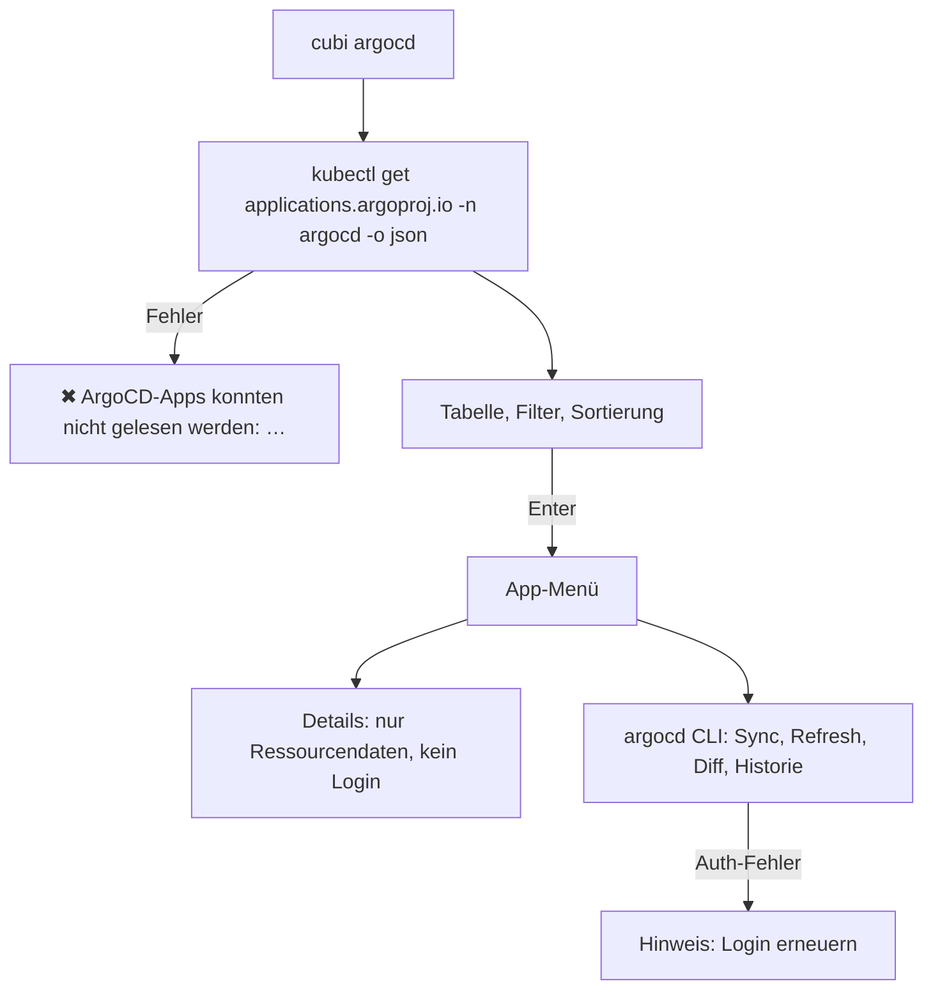

# ArgoCD

Tabelle aller ArgoCD-Applications mit Sync- und Health-Status, Filter, Sync, Diff, Refresh und Verknüpfung zu GitHub.

Code: [modules/argocd.py](https://github.com/pkr-lab/cubi/blob/main/src/cubi/modules/argocd.py), [argocd_apps.py](https://github.com/pkr-lab/cubi/blob/main/src/cubi/argocd_apps.py), [argocd_config.py](https://github.com/pkr-lab/cubi/blob/main/src/cubi/argocd_config.py)

Die Änderungs-Features (Auto-Sync, Feature-Testing, Pods skalieren) stehen in [ArgoCD-Features](argocd-features.md). Wie ArgoCD im Homelab aufgebaut ist: [ArgoCD](../capulus/capulus-core/b-kubernetes-gitops/b0010-argocd.md), [AppProjects](../capulus/capulus-core/b-kubernetes-gitops/b0020-argocd-projects.md).

---

## Überblick

`cubi argocd` (`argo`) liest die Custom Resources `applications.argoproj.io` im ArgoCD-Namespace (`argocd.namespace`, Standard `argocd`) direkt per `kubectl get … -o json`. Es braucht dafür **keinen** ArgoCD-Login und funktioniert, auch wenn der ArgoCD-Server nicht läuft. Nur Diff, Sync, Refresh und Historie rufen die `argocd`-CLI auf und brauchen den Login ([Login](login.md)).

Die Tabelle lädt alle 10 Sekunden neu.

| Spalte | Quelle |
|---|---|
| App | `metadata.name` |
| Projekt | `spec.project` (sonst `default`) |
| Sync | `status.sync.status`: `Synced` grün, `OutOfSync` gelb, `Unknown` magenta |
| Health | `status.health.status`: `Healthy` grün, `Progressing` gelb, `Degraded` und `Missing` rot, `Suspended` cyan, `Unknown` magenta |

Sortierung: schlechtester Zustand zuerst (`Degraded` vor `OutOfSync` vor `Missing` vor `Progressing` …, dann nach Name). Über der Tabelle zählt cubi die Zustände (`Sync Synced 30 · OutOfSync 1`, `Health Healthy 28 · …`). `OutOfSync` und `Degraded` erscheinen immer, auch mit 0.

---

## Tasten

| Taste | Wirkung |
|---|---|
| Enter | Menü der App |
| `f` | Filter: alle Apps, nur Probleme (nicht `Synced` oder nicht `Healthy`), oder ein Projekt |
| `c` | ArgoCD-Kontext der CLI wechseln (`argocd context <name>`) |
| `m` | mehrere Apps synchronisieren (vorgewählt: alle `OutOfSync`), `argocd app sync <namen…>` nach Rückfrage |
| `s` | [Auto-Sync](argocd-features.md#auto-sync-deaktivieren-und-aktivieren) |
| `t` | [Feature-Testing](argocd-features.md#feature-testing-branch-einer-app-umstellen) |
| `z` | [Pods skalieren](argocd-features.md#pods-skalieren-und-wiederherstellen) |
| `r` | neu laden |
| Esc | zurück |

### Menü einer App

| Eintrag | Befehl |
|---|---|
| Details | zeigt aus der Application-Ressource Projekt, Ziel-Namespace, Sync, Revision (10 Zeichen), Health inklusive Meldung, Repo, Pfad, Ziel-Revision, Sync-Policy, letzten Sync (Phase, Alter, Meldung), Bedingungen und betroffene Ressourcen (nicht `Synced` oder nicht `Healthy`) |
| Sync | `argocd app sync <name>` nach Rückfrage |
| Refresh | `argocd app get <name> --refresh` |
| Hard Refresh | `argocd app get <name> --hard-refresh` (verwirft den Manifest-Cache) |
| Diff | `argocd app diff <name>` (`Keine Unterschiede`, wenn leer) |
| Historie | `argocd app history <name>` |
| Quelle auf GitHub | letzte Commits für den Pfad der App, Link, siehe [GitHub](github.md) |

---

## Ablauf

---

## Konfiguration

| Schlüssel in `targets.yaml` | Wirkung |
|---|---|
| `argocd.namespace` | Namespace der Applications |
| `argocd.contexts[]` | Zugänge für die Kontextwahl und den Login, siehe [Konfiguration](konfiguration.md) |

---

## Randfälle

- Der Kontext von `kubectl` muss auf den Cluster mit ArgoCD zeigen. Die Kontextwahl in cubi (`c`) betrifft nur die `argocd`-CLI, nicht `kubectl` ([Kubernetes](kubernetes.md) für `kubectl`).
- Apps mit mehreren Sources zeigen in Ansichten die erste Source als Repo und Pfad.
- Apps, die ein ApplicationSet oder eine übergeordnete App verwaltet, überschreiben Änderungen. Dazu [ArgoCD-Features](argocd-features.md#apps-aus-einem-applicationset).
- `Refresh` und `Hard Refresh` sind Aufrufe von `argocd app get`: Sie lösen einen neuen Abgleich mit Git aus, ändern aber nichts am Cluster.

---

## Debugging und Fehlersuche

| Meldung | Ursache | Lösung |
|---|---|---|
| `ArgoCD-Apps konnten nicht gelesen werden: …` | `kubectl` kann Applications nicht lesen: falscher Kontext, keine Rechte, CRD fehlt, falscher Namespace | `kubectl get applications.argoproj.io -n argocd` direkt prüfen, `argocd.namespace` kontrollieren, [Kubernetes](kubernetes.md) |
| `kubectl ist nicht installiert oder nicht im PATH` | `kubectl` fehlt | installieren |
| `argocd ist nicht installiert oder nicht im PATH` | CLI fehlt (betrifft nur Diff, Sync, Refresh, Historie, Login) | `argocd` installieren |
| `Hinweis: Login abgelaufen oder fehlt. Im Hauptmenü unter Login erneuern.` | ArgoCD-CLI ohne gültigen Login | [Login](login.md) |
| `Zeitüberschreitung bei: argocd app …` | ArgoCD-Server nicht erreichbar (Timeout 90 Sekunden) | Server, Port und VPN prüfen; zum Vergleich `argocd.contexts[].server` |
| `FATA[…] rpc error … Unauthenticated` | Token abgelaufen | [Login](login.md) |
| `FATA[…] … connection refused` | falscher Server oder `plaintext`/`insecure` falsch | `server`, `plaintext`, `insecure` in der Config |
| `Keine Einträge` in der Tabelle | Filter aktiv, oder keine Apps im Namespace | `f` → Alle Apps |
| App steht dauerhaft auf `Unknown` | Repo nicht erreichbar oder Manifest-Fehler | *Details* → Bedingungen; *Hard Refresh*; [ArgoCD](../capulus/capulus-core/b-kubernetes-gitops/b0010-argocd.md) |
| App `OutOfSync`, Sync ändert nichts | `ignoreDifferences` oder selfHeal-Konflikt | *Diff*, siehe [ArgoCD](../capulus/capulus-core/b-kubernetes-gitops/b0010-argocd.md) |
| App `Degraded` | Ressource unhealthy (zum Beispiel Pod crasht) | *Details* → Betroffene Ressourcen, danach [Kubernetes](kubernetes.md) → Pods, Logs |

Checkliste „App ist nicht grün“:

1. `cubi argocd` → *Details*: Meldung, Bedingungen, betroffene Ressourcen.
2. *Hard Refresh*, dann *Diff*: was unterscheidet Git und Cluster?
3. Bei `Degraded`: `cubi kubernetes`, Pod-Status, *Describe*, *Logs*.
4. Bei `Progressing` länger als einige Minuten: Pod `Pending` (Node, PVC) oder Image nicht ziehbar.
5. Passende Fachdoku: [Dienste-Übersicht](../capulus/capulus-core/index.md).

Allgemeines: [Debugging und Fehlersuche](debugging.md).
