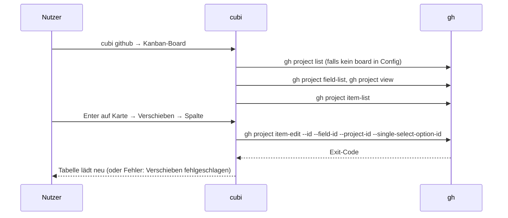

# GitHub

Workflow-Läufe, Pull Requests, Issues, Kanban-Board und Commits eines Repos, ohne Browser.

Code: [modules/github.py](https://github.com/pkr-lab/cubi/blob/main/src/cubi/modules/github.py) (alle Aufrufe gehen über die GitHub-CLI `gh`)

---

## Überblick

`cubi github` öffnet das Repo aus `github.default_repo` (oder lässt beim Start eines wählen). Das Hauptmenü des Bereichs:

| Eintrag | Befehl dahinter | Inhalt |
|---|---|---|
| Workflow-Runs | `gh run list` | letzte 40 Läufe, Status farbig |
| Pull Requests | `gh pr list` | offene PRs mit Review-Status |
| Issues | `gh issue list` | offene Issues mit Labels, bearbeitbar |
| Kanban-Board | `gh project item-list` | Issues des GitHub-Projekts nach Status-Spalte |
| Repo-Link anzeigen | – | gibt die URL aus |
| Repo wechseln | `gh repo list` | Repos aus der Config plus bis zu 100 aus `gh repo list` |

Alle Listen laden alle 30 Sekunden automatisch neu (`r` sofort). Es wird nie ein Browser oder Editor geöffnet: „Link anzeigen“ gibt nur die URL aus, Texteingaben laufen im Terminal ([Bedienung](bedienung.md)).

Der Bereich hängt auch an [ArgoCD](argocd.md): *Quelle auf GitHub* zeigt die letzten Commits für den Pfad und den Link zur App-Quelle.

---

## Funktionen

### Workflow-Runs

Spalten: Workflow, Titel, Branch, Event, Status, Alter. Status ist `conclusion` bei abgeschlossenen Läufen, sonst `status` (`in_progress`, `queued`, …), Farbe grün/rot/gelb/grau nach `RUN_STYLES`. Aktionen je Lauf:

| Aktion | Befehl |
|---|---|
| Details | `gh run view <id> -R <repo>` |
| Log fehlgeschlagener Schritte | `gh run view <id> --log-failed` |
| Neu starten | `gh run rerun <id>` nach Rückfrage |
| Link anzeigen | URL zum Lauf |

Was die Workflows in den Repos tun: [CI-Workflows und Skripte](../capulus-core/6-hintergruende/600a0-ci-workflows-und-skripte.md).

### Pull Requests

Spalten: Nummer, Titel, Autor, Branch, Review (`approved`, `changes`, `review`, `draft`, `-`). Aktionen: Details, Checks (`gh pr checks`), Diff, *Entwurf umschalten* (`gh pr ready` bzw. `--undo`, mit Rückfrage), Link.

### Issues

Spalten: Nummer, Titel, Autor, Labels, Alter. Aktionen: Details, *Bearbeiten*, *Kommentieren*, Link. *Bearbeiten* bietet:

| Eintrag | Befehl | Hinweis |
|---|---|---|
| Titel ändern | `gh issue edit --title` | leerer oder unveränderter Titel bricht ohne Änderung ab |
| Beschreibung bearbeiten | `gh issue edit --body` | zeigt die alte, Eingabe der neuen im Terminal, leere Zeile beendet, ersetzt die bisherige |
| Labels hinzufügen / entfernen | `--add-label` / `--remove-label` | Mehrfachauswahl, mindestens ein Eintrag |
| Zuweisen / Zuweisung entfernen | `--add-assignee` / `--remove-assignee` | Auswahl aus `repos/<repo>/assignees` |
| Schließen/Öffnen | `gh issue close` / `reopen` | mit Rückfrage |

### Kanban-Board

Auswahl des Boards: `github.board` aus der Config, sonst Menü aus `gh project list --owner <eigentümer>` (die Wahl wird für die Sitzung gemerkt). Die Spalten stammen aus dem Feld „Status“ (oder dem ersten Single-Select-Feld mit Optionen). Es erscheinen nur Einträge vom Typ Issue (keine Draft-Items oder PRs), sortiert nach Spaltenreihenfolge. Aktionen: *Verschieben* (`gh project item-edit`), Details, Kommentieren, Link.

Karten verschieben sowie Labels/Zuständige ändern braucht den Token-Scope `project`: `cubi login` → GitHub → *Projekt-Scope aktivieren*.

### Commits (aus ArgoCD)

Aus der ArgoCD-App-Liste: *Quelle auf GitHub* → *Letzte Commits für den Pfad* ruft `gh api repos/<repo>/commits?per_page=30&path=<pfad>&sha=<revision>` und zeigt Hash, Alter, Autor und Betreff. Enter auf einem Commit gibt dessen URL aus. Quellen, die keine GitHub-Repos sind, melden `Quelle ist kein GitHub-Repository: …`.

---

## Ablauf: Kanban-Karte verschieben

---

## Debugging und Fehlersuche

cubi hat keinen eigenen Log. Probleme erkennt man an den `gh`-Fehlertexten, die cubi (erste nützliche Zeile des stderr) als `Fehler` oder rote Zeile in der Tabelle zeigt. Zum Nachstellen führt man den Befehl aus der Tabelle oben direkt aus, mit `GH_DEBUG=api gh …` für die HTTP-Aufrufe.

| Meldung | Ursache | Lösung |
|---|---|---|
| `gh ist nicht installiert oder nicht im PATH` | GitHub-CLI fehlt | `gh` installieren |
| `To authenticate, please run: gh auth login` / `HTTP 401` / `Bad credentials` | nicht eingeloggt oder Token abgelaufen | `cubi login` → GitHub → *Login* oder *Scopes erneuern* |
| `Keine Repositories gefunden` | weder Config noch `gh repo list` liefern Repos | `github.default_repo` und `github.repos` setzen, `gh auth status` prüfen |
| `Could not resolve to a Repository` / `HTTP 404` | Repo-Name falsch oder keine Rechte | `owner/name` in der Config prüfen |
| `Keine Projekte für <owner> gefunden` | Eigentümer hat keine Projects oder Scope `read:project` fehlt | *Projekt-Scope aktivieren* (siehe oben) |
| `Kein Board ausgewählt` | Boardauswahl mit Esc abgebrochen | erneut öffnen oder `github.board` in der Config festlegen |
| `Projekt-ID nicht gefunden` | `gh project view` lieferte keine ID | Board-Nummer und Eigentümer prüfen |
| `Kein Status-Feld mit Spalten im Board gefunden` | im Projekt gibt es kein Single-Select-Feld | Feld „Status“ mit Optionen im Board anlegen |
| `Verschieben fehlgeschlagen` | Scope `project` fehlt oder Board geändert | Scope ergänzen, Ansicht mit `r` neu laden |
| `Titel konnte nicht geändert werden`, `Beschreibung konnte nicht geändert werden`, `Label konnte nicht hinzugefügt/entfernt werden`, `Zuweisung fehlgeschlagen`, `Zuweisung konnte nicht entfernt werden`, `Kommentar konnte nicht hinzugefügt werden`, `Schließen fehlgeschlagen`, `Öffnen fehlgeschlagen` | Schreibrechte oder Scope fehlen; gh-Fehlertext steht davor | Repo-Rolle (Write) und Scopes prüfen, `gh issue edit …` direkt probieren |
| `Keine weiteren Labels verfügbar`, `Issue hat keine Labels`, `Keine weiteren Personen verfügbar`, `Issue ist niemandem zugewiesen` | nichts auszuwählen | kein Fehler, nur Hinweis |
| `Quelle ist kein GitHub-Repository: <url>` | ArgoCD-App zeigt auf ein anderes Git-Hosting | nur GitHub wird unterstützt |
| `Zeitüberschreitung bei: gh …` | GitHub langsam oder Netzwerk gestört (Timeouts 20 bis 90 Sekunden) | Netzwerk prüfen, `gh api rate_limit` für Rate-Limits |
| `Ungültige Ausgabe von: gh …` | `gh` lieferte kein JSON | Befehl direkt ausführen, `gh` aktualisieren |

Checkliste „GitHub-Bereich funktioniert nicht“:

1. `gh auth status`: eingeloggt, Scopes (`repo`, `project`, `read:project`)?
2. `gh repo view <owner/name>`: Repo erreichbar?
3. `cubi login`: Zeile GitHub grün?
4. Listet `gh run list -R <repo>` etwas? Wenn ja und die Tabelle nicht: cubi mit dem Befehl aus der Fehlermeldung vergleichen.
5. Rate-Limit: `gh api rate_limit`.

Allgemeines: [Debugging und Fehlersuche](debugging.md).
