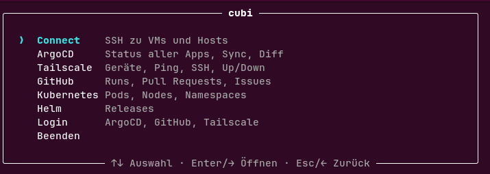
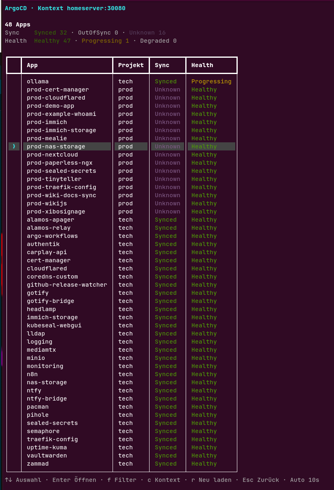
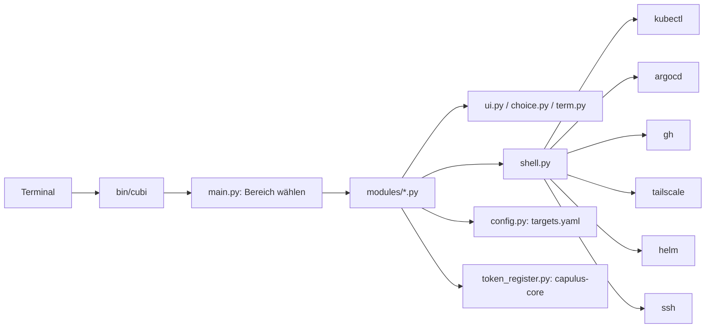

# cubi

Interaktives Terminal-Werkzeug für den Kubernetes-Alltag. cubi bündelt Werkzeuge, die schon installiert sind (`kubectl`, `argocd`, `gh`, `tailscale`, `helm`, `ssh`), in einem Menü, das man mit den Pfeiltasten bedient. Alles wird inline im normalen Terminal gezeichnet, der Verlauf bleibt sichtbar.

```bash
cubi
```



Repository: [pkr-lab/cubi](https://github.com/pkr-lab/cubi)

---

## Bereiche

| Bereich | Aufruf (Alias) | Inhalt | Doku |
|---|---|---|---|
| Connect | `cubi connect` | SSH zu VMs und Hosts, gruppiert wie in der Konfiguration | [connect.md](connect.md) |
| ArgoCD | `cubi argocd` (`argo`) | Tabelle aller Apps mit Sync- und Health-Status, Filter, Sync (auch mehrere Apps), Diff, Refresh, Link zur GitHub-Quelle | [argocd.md](argocd.md) |
| Auto-Sync | `cubi autosync` (`sync`) | Auto-Sync mehrerer Apps aus- und wieder einschalten, prune und selfHeal werden gemerkt | [argocd-features.md](argocd-features.md) |
| Feature-Testing | `cubi feature-testing` (`branch`, `ft`) | Ziel-Branch mehrerer ArgoCD-Apps umstellen oder auf `main` zurücksetzen | [argocd-features.md](argocd-features.md) |
| Pods skalieren | `cubi scale` | Workloads mehrerer Apps auf 0 oder eine eigene Anzahl stellen und später wiederherstellen | [argocd-features.md](argocd-features.md) |
| Tailscale | `cubi tailscale` (`ts`) | Geräteliste mit Status, Ping, SSH, `up` und `down` | [tailscale.md](tailscale.md) |
| GitHub | `cubi github` (`gh`) | Workflow-Läufe, Pull Requests, Issues (auch bearbeiten), Commits, Kanban-Board | [github.md](github.md) |
| Kubernetes | `cubi kubernetes` (`k8s`, `kubectl`) | Pods mit Logs und Shell, Nodes, Warnungen, Namespace und Kontext wechseln | [kubernetes.md](kubernetes.md) |
| Helm | `cubi helm` | Releases mit Status, Values und Historie | [helm.md](helm.md) |
| Tokens | `cubi tokens` (`token`) | Alter, Ablauf und Rotation der Tokens aus dem Token-Register von capulus-core | [tokens.md](tokens.md) |
| Login | `cubi login` (`auth`) | Login-Status für ArgoCD, GitHub und Tailscale samt Login-Befehlen | [login.md](login.md) |

Jeder Bereich lässt sich direkt öffnen, zum Beispiel `cubi argocd` oder `cubi login`. Ohne Argument startet das Hauptmenü, `cubi --help` listet die Bereiche. Ein unbekannter Bereich beendet cubi mit Exit-Code 2.

Die ArgoCD-Ansicht sortiert Apps mit Problemen nach oben und lädt die Tabelle automatisch neu:



---

## Architektur

cubi ist ein Python-3-Programm ohne Server und ohne eigenen Zustand auf dem Rechner. `bin/cubi` startet `cubi.main`, das einen Bereich (Modul) auswählt. Jedes Modul ruft die vorhandenen Werkzeuge als Unterprozess auf und stellt die Ausgabe mit [rich](https://github.com/Textualize/rich) als Tabelle oder Menü dar. cubi speichert weder Passwörter noch Tokens.



| Datei (`src/cubi/`) | Aufgabe |
|---|---|
| `main.py` | Argumente, Bereichsmenü, Aliase, Exit-Codes |
| `modules/*.py` | ein Modul je Bereich, Einstieg `run()` |
| `ui.py` | Fassade: Auswahl, Eingabe, Bestätigung, Ausgabe, `guard()` fängt `CubiError` |
| `choice.py`, `term.py` | inline gezeichnete Auswahl und Tastaturlesen, siehe [Select-Komponente](select-komponente.md) |
| `shell.py` | Unterprozesse mit Timeout, Fehlertext-Aufbereitung |
| `config.py` | `targets.yaml` suchen und laden |
| `argocd_config.py` | ArgoCD-Kontexte aus Config und `~/.config/argocd/config` |
| `argocd_apps.py` | ArgoCD-Applications lesen und patchen, `cubi-state`-ConfigMap, ApplicationSet-Regeln |
| `token_register.py` | Token-Register lesen und Datumsfelder fortschreiben |
| `errors.py` | `CubiError` (Meldung an den Nutzer) und `Finished` (Programmende nach Änderung) |
| `timeutil.py` | Zeitstempel parsen, Alter als `3d`, `5h`, `2m` |

Alle Code-Pfade beziehen sich auf [pkr-lab/cubi](https://github.com/pkr-lab/cubi/tree/main/src/cubi).

### Beziehung zu anderen Repos

- [capulus-core](../capulus/capulus-core/index.md): `cubi tokens` liest `ops/token-register.yaml` und führt `scripts/check-token-register.py` aus dem Checkout aus. `cubi argocd`, `autosync`, `scale` und `feature-testing` ändern die ArgoCD-Applications des Clusters, die dort per GitOps definiert sind ([ArgoCD](../capulus/capulus-core/b-kubernetes-gitops/b0010-argocd.md)).
- [pkr-lab-docs](../README.md): Runbooks mit dem Präfix `pkr-lab-docs:` im Token-Register öffnet `cubi tokens` aus dem Checkout dieses Repos.
- [capulus-ansible](../capulus/capulus-ansible/index.md): Die SSH-Ziele in `connect` entsprechen den dort provisionierten Hosts.

### Terminal-Verhalten

cubi bleibt immer in der normalen Terminal-Ansicht: kein Vollbild, kein Löschen des Terminals, kein Pager, Editor oder Browser. Details unter [Bedienung](bedienung.md). Ohne interaktives Terminal (Pipe, Cron) weigert sich cubi zu starten.

---

## Seiten

| Seite | Inhalt |
|---|---|
| [Installation](installation.md) | Voraussetzungen, `install.sh`, Prüfung, Deinstallation |
| [Konfiguration](konfiguration.md) | `targets.yaml`, Suchreihenfolge, alle Schlüssel |
| [Nutzung](nutzung.md) | Aufruf, Tasten, typische Abläufe |
| [Bedienung](bedienung.md) | Tasten, Einfach- und Mehrfachauswahl, Inline-Verhalten |
| [ArgoCD](argocd.md) | App-Tabelle, Filter, Sync, Diff, Refresh |
| [ArgoCD-Features](argocd-features.md) | Auto-Sync, Feature-Testing, Pods skalieren |
| [Connect](connect.md), [Tailscale](tailscale.md), [GitHub](github.md), [Kubernetes](kubernetes.md), [Helm](helm.md), [Tokens](tokens.md), [Login](login.md) | je ein Bereich |
| [Select-Komponente](select-komponente.md) | Aufbau der Auswahl im Code |
| [Debugging und Fehlersuche](debugging.md) | Fehlermeldungen, Checkliste, lokales Debugging |
| [Entwicklung](entwicklung.md) | Tests, neuen Bereich ergänzen |
| [Releases](releases.md) | Release-Prozess |


## Fehlersuche

Meldungen, Checkliste und lokales Debugging: [Debugging und Fehlersuche](debugging.md). Jeder Bereich hat auf seiner Seite einen Abschnitt „Debugging und Fehlersuche“.
