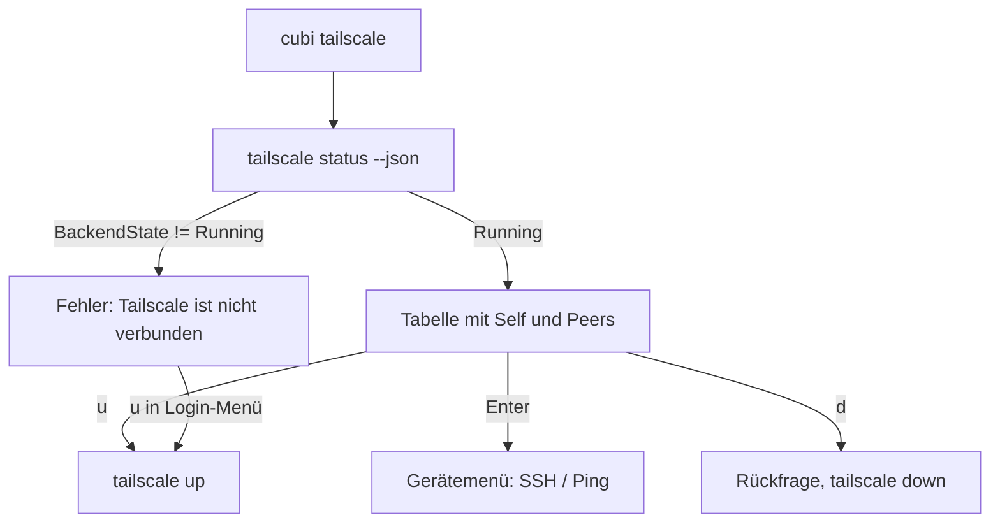

# Tailscale

Geräte im Tailnet ansehen, anpingen, per SSH erreichen sowie Tailscale starten und trennen.

Code: [modules/tailscale.py](https://github.com/pkr-lab/cubi/blob/main/src/cubi/modules/tailscale.py)

---

## Überblick

`cubi tailscale` liest `tailscale status --json` und zeigt alle Geräte als Tabelle. Die Tabelle lädt alle 15 Sekunden neu. Hintergrund zum Tailnet im Homelab: [Tailscale](../capulus/capulus-core/c-netzwerk-dns/c0010-tailscale.md) und [Tailscale auf den Hosts](../capulus/capulus-ansible/rollen/tailscale.md).

| Spalte | Quelle |
|---|---|
| Gerät | `HostName`, sonst `DNSName` |
| IP | erste Adresse aus `TailscaleIPs` |
| OS | `OS` |
| Status | `dieses Gerät` (cyan), `online` (grün), `offline · <Alter>` (rot, Alter aus `LastSeen`) |

Sortierung: eigenes Gerät zuerst, dann Online-Geräte, dann Offline-Geräte, jeweils alphabetisch. Die Zusammenfassung zeigt `N Geräte · M online`.

---

## Bedienung

| Taste | Wirkung |
|---|---|
| Enter auf einem fremden Gerät | Menü *SSH* und *Ping* (Enter auf dem eigenen Gerät tut nichts) |
| `u` | `tailscale up` |
| `d` | `tailscale down`, nach Rückfrage |
| `s` | `tailscale status` roh |
| `r` | neu laden |

*SSH* nutzt den Gerätenamen, wenn er als `Host` in `~/.ssh/config` steht (Wildcard-Einträge zählen nicht), sonst die Tailscale-IP. cubi übergibt das Terminal an `ssh` und endet. *Ping* führt `tailscale ping -c 3 <ip>` aus.

Bei `up` und `down` weist cubi bei einem Fehlercode darauf hin, dass Root-Rechte nötig sein können (`sudo tailscale up`).

---

## Ablauf

---

## Debugging und Fehlersuche

| Meldung | Ursache | Lösung |
|---|---|---|
| `Tailscale ist nicht verbunden (Status: Stopped). Mit u starten oder unter Login anmelden.` | Dienst gestoppt (`tailscale down`) | im Bereich `u` drücken oder `tailscale up` |
| `… (Status: NeedsLogin)` | Anmeldung fehlt oder abgelaufen | `cubi login` → Tailscale → `tailscale login`, siehe [Login](login.md) |
| `… (Status: unbekannt)` | `BackendState` fehlt in der Ausgabe | `tailscale status --json` manuell prüfen, Tailscale-Version prüfen |
| `Tailscale-Status nicht lesbar` | die Ausgabe von `tailscale status --json` ist kein JSON (zum Beispiel Fehlertext) | Befehl direkt ausführen und die Fehlermeldung lesen, meist fehlen Rechte oder `tailscaled` läuft nicht |
| `tailscale ist nicht installiert oder nicht im PATH` | Client fehlt | [Tailscale](../capulus/capulus-core/c-netzwerk-dns/c0010-tailscale.md) bzw. Paket installieren |
| `Zeitüberschreitung bei: tailscale status --json` | `tailscaled` antwortet nicht binnen 15 Sekunden | `systemctl status tailscaled`, `journalctl -u tailscaled` |
| Gerät steht auf `offline · 3d` | Gerät lange nicht erreichbar | Gerät prüfen, auf dem Gerät `tailscale status` |
| `up`/`down` meldet Fehlercode und Root-Hinweis | fehlende Rechte | `sudo tailscale up` außerhalb von cubi, oder einmalig `sudo tailscale set --operator=$USER` |

Checkliste „Tailscale-Bereich funktioniert nicht“:

1. `tailscale status` in der Shell: gleiche Meldung?
2. `systemctl status tailscaled`: läuft der Dienst?
3. `cubi login`: Zeile Tailscale grün (`verbunden`)?
4. Verbindung zu einem Host scheitert trotz `online`: ACLs im Tailnet und Hostname in `~/.ssh/config` prüfen, siehe [Tailscale](../capulus/capulus-core/c-netzwerk-dns/c0010-tailscale.md).

Allgemeines: [Debugging und Fehlersuche](debugging.md).
