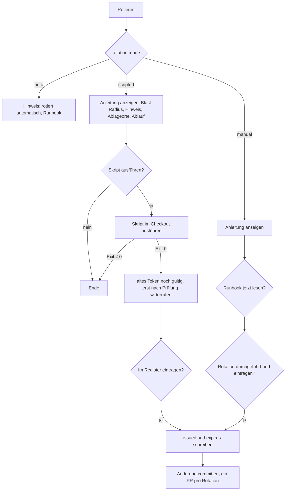

# Tokens

Alter, Ablauf und Rotation der Tokens aus dem Token-Register von capulus-core.

Code: [modules/tokens.py](https://github.com/pkr-lab/cubi/blob/main/src/cubi/modules/tokens.py), [token_register.py](https://github.com/pkr-lab/cubi/blob/main/src/cubi/token_register.py)

---

## Überblick

`cubi tokens` (`token`) liest `ops/token-register.yaml` aus dem capulus-core-Checkout (`tokens.repo`, siehe [Konfiguration](konfiguration.md)) und listet jedes Token mit Alter und Fälligkeit, das dringendste zuerst. Das Register enthält **keine** Werte, nur Metadaten: Wo das Secret liegt, wann es ausgestellt wurde, wann es abläuft, wie es rotiert wird und was passiert, wenn es in falsche Hände gerät (`blast_radius`).

Zum Register selbst und zur Überwachung im Betrieb: [CI-Lint (Register-Prüfung)](../capulus-core/f-cicd-automatisierung/f0070-ci-lint.md), [CI-Workflows und Skripte (token-watch)](../capulus-core/6-hintergruende/600a0-ci-workflows-und-skripte.md) und die [Secrets-Rotation-Checkliste](../capulus-core/d-sicherheit/d0060-secrets-rotation.md). cubi ist das Bedienwerkzeug dafür: Es zeigt, was fällig ist, und führt durch die Rotation. Die tägliche Überwachung übernimmt der Workflow `token-watch.yml`.

### Tabelle

| Spalte | Bedeutung |
|---|---|
| Token | `id` aus dem Register |
| Dienst | `service` |
| Rotation | `auto` (grün), `scripted` (cyan), `manual` |
| Ausgestellt | `issued` und Alter in Tagen, `-` wenn unbekannt |
| Läuft ab | Fälligkeitsdatum und Restzeit, siehe unten |

Das Fälligkeitsdatum ist `expires`, sonst `issued + max_age_days`. Ohne beides: `unbekannt` (gelb).

| Darstellung | Restzeit |
|---|---|
| fett rot, `seit N d abgelaufen` | überfällig |
| rot | höchstens 7 Tage |
| gelb | höchstens 60 Tage |
| grün | mehr als 60 Tage |

Sortiert wird nach Dringlichkeit (überfällig oder höchstens 7 Tage, dann ohne Datum, dann höchstens 60 Tage, dann der Rest), dann nach Restzeit. Die Zusammenfassung zählt „N dringend · M bald fällig · K ohne Ablaufdatum“.

---

## Register-Felder, die cubi nutzt

| Feld | Pflicht laut Prüfskript | Bedeutung |
|---|---|---|
| `id` | ja | eindeutiger Name |
| `service`, `kind` | ja | Dienst und Art (`api-token`, `auth-key`, `password`, `encryption-key`, `ssh-key`, `tunnel-credential`, `certificate`) |
| `stored_in[]` | ja | Orte, an denen das Secret liegt (Dateipfade oder `repo:pfad`) |
| `issued`, `expires` | nein | Datum als `JJJJ-MM-TT` oder `null` |
| `max_age_days` | ja | maximale Lebensdauer in Tagen |
| `rotation.mode` | ja | `auto`, `scripted` oder `manual` |
| `rotation.runbook` | ja | Pfad im capulus-core-Checkout, oder `pkr-lab-docs:<pfad>` für dieses Docs-Repo, optional mit `#anker` |
| `rotation.command` | bei `scripted` | Skript mit Argumenten, relativ zum Checkout |
| `rotation.hint` | nein | Hinweis, der vor der Rotation angezeigt wird |
| `rotation.overlap` | nein (Standard `true`) | `false`: das Token kann nicht parallel gelten, es wird in einem Schritt getauscht |
| `blast_radius` | ja | Auswirkung bei Missbrauch |
| `live_check` | nein | `github-pat` oder `tailscale-device`, siehe token-watch |

---

## Menü je Token

Enter öffnet das Menü mit dem `blast_radius` als Untertitel:

| Eintrag | Wirkung |
|---|---|
| Rotieren | führt durch die Rotation (siehe Ablauf) |
| Details | Dienst, Art, Rotationsmodus, Ausgestellt, Läuft ab, Live-Prüfung, Runbook, Ablageorte, Blast Radius |
| Runbook lesen | zeigt das Runbook im Terminal; mit `#anker` ab der passenden Überschrift |
| Als rotiert im Register eintragen | fragt `ausgestellt am` (Vorgabe heute) und `läuft ab am` (leer: `issued + max_age_days`, oder unbekannt ohne `max_age_days`) und schreibt beide Felder |

Mit `c` führt der Bereich `scripts/check-token-register.py` im Checkout aus und zeigt dessen Ausgabe. Das ist dieselbe Prüfung wie in der CI.

---

## Ablauf der Rotation

Die Anleitung nennt bei `overlap: true` den Ablauf: neues Token anlegen und das alte gültig lassen, alle Verbraucher umstellen, prüfen, erst dann das alte Token widerrufen. Bei `overlap: false` steht stattdessen, dass das Token in einem Schritt getauscht wird.

`scripted` führt das Skript aus `rotation.command` mit dem Checkout als Arbeitsverzeichnis aus, nach Rückfrage. Die Skripte aus capulus-core (`scripts/seal-*.sh`, `scripts/create-argocd-ci-token.sh`) erzeugen in der Regel neue SealedSecrets im Arbeitsverzeichnis. cubi committet nichts. Zur aktuellen Lage der `command`-Einträge siehe den nächsten Abschnitt.

*Als rotiert eintragen* ändert nur die Zeilen `issued:` und `expires:` des Eintrags, der Rest der Datei bleibt unverändert (Kommentare, Reihenfolge, Formatierung). Das Schreiben erfolgt atomar über eine temporäre Datei im selben Verzeichnis, die Dateirechte bleiben erhalten. Datumsformat strikt `JJJJ-MM-TT`.

---

## Bekannte Einschränkung: `scripted` ohne `rotation.command`

Stand der Prüfung (cubi `main`, capulus-core `main`, 2026-10-21): Das Register in capulus-core hat 49 Einträge (43 `manual`, 5 `scripted`, 1 `auto`). Die fünf `scripted`-Einträge (`github-readonly-pat`, `argocd-ci-token-hub`, `argocd-ci-token-entw` und die beiden Schreib-Zugänge für VictoriaMetrics und VictoriaLogs) tragen **kein** `rotation.command`. Bei den ersten drei steht in `rotation.runbook` direkt ein Skriptpfad (`scripts/seal-github-token.sh`, `scripts/create-argocd-ci-token.sh`).

Folge: *Rotieren* bricht bei diesen Tokens nach der Anleitung mit `<id>: Im Register fehlt rotation.command` ab, und *Runbook lesen* zeigt den Inhalt des Skripts statt einer Anleitung. Das Prüfskript meldet das nicht, weil `rotation.command` dort kein Pflichtfeld ist. Abhilfe bis zur Korrektur: das Skript aus `runbook` oder aus dem Runbook von Hand im capulus-core-Checkout ausführen und danach *Als rotiert im Register eintragen* nutzen. TODO: prüfen, ob `rotation.command` im Register ergänzt oder die cubi-Logik angepasst werden soll (dokumentiert wird hier der Ist-Zustand).

---

## Randfälle

- Das Runbook wird nur gefunden, wenn es als Datei existiert. Der Präfix `pkr-lab-docs:` löst gegen `tokens.docs_repo` auf, alles andere gegen `tokens.repo`.
- Ein Anker wird wie auf GitHub zu einem Slug umgewandelt. Wird die Überschrift nicht gefunden, zeigt cubi das ganze Runbook.
- Fehlt `issued` oder `expires` als Zeile im Eintrag, bricht das Schreiben mit `Feld … fehlt im Register` ab.
- Einträge ohne `id` führen zu einem Python-Fehler statt zu einer Meldung (`entry["id"]`), siehe unten.

---

## Debugging und Fehlersuche

| Meldung | Ursache | Lösung |
|---|---|---|
| `Token-Register nicht gefunden: <pfad>/ops/token-register.yaml (tokens.repo in der Config setzen)` | `tokens.repo` fehlt oder zeigt auf den falschen Ort. Standard ist `../capulus-core` neben dem cubi-Checkout | `tokens.repo` auf den capulus-core-Checkout setzen, siehe [Konfiguration](konfiguration.md) |
| `Docs-Repo nicht gefunden: <pfad> (tokens.docs_repo in der Config setzen)` | Runbook mit Präfix `pkr-lab-docs:`, aber Checkout fehlt | `tokens.docs_repo` setzen |
| `Ungültiges Register <pfad>: …` | YAML-Fehler im Register | Syntax prüfen, `python3 scripts/check-token-register.py` im Checkout |
| `Ungültiges Datum im Register: '<wert>'` | `issued` oder `expires` ist kein ISO-Datum | Format `JJJJ-MM-TT` in Anführungszeichen |
| `<id> steht nicht im Register` | Eintrag wurde zwischenzeitlich geändert oder entfernt, oder die Zeile `- id: <id>` hat andere Formatierung | Ansicht neu starten; die Zeile muss exakt `- id: <id>` lauten (ohne Anführungszeichen oder Kommentare) |
| `Runbook ist keine Datei im Repo: <wert>` | Pfad im Register falsch oder leer | `rotation.runbook` korrigieren, Datei im richtigen Checkout prüfen |
| `<id>: Im Register fehlt rotation.command` | `mode: scripted` ohne Befehl | `rotation.command` ergänzen |
| `Datum muss das Format JJJJ-MM-TT haben: '<wert>'` | Eingabe bei *Als rotiert eintragen* falsch | Datum wie `2026-10-21` eingeben |
| `<id>: Feld issued fehlt im Register` (oder `expires`) | Eintrag hat die Zeile `  issued:` oder `  expires:` nicht, oder mit anderer Einrückung (cubi erwartet zwei Leerzeichen) | Zeile im Register ergänzen |
| `Beendet mit Code N` (nach *Skript ausführen*) | Rotationsskript ist fehlgeschlagen; Meldung steht darüber | Skript direkt im Checkout ausführen (`./scripts/…`), Voraussetzungen prüfen (`kubeseal`, Cluster-Zugriff) |
| Python-Traceback `KeyError: 'id'` beim Öffnen | Register-Eintrag ohne `id` | Eintrag korrigieren; `c` bzw. das Prüfskript meldet `Pflichtfeld fehlt: id` |
| Register-Prüfung (`c`) meldet `SealedSecret ohne Register-Eintrag: <datei>` | neues SealedSecret nicht im Register | Eintrag mit `stored_in: [<datei>]` ergänzen |
| Register-Prüfung meldet `Rotation ueberfaellig` oder `abgelaufen am …` | Frist verstrichen | rotieren und eintragen |

Checkliste „Tokens-Bereich funktioniert nicht“:

1. `ls <tokens.repo>/ops/token-register.yaml`: existiert die Datei?
2. `python3 scripts/check-token-register.py` im Checkout: sind Struktur und Daten gültig?
3. Zeigt die Tabelle Daten, aber die Rotation scheitert: Skript direkt ausführen, Voraussetzungen siehe [Secrets-Rotation](../capulus-core/d-sicherheit/d0060-secrets-rotation.md).
4. Nach der Rotation: `git diff ops/token-register.yaml` im Checkout, nur `issued`/`expires` dürfen sich ändern.

Allgemeines: [Debugging und Fehlersuche](debugging.md).
