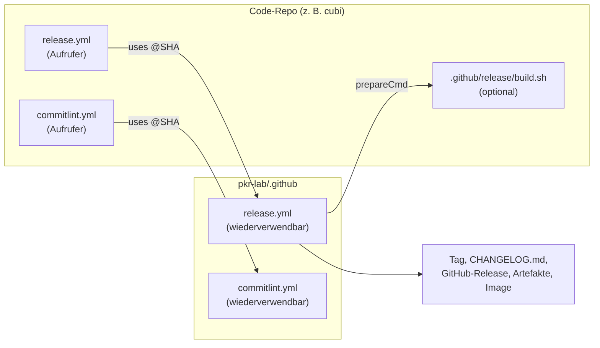

# github-workflows (pkr-lab/.github)

Zentrale, wiederverwendbare GitHub-Workflows für alle Repos von pkr-lab: automatische Releases aus Conventional Commits und eine Prüfung der Commit-Nachrichten auf Pull Requests. Dazu ein lokaler `commit-msg`-Hook.

Repository: [pkr-lab/.github](https://github.com/pkr-lab/.github)

## Überblick

| Datei | Aufgabe |
|---|---|
| `.github/workflows/release.yml` | wiederverwendbar: semantic-release mit CHANGELOG, Tag, GitHub-Release, optionalem Artefakt-Skript und Container-Image |
| `.github/workflows/commitlint.yml` | wiederverwendbar: prüft alle Commits eines Pull Requests |
| `hooks/commit-msg` | lokaler Hook mit denselben Regeln, ohne Abhängigkeiten |
| `.github/workflows/self-release.yml`, `self-commitlint.yml`, `ci.yml` | das Repo nutzt seine Workflows selbst und prüft sie mit actionlint |

## Architektur

Die Aufrufer in den Repos binden die Workflows mit dem Commit-SHA ein (`uses: pkr-lab/.github/.github/workflows/release.yml@<sha> # v1.0.1`). Renovate hebt die Version an. Die Konfiguration von semantic-release liegt nur zentral; Repos haben keine eigene `.releaserc.json`.

## Wer nutzt sie

capulus-core, capulus-ansible, capulus-ios, capulus-wiki-sync, cubi, ui-terminal-config, DocFlowEngine, PowerShell, ps-data-fixtures, EDV-Kretzer, pkr-lab und pkr-lab-docs.

## Seiten

- [Installation](installation.md)
- [Konfiguration](konfiguration.md)
- [Nutzung](nutzung.md)
- [Releases](releases.md)

## Fehlersuche

Fehlerbilder der Release- und Commitlint-Workflows: [Nutzung: Fehlersuche](nutzung.md#fehlersuche). Je Repo, das die Workflows nutzt, gibt es zusätzlich die Fehlerbilder der Aufrufer (zum Beispiel [capulus-core: Skripte und Workflows](../capulus/capulus-core/f-cicd-automatisierung/f00c0-skripte-und-workflows-referenz.md#workflows)). Stand der Prüfung (2026-10-21): Das Repo `pkr-lab/.github` liegt nicht unter `~/gitlab`, die Angaben stützen sich auf die vorhandene Doku und die Aufrufer-Workflows der anderen Repos (TODO: prüfen gegen das Repo selbst).
