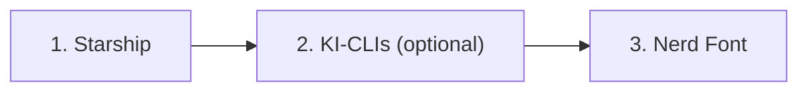

# ui-terminal-config

Ein Skript für Ubuntu Desktop, das eine einheitliche Terminal-Oberfläche einrichtet: den Prompt [Starship](https://starship.rs) samt Konfiguration, die Schrift JetBrainsMono Nerd Font und optional KI-Kommandozeilenwerkzeuge. Mehr nicht, keine Editor-Konfiguration, keine Plugins.

Repository: [pkr-lab/ui-terminal-config](https://github.com/pkr-lab/ui-terminal-config)

## Überblick

| Datei | Aufgabe |
|---|---|
| `install.sh` | installiert Starship, verlinkt die Konfiguration, installiert optional KI-CLIs und die Nerd Font; mehrfach ausführbar, jeder Schritt überspringt Vorhandenes |
| `starship-toml-template` | Starship-Konfiguration: farbige Powerline-Segmente (OS, Benutzer, Verzeichnis, Git, Sprachen, Dauer), Palette Catppuccin Mocha |

Der Ablauf von `install.sh` in drei Abschnitten:

## Seiten

- [Installation](installation.md)
- [Konfiguration](konfiguration.md)
- [Nutzung](nutzung.md)
- [Releases](releases.md)
