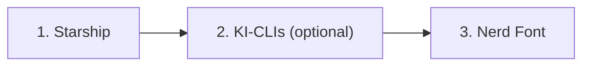
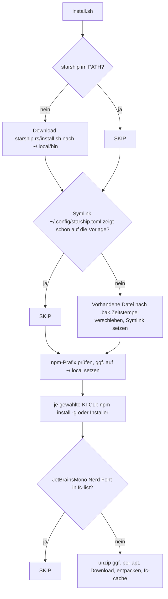

# ui-terminal-config

Ein Skript für Ubuntu Desktop, das eine einheitliche Terminal-Oberfläche einrichtet: den Prompt [Starship](https://starship.rs) samt Konfiguration, die Schrift JetBrainsMono Nerd Font und optional KI-Kommandozeilenwerkzeuge. Mehr nicht, keine Editor-Konfiguration, keine Plugins.

Repository: [pkr-lab/ui-terminal-config](https://github.com/pkr-lab/ui-terminal-config)

## Überblick

| Datei | Aufgabe |
|---|---|
| `install.sh` | installiert Starship, verlinkt die Konfiguration, installiert optional KI-CLIs und die Nerd Font; mehrfach ausführbar, jeder Schritt überspringt Vorhandenes |
| `starship-toml-template` | Starship-Konfiguration: farbige Powerline-Segmente (OS, Benutzer, Verzeichnis, Git, Sprachen, Dauer), Palette Catppuccin Mocha |

Der Ablauf von `install.sh` in drei Abschnitten:

Das Skript schreibt nur an vier Stellen: `~/.local/bin` (Starship, npm-Programme), `~/.config/starship.toml` (Symlink), `~/.local/share/fonts` (Schrift) und die npm-Einstellung `prefix` (nur falls das globale Verzeichnis nicht beschreibbar ist). Die Shell-Konfiguration (`~/.bashrc`) ändert es nicht, siehe [Installation](installation.md#danach).

### Ablauf im Detail

Schritte, die schon erledigt sind, meldet das Skript als `[SKIP]`, erledigte als `[OK]`, Hinweise als `[INFO]`, Fehler als `[ERROR]` (auf stderr). Das Skript bricht bei jedem Fehler eines Befehls ab (`set -euo pipefail`), außer bei der fehlenden Node.js-Installation, die es nur meldet.

## Seiten

- [Installation](installation.md)
- [Konfiguration](konfiguration.md)
- [Nutzung](nutzung.md)
- [Debugging und Fehlersuche](debugging.md)
- [Releases](releases.md)

## Fehlersuche

Meldungen von `install.sh`, Fehlerbilder im Terminal und Checkliste: [Debugging und Fehlersuche](debugging.md).
